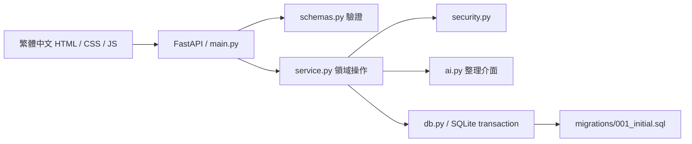

# 架構與資料邊界

## 模組

瀏覽器只呈現與收集輸入；正式資料存於 Python 服務的 SQLite。靜態前端不使用 localStorage 保存人物、session token 或假資料庫。

## 資料

`users` 的 owner ID 在 guest → registered 時保持不變。`sessions` 只保存 token 雜湊、CSRF 與失效時間，升級時撤銷舊工作階段並換新 token。

`goals` 與三筆 `actions` 一次建立，並同交易寫入首次 `hatched_at`。星期規律屬於各行動；28 天為預覽視窗，沒有將 28 個布林值當永久排程。單日例外／歷史規則版本尚未開放。

`drafts` 保存原始記錄、帶時區轉 UTC 的發生時間、選填人物與貢獻、revision。正式確認產生 `experiences`、`contributions`、`tasks`、`reward_ledger`，全部放在同一寫入交易。任何步驟失敗都回滾，草稿仍可重試。

小數以標準化十進位字串保存，由 Python Decimal 精確累加；不以浮點 SUM 計算正式進度。前端 progress bar 僅是顯示，數字以後端回傳為準。

`requests` 記錄 owner／operation／request ID／請求指紋／回執。同 key 同內容回原回執，不同內容回 409。SQLite `BEGIN IMMEDIATE` 序列化併發寫入，唯一約束保護每份草稿及積分事件。

`people` 跨目標存在；v0.2 起以互動事件去重，只有 `in_person` 計見面。v0.3 另分參與與直接互動，提及不入統計；同次互動可人工合併，尚無自動語意辨識。

`evidence` 以 BLOB 保存，通過 owner／goal 檢查及 Pillow 格式／損毀驗證才能引用。`completions` 必須由使用者明確確認並帶同目標證據；不以 action progress 自動完成。

`notes` 保存 preparation／simulation／message，沒有呼叫正式經歷確認與計分流程。

## 安全與失敗

- 存取前檢查 session 與有效期；所有寫入（啟動 guest 及無既有 session 的登入除外）需 CSRF。
- 過期 session 不能讀寫；帳號切換不合併訪客世界。登入既有帳號前明確確認是否離開原訪客身分。
- 驗證錯誤只回欄位路徑，不回傳原密碼／敏感 input；未知錯誤不暴露 SQL、原文或堆疊。
- 服務綁定 127.0.0.1，限制 Host、拒絕跨來源寫入。HttpOnly、SameSite=strict cookie；Secure 預設關閉以支援本機 HTTP。
- 人物／目標／草稿／佐證逐筆檢查 owner；不相信前端傳來的 owner、積分或完成狀態。
- CSP 阻止外部腳本，使用者文字以跳脫內容呈現；圖片必須通過認證，禁止 MIME 猜測。
- API 與圖片不快取；登出清除前端世界資料並撤銷該 session。

本機模式未包含正式服務的受管驗證、TLS／proxy、全站登入速率限制、媒體掃描、離線同步、備份保留政策或災難復原部署；上線整合見 ROADMAP。

## v0.2 人物增量遷移

新增 migration 002_people_360.sql，保留全部舊欄位。PeopleMixin 集中處理人物查詢／版本、來源、衝突、互動統計及關聯，前端 relationships.js 提供同一份人物資料的不同視圖。

舊 role 全文作為 roles 的單一項目，不推測逗號含義；備註不轉為事實。舊經歷以穩定 legacy ID 轉成 unknown 互動，分類前不算見面。互動的多經歷關聯與人物參與者各自保存，合併不更新積分／貢獻。人物事實同值合併來源，衝突明確採用後保留歷史，撤回引用不刪原文。

啟動前已使用 SQLite backup API 保存本機遷移前副本，備份在排除 Git 的 data/backups；14 個舊表的既有欄位逐筆比對一致。回退須停服務，使用對應的舊版程式及遷移前備份，不能僅將程式回退到仍使用六欄 positional INSERT 的初版。

## v0.3 交會與逐經歷來源

`ConnectionsMixin`／`connections.py` 使用增量遷移 `003_connections.sql`：`draft_stories` 保存草稿候選，`experience_stories` 保存審閱／展示／版本，`experience_participants` 保存逐筆參與與直接互動，`experience_mentions` 保存原名／Unicode 範圍／人工身分配對，`story_history` 保存更正。舊欄位與帳本不變，舊經歷只回填待核對狀態。

確認仍在單一交易內保存經歷、人物角色、互動、任務、貢獻與一次獎勵。事件合併不改每筆故事名單；配對、更正與展示撤回都有 owner、CSRF、版本及重送去重，不重新發獎勵。

前端 `connections.js` 取代星圖，與收藏冊／人物卡共用資料；來源用獨立底部抽屜。路徑、展開、捲動及核對編輯暫存本頁，URL 保留當前焦點，登出／換帳號清除，不寫 localStorage。正式配對由 SQLite 保存，刷新可重讀。
