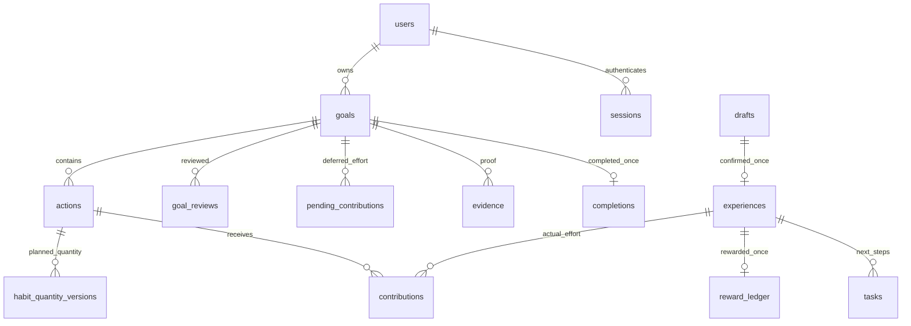
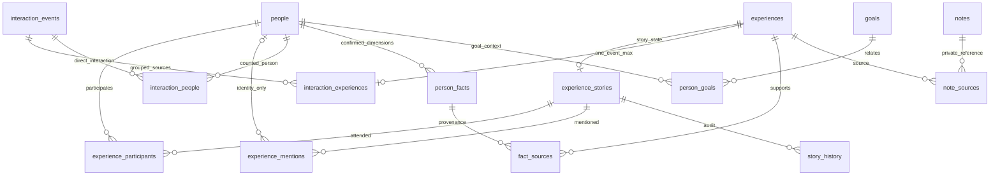

# Life World｜完整 Table Schema 與頁面資料對照

查核日期：2026-10-29。交接對象：Jerry（技術整合）、歐桑（資料品質）、Boyi（產品）。**本文件描述目前可執行的 SQLite 結構，不代表 PostgreSQL／GCP 已完成。**

## 1. 來源、連線及交接基準

- App 入口：`app/main.py:create_app` → `app/db.py:Database`。資料目錄優先序：工廠 `data_dir` 參數 → `LIFEWORLD_DATA_DIR` → Repository 的 `data/`；DB 檔名固定 `lifeworld.sqlite3`，沒有 SQL Server／PostgreSQL 連線字串。
- 已查核 localhost:8000 程序的 uvicorn 入口、Repository 工作目錄及資料目錄覆寫設定：沒有 `LIFEWORLD_DATA_DIR`，使用 `data/lifeworld.sqlite3`。這是本機連線驗證，不表示遠端環境相同；不把個人絕對路徑、程序環境或資料列放進本交接。
- 本次以 `mode=ro`＋`query_only` 唯讀讀取 SQLite metadata，未透過 App 工廠開啟來源 DB，未執行任何 migration、修改或匯出使用者資料。
- **31 張表＝30 張應用表＋1 張 schema_migrations；201 欄位、60 條外鍵、50 個索引（9 個明確建立、41 個主鍵／唯一鍵自動索引）；無 view／trigger。** WAL 模式；完整性 `ok`、外鍵違規 0。
- 已套用 001–005。原 HEAD `585e0a3` 的 migration 只到 004；005 與本輪之前的習慣調整仍是工作樹未發布增量。Jerry 不能只拿舊 GitHub HEAD 就假定有相同 schema，交接需以包含 005 的一致來源版本為準；本輪不 Commit／Push。
- 另找到本機原始交接包的「04_資料模型與API契約_提案.md」及人物研究包的 `proposed_schema.sql`。兩者自標提案，涵蓋尚未完成能力，不能作目前 SQLite 全表定義，也不隨本 App 自動發布；原件保留不修改。
- 原有 [架構](ARCHITECTURE.md)、[API](API.md)、[migrations](../app/migrations/) 提供局部定義，未找到整合式逐表資料字典，因此新增本文件。[機器可讀結構快照](database/schema_snapshot.json)含欄位、鍵、索引、原始建表 SQL 與 migration 指紋；[SQLite 純結構 DDL](database/sqlite_schema.sql)可供工具分析，**不是正式遷移或含資料的備份**。
- DDL 與 migrations 比對：22 張舊表只因後補註解／空白而原文不同，忽略本次 SQL 註解及空白後，結構 metadata 與 CHECK 完全一致，沒有發現結構漂移。

## 2. 資料表示與規則邊界

- ID 是 TEXT 字串，不保證全部 UUID；舊事件存在 `legacy:<experience_id>`。跨帳號隔離主要由服務的 owner 檢查保護，普通外鍵不保證兩端 owner 相同。
- quantity／target 是習慣量，以十進位字串＋Python Decimal 精確處理，不用 FLOAT 或文字 SUM。輸入正數／精度限制見 `schemas.py:decimal_string`；衍生 target 不應誤套每次輸入上限。
- 時點以帶時區的 UTC ISO 8601 TEXT 保存；日期以目標固定時區的 YYYY-MM-DD 保存；`schedule_timezone` 不隨帳號時區改動。JSON 陣列／快照目前是 TEXT，沒有 json_valid CHECK 或其中 ID 的實體 FK。
- 下方「NN」只列 SQLite `NOT NULL` 宣告；TEXT PRIMARY KEY 在此 rowid table 並不自動等於 NOT NULL，服務仍會提供非空 ID。不得把 API 驗證誤寫成既有 DB 約束。
- 外鍵在服務每個連線執行 `PRAGMA foreign_keys=ON`，不是資料庫檔案的永久全域開關；寫入使用 `BEGIN IMMEDIATE`，不等於 PostgreSQL 併發行為。
- 實體 goals.status 只有 active／completed。API 另推導 needs_setup／awaiting_review／ended；未完成結束由 ended_at 判斷。到期不自動更新實體 status，不扣分。單一未結束目標及恰好三習慣由交易／API 保證，DB 沒有對應部分唯一鍵或跨表筆數 CHECK。
- `actions.per_occurrence` 實體仍是原始值；API 依 habit_quantity_versions 回傳今天適用值；`target` 可按日期版本推算。原文提及範圍採 Python Unicode code point，前端 JS 不能直接拿 UTF-16 index 寫回。
- 沒有總養分、見面總數、Lumi 寵物主檔、進度百分比等實體欄位；由帳本／事件／目標與 users.hatched_at 組合。不要另建第二份總量而失去來源一致性。

## 3. 網站／頁面讀寫對照

| 頁面／流程 | 主要資料表 | 寫入與顯示邊界 |
|---|---|---|
| 訪客／登入／Bio | users、sessions | 升級保留 owner；token 原文不存 DB；邀請與復原尚無資料表 |
| 世界、Lumi、目標蛋 | users、goals、actions、contributions、reward_ledger、tasks | 讀取組合畫面，不是寵物／物品庫已完成 |
| 建目標／月週安排／修改 | goals、actions、habit_quantity_versions、goal_reviews、requests | 三習慣一起建立；日期是預計，量修改隔天生效 |
| 目標旅程／回顧／延長 | goals、goal_reviews、pending_contributions、completions、evidence | 歷史不恢復；待採計與首次發獎分開 |
| 建目標中尚未提交的草稿 | 無對應 DB 表；owner 分隔 localStorage | 與 drafts 經歷草稿不同，不保證跨裝置 |
| 文字紀錄／人工確認 | drafts、draft_stories → experiences、contributions／pending_contributions、tasks、reward_ledger、requests | 正式保存同交易；AI 候選不自行入帳 |
| 人物收藏冊／摘要／星標 | people、person_goals、interaction_events、interaction_people | followed 欄位即私人星標，非通知／親密度 |
| 人物 360°／四維度／來源 | person_facts、fact_sources、experiences、interaction_experiences、person_goals、person_connections | 未知不造事實；同值合併來源，衝突及撤回保留 |
| 交會／來源抽屜 | experience_stories、experience_participants、experience_mentions、story_history、experiences、people | 出席、直接互動、提及與身分配對分離；共現不造私人關係 |
| 互動時間線／見面次數 | interaction_events、interaction_experiences、interaction_people | 一事件多經歷不多算見面；只 in_person 算實體會面 |
| 準備／演練／傳達心意 | notes、note_sources | 私人筆記，不更新人物、貢獻或積分；非完整多輪聊天 session |
| 圖片成果佐證 | evidence、completions | 目前是圖片 BLOB，不等於經歷多模態附件 |
| 錄音／OCR／名片／夜間 | 正式 DB 尚無對應媒體／辨識工作／夜間偏好表 | 完整 wireframe 的示範狀態在獨立瀏覽器 localStorage，不當成 DB 已完成 |

## 4. 主要關聯（完整 FK 見逐表字典）

下圖省略多數 owner 邊以便閱讀；圖中的一對一是資料庫至多一筆，不代表每個父資源已經有子資料。

## 5. 完整逐表資料字典

欄位與鍵、預設值取自實際 DB 的 PRAGMA；說明取自服務／API。`—` 表示沒有宣告預設值，不等於空字串。JSON 內容格式與服務限制另見第 6 節。明確及隱含索引都列出，不把 SQLite 自動索引當成需要手動重建的索引名。

### 5.1 `users`｜帳號與首次引導

主鍵：`id`。

| 欄位 | SQLite 型別 | NN | 預設 | 說明 |
|---|---|---|---|---|
| `id` | `TEXT` | 否 | — | 固定識別碼；服務產生，遷移保留原字串，不重建 ID。 |
| `status` | `TEXT` | 是 | — | guest／registered；升級不變更 owner ID。 |
| `username` | `TEXT` | 否 | — | 本機登入帳號，唯一；訪客可空。 |
| `password_hash` | `TEXT` | 否 | — | 密碼雜湊，使用 pwdlib 建議雜湊器；訪客可空，不存明文。 |
| `name` | `TEXT` | 是 | `''` | 使用者希望被稱呼的名稱。 |
| `bio` | `TEXT` | 是 | `''` | 首次引導的個人介紹；建立首目標前由服務檢查。 |
| `timezone` | `TEXT` | 是 | `'Asia/Taipei'` | 帳號 IANA 時區；不覆寫既有目標固定時區。 |
| `hatched_at` | `TEXT` | 否 | — | 首次成功建立目標後 Lumi 誕生時間；NULL 代表尚未孵化。 |
| `created_at` | `TEXT` | 是 | — | 建立時間，服務寫入帶時區的 UTC ISO 8601 文字。 |

外鍵：無。

DB CHECK：`CHECK(status IN ('guest','registered'))`

| 索引 | 類型 | 鍵欄位 |
|---|---|---|
| `sqlite_autoindex_users_1` | 主鍵自動索引 | `id` |
| `sqlite_autoindex_users_2` | UNIQUE 自動索引 | `username` |

### 5.2 `sessions`｜登入工作階段

主鍵：`token_hash`。

| 欄位 | SQLite 型別 | NN | 預設 | 說明 |
|---|---|---|---|---|
| `token_hash` | `TEXT` | 否 | — | 登入 cookie token 的 SHA-256 雜湊；不是可回傳的原 token。 |
| `owner_id` | `TEXT` | 是 | — | 資料所屬 users.id；寫入及讀取均須核對同一帳號。 |
| `csrf_token` | `TEXT` | 是 | — | 寫入防護的隨機 CSRF token；不放公開文件／日誌。 |
| `expires_at` | `TEXT` | 是 | — | 工作階段到期時間；服務判定失效。 |
| `created_at` | `TEXT` | 是 | — | 建立時間，服務寫入帶時區的 UTC ISO 8601 文字。 |

外鍵：`owner_id` → `users.id`（更新／刪除 NO ACTION／NO ACTION）。

DB CHECK：無；其他輸入限制由服務實作。

| 索引 | 類型 | 鍵欄位 |
|---|---|---|
| `session_owner_idx` | 明確索引 | `owner_id` |
| `sqlite_autoindex_sessions_1` | 主鍵自動索引 | `token_hash` |

### 5.3 `goals`｜目標與實體生命週期

主鍵：`id`。

| 欄位 | SQLite 型別 | NN | 預設 | 說明 |
|---|---|---|---|---|
| `id` | `TEXT` | 否 | — | 固定識別碼；服務產生，遷移保留原字串，不重建 ID。 |
| `owner_id` | `TEXT` | 是 | — | 資料所屬 users.id；寫入及讀取均須核對同一帳號。 |
| `title` | `TEXT` | 是 | — | 供畫面呈現的標題／名稱；不是來源原文。 |
| `outcome` | `TEXT` | 是 | — | 使用者描述終極成果；不由習慣累計自動認定達成。 |
| `status` | `TEXT` | 是 | — | 實體僅 active／completed；公開五狀態另由日期與結束欄位推導。 |
| `created_at` | `TEXT` | 是 | — | 建立時間，服務寫入帶時區的 UTC ISO 8601 文字。 |
| `completed_at` | `TEXT` | 否 | — | 人工確認完成時間；未完成可空。 |
| `reflection` | `TEXT` | 是 | `''` | 使用者人工輸入的回顧／完成感想。 |
| `start_date` | `TEXT` | 否 | — | 目標當地開始日 YYYY-MM-DD；舊資料可空，不猜期限。 |
| `deadline` | `TEXT` | 否 | — | 使用者選定的截止日；含固定目標時區整天，舊資料可空。 |
| `schedule_timezone` | `TEXT` | 否 | — | 建立／補設定時固定的 IANA 目標時區；舊資料可空。 |
| `revision` | `INTEGER` | 是 | `1` | 樂觀鎖版本；寫入攜帶 expected_revision，衝突須重新核對。 |
| `ended_at` | `TEXT` | 否 | — | 主動收藏未完成挑戰的時間；不等於刪除目標。 |
| `end_reason` | `TEXT` | 否 | — | early_end／expired；區分提前結束與到期未完成。 |

外鍵：`owner_id` → `users.id`（更新／刪除 NO ACTION／NO ACTION）。

DB CHECK：`CHECK(status IN ('active','completed'))`；`CHECK(end_reason IN ('early_end','expired'))`

| 索引 | 類型 | 鍵欄位 |
|---|---|---|
| `goals_owner_idx` | 明確索引 | `owner_id` |
| `sqlite_autoindex_goals_1` | 主鍵自動索引 | `id` |

### 5.4 `actions`｜三個習慣

主鍵：`id`。

| 欄位 | SQLite 型別 | NN | 預設 | 說明 |
|---|---|---|---|---|
| `id` | `TEXT` | 否 | — | 固定識別碼；服務產生，遷移保留原字串，不重建 ID。 |
| `goal_id` | `TEXT` | 是 | — | 關聯目標 goals.id；不因目標結束而刪除歷史。 |
| `owner_id` | `TEXT` | 是 | — | 資料所屬 users.id；寫入及讀取均須核對同一帳號。 |
| `title` | `TEXT` | 是 | — | 供畫面呈現的標題／名稱；不是來源原文。 |
| `unit` | `TEXT` | 是 | — | 固定計量單位；本輪修改習慣不更換單位。 |
| `target` | `TEXT` | 是 | — | 預計累計量十進位字串；新式依日期版本加總，舊明確總量保留。 |
| `level` | `INTEGER` | 是 | — | 舊版 1–3 養分等級，相容保留，不當成目前正式獎勵政策。 |
| `weekdays` | `TEXT` | 是 | — | JSON 整數陣列，週一 0 至週日 6；保存星期快選。 |
| `position` | `INTEGER` | 是 | — | 三習慣的顯示順序；服務新建使用 0、1、2。 |
| `per_occurrence` | `TEXT` | 是 | `'1'` | 實體原始每次量；API 會用 quantity_versions 覆寫為今天適用量，不可直接當最新標準。 |
| `schedule_dates` | `TEXT` | 否 | — | 已確認安排日期的 JSON 字串陣列；NULL 代表舊資料待補設定。 |
| `cycle` | `TEXT` | 是 | `'month'` | month／week，日期編輯檢視，不是目標期限。 |
| `target_is_derived` | `INTEGER` | 是 | `0` | 1 代表 target 可依日期／用量版本推算，0 保留明確總量；DB 無布林 CHECK。 |

外鍵：`owner_id` → `users.id`（更新／刪除 NO ACTION／NO ACTION）；`goal_id` → `goals.id`（更新／刪除 NO ACTION／NO ACTION）。

DB CHECK：`CHECK(level BETWEEN 1 AND 3)`；`CHECK(cycle IN ('month','week'))`

| 索引 | 類型 | 鍵欄位 |
|---|---|---|
| `sqlite_autoindex_actions_1` | 主鍵自動索引 | `id` |

### 5.5 `habit_quantity_versions`｜習慣日期用量版本

主鍵：`action_id`、`effective_from`。

| 欄位 | SQLite 型別 | NN | 預設 | 說明 |
|---|---|---|---|---|
| `action_id` | `TEXT` | 是 | — | 關聯習慣 actions.id；保留穩定 ID，不以名稱配對。 |
| `effective_from` | `TEXT` | 是 | — | 目標當地生效日；新調整從隔天生效；0001-01-01 只標記舊原始標準，非真實起日。 |
| `quantity` | `TEXT` | 是 | — | 該版本每次預期量的精確十進位字串，不是完成量。 |
| `created_at` | `TEXT` | 是 | — | 此生效日版本最近確認時間；同日改寫會更新，前值見 goal_reviews。 |

外鍵：`action_id` → `actions.id`（更新／刪除 NO ACTION／NO ACTION）。

DB CHECK：無；其他輸入限制由服務實作。

| 索引 | 類型 | 鍵欄位 |
|---|---|---|
| `sqlite_autoindex_habit_quantity_versions_1` | 主鍵自動索引 | `action_id, effective_from` |

### 5.6 `goal_reviews`｜目標回顧與異動快照

主鍵：`id`。

| 欄位 | SQLite 型別 | NN | 預設 | 說明 |
|---|---|---|---|---|
| `id` | `TEXT` | 否 | — | 固定識別碼；服務產生，遷移保留原字串，不重建 ID。 |
| `owner_id` | `TEXT` | 是 | — | 資料所屬 users.id；寫入及讀取均須核對同一帳號。 |
| `goal_id` | `TEXT` | 是 | — | 關聯目標 goals.id；不因目標結束而刪除歷史。 |
| `decision` | `TEXT` | 是 | — | 服務限定 end／extend／setup／schedule；DB 未加 enum CHECK。 |
| `previous_state` | `TEXT` | 是 | — | 操作前目標及習慣 JSON 快照，不遞迴嵌入歷史 reviews。 |
| `new_state` | `TEXT` | 是 | — | 操作後 JSON 快照，保留名稱／排程／用量版本異動。 |
| `reflection` | `TEXT` | 是 | — | 使用者人工輸入的回顧／完成感想。 |
| `created_at` | `TEXT` | 是 | — | 建立時間，服務寫入帶時區的 UTC ISO 8601 文字。 |

外鍵：`goal_id` → `goals.id`（更新／刪除 NO ACTION／NO ACTION）；`owner_id` → `users.id`（更新／刪除 NO ACTION／NO ACTION）。

DB CHECK：無；其他輸入限制由服務實作。

| 索引 | 類型 | 鍵欄位 |
|---|---|---|
| `sqlite_autoindex_goal_reviews_1` | 主鍵自動索引 | `id` |

### 5.7 `drafts`｜經歷草稿

主鍵：`id`。

| 欄位 | SQLite 型別 | NN | 預設 | 說明 |
|---|---|---|---|---|
| `id` | `TEXT` | 否 | — | 固定識別碼；服務產生，遷移保留原字串，不重建 ID。 |
| `owner_id` | `TEXT` | 是 | — | 資料所屬 users.id；寫入及讀取均須核對同一帳號。 |
| `goal_id` | `TEXT` | 否 | — | 草稿關聯目標，選填；有貢獻時需核對行動屬於該目標。 |
| `person_id` | `TEXT` | 否 | — | 草稿主要關聯人物，選填；多人候選另存 draft_stories。 |
| `raw_text` | `TEXT` | 是 | — | 原始經歷文字，保留空白、換行與 Unicode，摘要不覆寫本欄。 |
| `occurred_at` | `TEXT` | 是 | — | 實際發生時間，服務轉 UTC 保存；與建立時間分開。 |
| `contributions` | `TEXT` | 是 | — | JSON [{action_id,quantity}]，尚未確認，不更新正式進度。 |
| `status` | `TEXT` | 是 | — | draft／confirmed；只有明確確認交易才能轉正式。 |
| `revision` | `INTEGER` | 是 | — | 樂觀鎖版本；寫入攜帶 expected_revision，衝突須重新核對。 |
| `created_at` | `TEXT` | 是 | — | 建立時間，服務寫入帶時區的 UTC ISO 8601 文字。 |
| `updated_at` | `TEXT` | 是 | — | 最近修改時間，UTC ISO 8601 文字。 |

外鍵：`person_id` → `people.id`（更新／刪除 NO ACTION／NO ACTION）；`goal_id` → `goals.id`（更新／刪除 NO ACTION／NO ACTION）；`owner_id` → `users.id`（更新／刪除 NO ACTION／NO ACTION）。

DB CHECK：`CHECK(status IN ('draft','confirmed'))`

| 索引 | 類型 | 鍵欄位 |
|---|---|---|
| `sqlite_autoindex_drafts_1` | 主鍵自動索引 | `id` |

### 5.8 `draft_stories`｜草稿人物整理

主鍵：`draft_id`。

| 欄位 | SQLite 型別 | NN | 預設 | 說明 |
|---|---|---|---|---|
| `draft_id` | `TEXT` | 否 | — | 一對一依附 drafts.id，保存未審閱的人物整理。 |
| `payload` | `TEXT` | 是 | — | JSON StoryInput：title、participants[{person_id,interacted}]、mentions[{name,start,end,person_id?}]。 |

外鍵：`draft_id` → `drafts.id`（更新／刪除 NO ACTION／NO ACTION）。

DB CHECK：無；其他輸入限制由服務實作。

| 索引 | 類型 | 鍵欄位 |
|---|---|---|
| `sqlite_autoindex_draft_stories_1` | 主鍵自動索引 | `draft_id` |

### 5.9 `experiences`｜已確認真實經歷

主鍵：`id`。

| 欄位 | SQLite 型別 | NN | 預設 | 說明 |
|---|---|---|---|---|
| `id` | `TEXT` | 否 | — | 固定識別碼；服務產生，遷移保留原字串，不重建 ID。 |
| `owner_id` | `TEXT` | 是 | — | 資料所屬 users.id；寫入及讀取均須核對同一帳號。 |
| `draft_id` | `TEXT` | 是 | — | 唯一來源草稿；同一草稿至多形成一筆正式經歷。 |
| `goal_id` | `TEXT` | 否 | — | 保存記錄當時的目標上下文；不表示自動有貢獻。 |
| `person_id` | `TEXT` | 否 | — | 相容舊版的主要人物，非完整參與名單；新版必須是已確認參與者。 |
| `raw_text` | `TEXT` | 是 | — | 原始經歷文字，保留空白、換行與 Unicode，摘要不覆寫本欄。 |
| `summary` | `TEXT` | 是 | — | 經使用者確認的摘要。 |
| `occurred_at` | `TEXT` | 是 | — | 實際發生時間，服務轉 UTC 保存；與建立時間分開。 |
| `created_at` | `TEXT` | 是 | — | 建立時間，服務寫入帶時區的 UTC ISO 8601 文字。 |

外鍵：`person_id` → `people.id`（更新／刪除 NO ACTION／NO ACTION）；`goal_id` → `goals.id`（更新／刪除 NO ACTION／NO ACTION）；`draft_id` → `drafts.id`（更新／刪除 NO ACTION／NO ACTION）；`owner_id` → `users.id`（更新／刪除 NO ACTION／NO ACTION）。

DB CHECK：無；其他輸入限制由服務實作。

| 索引 | 類型 | 鍵欄位 |
|---|---|---|
| `experiences_owner_idx` | 明確索引 | `owner_id` |
| `sqlite_autoindex_experiences_1` | 主鍵自動索引 | `id` |
| `sqlite_autoindex_experiences_2` | UNIQUE 自動索引 | `draft_id` |

### 5.10 `contributions`｜正式習慣投入

主鍵：`id`。

| 欄位 | SQLite 型別 | NN | 預設 | 說明 |
|---|---|---|---|---|
| `id` | `TEXT` | 否 | — | 固定識別碼；服務產生，遷移保留原字串，不重建 ID。 |
| `owner_id` | `TEXT` | 是 | — | 資料所屬 users.id；寫入及讀取均須核對同一帳號。 |
| `experience_id` | `TEXT` | 是 | — | 來源已確認經歷 experiences.id；不是尚未確認草稿。 |
| `action_id` | `TEXT` | 是 | — | 關聯習慣 actions.id；保留穩定 ID，不以名稱配對。 |
| `quantity` | `TEXT` | 是 | — | 使用者核對的實際投入量，Decimal 處理；不可由排程推定。 |

外鍵：`action_id` → `actions.id`（更新／刪除 NO ACTION／NO ACTION）；`experience_id` → `experiences.id`（更新／刪除 NO ACTION／NO ACTION）；`owner_id` → `users.id`（更新／刪除 NO ACTION／NO ACTION）。

DB CHECK：無；其他輸入限制由服務實作。

| 索引 | 類型 | 鍵欄位 |
|---|---|---|
| `sqlite_autoindex_contributions_1` | 主鍵自動索引 | `id` |
| `sqlite_autoindex_contributions_2` | UNIQUE 自動索引 | `experience_id, action_id` |

### 5.11 `pending_contributions`｜待處理／未採計投入

主鍵：`id`。

| 欄位 | SQLite 型別 | NN | 預設 | 說明 |
|---|---|---|---|---|
| `id` | `TEXT` | 否 | — | 固定識別碼；服務產生，遷移保留原字串，不重建 ID。 |
| `owner_id` | `TEXT` | 是 | — | 資料所屬 users.id；寫入及讀取均須核對同一帳號。 |
| `goal_id` | `TEXT` | 是 | — | 關聯目標 goals.id；不因目標結束而刪除歷史。 |
| `experience_id` | `TEXT` | 是 | — | 來源已確認經歷 experiences.id；不是尚未確認草稿。 |
| `action_id` | `TEXT` | 是 | — | 關聯習慣 actions.id；保留穩定 ID，不以名稱配對。 |
| `quantity` | `TEXT` | 是 | — | 原填貢獻量字串；經歷可已保存，但本量尚未正式採計。 |
| `status` | `TEXT` | 是 | `'pending'` | pending／accepted／unapplied；逐筆採計或未採計歷史。 |
| `accepted_quantity` | `TEXT` | 否 | — | 人工核對後實際採計量，可與原填不同，未採計可空。 |
| `accepted_at` | `TEXT` | 否 | — | 確認採計時間；不會再次產生 reward_ledger。 |

外鍵：`action_id` → `actions.id`（更新／刪除 NO ACTION／NO ACTION）；`experience_id` → `experiences.id`（更新／刪除 NO ACTION／NO ACTION）；`goal_id` → `goals.id`（更新／刪除 NO ACTION／NO ACTION）；`owner_id` → `users.id`（更新／刪除 NO ACTION／NO ACTION）。

DB CHECK：`CHECK(status IN ('pending','accepted','unapplied'))`

| 索引 | 類型 | 鍵欄位 |
|---|---|---|
| `pending_goal_idx` | 明確索引 | `owner_id, goal_id` |
| `sqlite_autoindex_pending_contributions_1` | 主鍵自動索引 | `id` |
| `sqlite_autoindex_pending_contributions_2` | UNIQUE 自動索引 | `experience_id, action_id` |

### 5.12 `reward_ledger`｜養分帳本

主鍵：`id`。

| 欄位 | SQLite 型別 | NN | 預設 | 說明 |
|---|---|---|---|---|
| `id` | `TEXT` | 否 | — | 固定識別碼；服務產生，遷移保留原字串，不重建 ID。 |
| `owner_id` | `TEXT` | 是 | — | 資料所屬 users.id；寫入及讀取均須核對同一帳號。 |
| `experience_id` | `TEXT` | 是 | — | 唯一經歷來源，防止同筆經歷重複發獎。 |
| `points` | `INTEGER` | 是 | — | 一次已確認經歷的正整數養分；不因缺席扣分。 |
| `rule_version` | `TEXT` | 是 | — | 產生本次回饋的規則版本，保留歷史可追溯。 |
| `created_at` | `TEXT` | 是 | — | 建立時間，服務寫入帶時區的 UTC ISO 8601 文字。 |

外鍵：`experience_id` → `experiences.id`（更新／刪除 NO ACTION／NO ACTION）；`owner_id` → `users.id`（更新／刪除 NO ACTION／NO ACTION）。

DB CHECK：`CHECK(points>0)`

| 索引 | 類型 | 鍵欄位 |
|---|---|---|
| `sqlite_autoindex_reward_ledger_1` | 主鍵自動索引 | `id` |
| `sqlite_autoindex_reward_ledger_2` | UNIQUE 自動索引 | `experience_id` |

### 5.13 `tasks`｜後續待辦

主鍵：`id`。

| 欄位 | SQLite 型別 | NN | 預設 | 說明 |
|---|---|---|---|---|
| `id` | `TEXT` | 否 | — | 固定識別碼；服務產生，遷移保留原字串，不重建 ID。 |
| `owner_id` | `TEXT` | 是 | — | 資料所屬 users.id；寫入及讀取均須核對同一帳號。 |
| `experience_id` | `TEXT` | 是 | — | 來源已確認經歷 experiences.id；不是尚未確認草稿。 |
| `title` | `TEXT` | 是 | — | 供畫面呈現的標題／名稱；不是來源原文。 |
| `done` | `INTEGER` | 是 | `0` | 0／1 待辦勾選，不等於習慣貢獻或終極成果完成。 |

外鍵：`experience_id` → `experiences.id`（更新／刪除 NO ACTION／NO ACTION）；`owner_id` → `users.id`（更新／刪除 NO ACTION／NO ACTION）。

DB CHECK：`CHECK(done IN (0,1))`

| 索引 | 類型 | 鍵欄位 |
|---|---|---|
| `sqlite_autoindex_tasks_1` | 主鍵自動索引 | `id` |

### 5.14 `evidence`｜目標完成圖片佐證

主鍵：`id`。

| 欄位 | SQLite 型別 | NN | 預設 | 說明 |
|---|---|---|---|---|
| `id` | `TEXT` | 否 | — | 固定識別碼；服務產生，遷移保留原字串，不重建 ID。 |
| `owner_id` | `TEXT` | 是 | — | 資料所屬 users.id；寫入及讀取均須核對同一帳號。 |
| `goal_id` | `TEXT` | 是 | — | 關聯目標 goals.id；不因目標結束而刪除歷史。 |
| `filename` | `TEXT` | 是 | — | 原始顯示檔名；視為私人 metadata，不作公開物件鍵。 |
| `mime` | `TEXT` | 是 | — | 驗證後圖片 MIME；目前服務接受 PNG／JPEG。 |
| `digest` | `TEXT` | 是 | — | 圖片內容 SHA-256，用於同目標、同帳號去重。 |
| `content` | `BLOB` | 是 | — | 經服務驗證的圖片 BLOB；不是私人筆記文字。 |
| `size` | `INTEGER` | 是 | — | 內容位元組數；上限由服務設定，不由 DB CHECK 強制。 |
| `created_at` | `TEXT` | 是 | — | 建立時間，服務寫入帶時區的 UTC ISO 8601 文字。 |

外鍵：`goal_id` → `goals.id`（更新／刪除 NO ACTION／NO ACTION）；`owner_id` → `users.id`（更新／刪除 NO ACTION／NO ACTION）。

DB CHECK：無；其他輸入限制由服務實作。

| 索引 | 類型 | 鍵欄位 |
|---|---|---|
| `sqlite_autoindex_evidence_1` | 主鍵自動索引 | `id` |
| `sqlite_autoindex_evidence_2` | UNIQUE 自動索引 | `owner_id, goal_id, digest` |

### 5.15 `completions`｜人工成果完成

主鍵：`id`。

| 欄位 | SQLite 型別 | NN | 預設 | 說明 |
|---|---|---|---|---|
| `id` | `TEXT` | 否 | — | 固定識別碼；服務產生，遷移保留原字串，不重建 ID。 |
| `owner_id` | `TEXT` | 是 | — | 資料所屬 users.id；寫入及讀取均須核對同一帳號。 |
| `goal_id` | `TEXT` | 是 | — | 唯一已完成目標；由佐證及人工確認交易產生。 |
| `evidence_ids` | `TEXT` | 是 | — | JSON 佐證 ID 陣列；不是 SQL 外鍵，服務檢查同帳號／同目標。 |
| `reflection` | `TEXT` | 是 | — | 使用者人工輸入的回顧／完成感想。 |
| `created_at` | `TEXT` | 是 | — | 建立時間，服務寫入帶時區的 UTC ISO 8601 文字。 |

外鍵：`goal_id` → `goals.id`（更新／刪除 NO ACTION／NO ACTION）；`owner_id` → `users.id`（更新／刪除 NO ACTION／NO ACTION）。

DB CHECK：無；其他輸入限制由服務實作。

| 索引 | 類型 | 鍵欄位 |
|---|---|---|
| `sqlite_autoindex_completions_1` | 主鍵自動索引 | `id` |
| `sqlite_autoindex_completions_2` | UNIQUE 自動索引 | `goal_id` |

### 5.16 `people`｜人物收藏冊主檔

主鍵：`id`。

| 欄位 | SQLite 型別 | NN | 預設 | 說明 |
|---|---|---|---|---|
| `id` | `TEXT` | 否 | — | 固定識別碼；服務產生，遷移保留原字串，不重建 ID。 |
| `owner_id` | `TEXT` | 是 | — | 資料所屬 users.id；寫入及讀取均須核對同一帳號。 |
| `name` | `TEXT` | 是 | — | 人物稱呼，不以姓名作唯一身分。 |
| `role` | `TEXT` | 是 | `''` | 舊版單一完整角色字串，相容保留，不能自動拆成已驗證事實。 |
| `notes` | `TEXT` | 是 | `''` | 使用者備註，不自動轉人物事實或 AI 訓練資料。 |
| `created_at` | `TEXT` | 是 | — | 建立時間，服務寫入帶時區的 UTC ISO 8601 文字。 |
| `roles` | `TEXT` | 是 | `'[]'` | JSON 多角色字串陣列。 |
| `tags` | `TEXT` | 是 | `'[]'` | JSON 人物標籤字串陣列，用於搜尋。 |
| `category` | `TEXT` | 是 | `'other'` | 服務限定 business／life／learning／other；DB 無類別 CHECK。 |
| `followed` | `INTEGER` | 是 | `0` | 0／1 私人星標（介面已由關注改稱星標）；不通知對方，不代表親密度。 |
| `revision` | `INTEGER` | 是 | `1` | 樂觀鎖版本；寫入攜帶 expected_revision，衝突須重新核對。 |
| `common_context` | `TEXT` | 是 | `''` | 人工記錄的共同場合／交集文字，不推論私人關係。 |

外鍵：`owner_id` → `users.id`（更新／刪除 NO ACTION／NO ACTION）。

DB CHECK：`CHECK(followed IN (0,1))`

| 索引 | 類型 | 鍵欄位 |
|---|---|---|
| `sqlite_autoindex_people_1` | 主鍵自動索引 | `id` |

### 5.17 `interaction_events`｜去重互動事件

主鍵：`id`。

| 欄位 | SQLite 型別 | NN | 預設 | 說明 |
|---|---|---|---|---|
| `id` | `TEXT` | 否 | — | 固定識別碼；服務產生，遷移保留原字串，不重建 ID。 |
| `owner_id` | `TEXT` | 是 | — | 資料所屬 users.id；寫入及讀取均須核對同一帳號。 |
| `kind` | `TEXT` | 是 | — | in_person／call／message／other／unknown；只有 in_person 計見面次數。 |
| `occurred_at` | `TEXT` | 是 | — | 實際發生時間，服務轉 UTC 保存；與建立時間分開。 |
| `revision` | `INTEGER` | 是 | `1` | 樂觀鎖版本；寫入攜帶 expected_revision，衝突須重新核對。 |

外鍵：`owner_id` → `users.id`（更新／刪除 NO ACTION／NO ACTION）。

DB CHECK：`CHECK(kind IN ('in_person','call','message','other','unknown'))`

| 索引 | 類型 | 鍵欄位 |
|---|---|---|
| `interactions_owner_time` | 明確索引 | `owner_id, occurred_at` |
| `sqlite_autoindex_interaction_events_1` | 主鍵自動索引 | `id` |

### 5.18 `interaction_experiences`｜事件與經歷對應

主鍵：`experience_id`。

| 欄位 | SQLite 型別 | NN | 預設 | 說明 |
|---|---|---|---|---|
| `experience_id` | `TEXT` | 否 | — | 主鍵使一筆經歷最多對應一個互動事件；一事件可對應多筆經歷。 |
| `event_id` | `TEXT` | 是 | — | 關聯互動事件 interaction_events.id。 |

外鍵：`event_id` → `interaction_events.id`（更新／刪除 NO ACTION／NO ACTION）；`experience_id` → `experiences.id`（更新／刪除 NO ACTION／NO ACTION）。

DB CHECK：無；其他輸入限制由服務實作。

| 索引 | 類型 | 鍵欄位 |
|---|---|---|
| `sqlite_autoindex_interaction_experiences_1` | 主鍵自動索引 | `experience_id` |

### 5.19 `interaction_people`｜事件互動人物

主鍵：`event_id`、`person_id`。

| 欄位 | SQLite 型別 | NN | 預設 | 說明 |
|---|---|---|---|---|
| `event_id` | `TEXT` | 是 | — | 事件聚合的互動人物關聯；不能當成每筆故事的出席名單。 |
| `person_id` | `TEXT` | 是 | — | 關聯人物 people.id；是否可空依本欄宣告。 |

外鍵：`person_id` → `people.id`（更新／刪除 NO ACTION／NO ACTION）；`event_id` → `interaction_events.id`（更新／刪除 NO ACTION／NO ACTION）。

DB CHECK：無；其他輸入限制由服務實作。

| 索引 | 類型 | 鍵欄位 |
|---|---|---|
| `sqlite_autoindex_interaction_people_1` | 主鍵自動索引 | `event_id, person_id` |

### 5.20 `experience_stories`｜交會故事狀態

主鍵：`experience_id`。

| 欄位 | SQLite 型別 | NN | 預設 | 說明 |
|---|---|---|---|---|
| `experience_id` | `TEXT` | 否 | — | 與正式經歷一對一的故事狀態。 |
| `owner_id` | `TEXT` | 是 | — | 資料所屬 users.id；寫入及讀取均須核對同一帳號。 |
| `title` | `TEXT` | 是 | `''` | 故事標題；空白時 API 以摘要前 80 字顯示，不造事件。 |
| `reviewed` | `INTEGER` | 是 | `0` | 0／1，人物及故事是否已由使用者核對；不表示所有參與者證實。 |
| `available` | `INTEGER` | 是 | `1` | 0／1，只控制交會來源展示；撤回不刪經歷或帳本。 |
| `revision` | `INTEGER` | 是 | `1` | 樂觀鎖版本；寫入攜帶 expected_revision，衝突須重新核對。 |

外鍵：`owner_id` → `users.id`（更新／刪除 NO ACTION／NO ACTION）；`experience_id` → `experiences.id`（更新／刪除 NO ACTION／NO ACTION）。

DB CHECK：`CHECK(reviewed IN (0,1))`；`CHECK(available IN (0,1))`

| 索引 | 類型 | 鍵欄位 |
|---|---|---|
| `sqlite_autoindex_experience_stories_1` | 主鍵自動索引 | `experience_id` |
| `stories_owner_review` | 明確索引 | `owner_id, reviewed, available` |

### 5.21 `experience_participants`｜逐故事參與與直接互動

主鍵：`experience_id`、`person_id`。

| 欄位 | SQLite 型別 | NN | 預設 | 說明 |
|---|---|---|---|---|
| `experience_id` | `TEXT` | 是 | — | 逐筆故事的實際參與名單，不取合併事件人物聯集。 |
| `person_id` | `TEXT` | 是 | — | 關聯人物 people.id；是否可空依本欄宣告。 |
| `interacted` | `INTEGER` | 是 | `0` | 0／1 同場是否另有直接互動；提及不能直接設為參與。 |

外鍵：`person_id` → `people.id`（更新／刪除 NO ACTION／NO ACTION）；`experience_id` → `experience_stories.experience_id`（更新／刪除 NO ACTION／NO ACTION）。

DB CHECK：`CHECK(interacted IN (0,1))`

| 索引 | 類型 | 鍵欄位 |
|---|---|---|
| `participants_person` | 明確索引 | `person_id, experience_id` |
| `sqlite_autoindex_experience_participants_1` | 主鍵自動索引 | `experience_id, person_id` |

### 5.22 `experience_mentions`｜原文提及與身分配對

主鍵：`id`。

| 欄位 | SQLite 型別 | NN | 預設 | 說明 |
|---|---|---|---|---|
| `id` | `TEXT` | 否 | — | 固定識別碼；服務產生，遷移保留原字串，不重建 ID。 |
| `owner_id` | `TEXT` | 是 | — | 資料所屬 users.id；寫入及讀取均須核對同一帳號。 |
| `experience_id` | `TEXT` | 是 | — | 來源已確認經歷 experiences.id；不是尚未確認草稿。 |
| `name` | `TEXT` | 是 | — | 精確原文人名片段，須與 raw_text[start:end] 相符。 |
| `start` | `INTEGER` | 是 | — | Python Unicode code point 起點；不是 UTF-8 byte 或 JavaScript UTF-16 位移。 |
| `end` | `INTEGER` | 是 | — | Unicode code point 排他終點；必須大於 start。 |
| `status` | `TEXT` | 是 | `'unmatched'` | unmatched／matched／rejected；配對不等於出席或直接關係。 |
| `person_id` | `TEXT` | 否 | — | matched 時必填，其餘狀態必空，由 DB CHECK 保護。 |
| `revision` | `INTEGER` | 是 | `1` | 樂觀鎖版本；寫入攜帶 expected_revision，衝突須重新核對。 |

外鍵：`person_id` → `people.id`（更新／刪除 NO ACTION／NO ACTION）；`experience_id` → `experience_stories.experience_id`（更新／刪除 NO ACTION／NO ACTION）；`owner_id` → `users.id`（更新／刪除 NO ACTION／NO ACTION）。

DB CHECK：`CHECK(start>=0)`；`CHECK(end>start)`；`CHECK(status IN ('unmatched','matched','rejected'))`；`CHECK((status='matched' AND person_id IS NOT NULL) OR (status<>'matched' AND person_id IS NULL))`

| 索引 | 類型 | 鍵欄位 |
|---|---|---|
| `mentions_person` | 明確索引 | `person_id, status, experience_id` |
| `sqlite_autoindex_experience_mentions_1` | 主鍵自動索引 | `id` |
| `sqlite_autoindex_experience_mentions_2` | UNIQUE 自動索引 | `experience_id, start, end` |

### 5.23 `story_history`｜交會更正歷史

主鍵：`id`。

| 欄位 | SQLite 型別 | NN | 預設 | 說明 |
|---|---|---|---|---|
| `id` | `TEXT` | 否 | — | 固定識別碼；服務產生，遷移保留原字串，不重建 ID。 |
| `owner_id` | `TEXT` | 是 | — | 資料所屬 users.id；寫入及讀取均須核對同一帳號。 |
| `experience_id` | `TEXT` | 是 | — | 來源已確認經歷 experiences.id；不是尚未確認草稿。 |
| `action` | `TEXT` | 是 | — | 人工更正／配對／展示異動的操作名稱；DB 未限制 enum。 |
| `before_json` | `TEXT` | 是 | — | 操作前 JSON 狀態，可能包含來源原文，不公開匯出。 |
| `after_json` | `TEXT` | 是 | — | 操作後 JSON 狀態；與更正同交易保存。 |
| `created_at` | `TEXT` | 是 | — | 建立時間，服務寫入帶時區的 UTC ISO 8601 文字。 |

外鍵：`experience_id` → `experience_stories.experience_id`（更新／刪除 NO ACTION／NO ACTION）；`owner_id` → `users.id`（更新／刪除 NO ACTION／NO ACTION）。

DB CHECK：無；其他輸入限制由服務實作。

| 索引 | 類型 | 鍵欄位 |
|---|---|---|
| `sqlite_autoindex_story_history_1` | 主鍵自動索引 | `id` |
| `story_history_source` | 明確索引 | `experience_id, created_at` |

### 5.24 `person_facts`｜四維度人物資訊

主鍵：`id`。

| 欄位 | SQLite 型別 | NN | 預設 | 說明 |
|---|---|---|---|---|
| `id` | `TEXT` | 否 | — | 固定識別碼；服務產生，遷移保留原字串，不重建 ID。 |
| `owner_id` | `TEXT` | 是 | — | 資料所屬 users.id；寫入及讀取均須核對同一帳號。 |
| `person_id` | `TEXT` | 是 | — | 關聯人物 people.id；是否可空依本欄宣告。 |
| `dimension` | `TEXT` | 是 | — | interests／food／skills／habits，對應四個人物維度。 |
| `value` | `TEXT` | 是 | — | 使用者已核對的資訊標籤，無資料不補造。 |
| `normalized_value` | `TEXT` | 是 | — | Unicode NFKC＋casefold 等正規化後的同值去重鍵。 |
| `description` | `TEXT` | 是 | — | 資訊說明，不覆寫來源經歷。 |
| `status` | `TEXT` | 是 | — | confirmed／conflict／archived／unavailable；衝突保留，最後來源撤回可不可用。 |
| `conflict_group` | `TEXT` | 否 | — | 人工指定的衝突群組；未衝突可空。 |
| `revision` | `INTEGER` | 是 | `1` | 樂觀鎖版本；寫入攜帶 expected_revision，衝突須重新核對。 |
| `created_at` | `TEXT` | 是 | — | 建立時間，服務寫入帶時區的 UTC ISO 8601 文字。 |

外鍵：`person_id` → `people.id`（更新／刪除 NO ACTION／NO ACTION）；`owner_id` → `users.id`（更新／刪除 NO ACTION／NO ACTION）。

DB CHECK：`CHECK(dimension IN ('interests','food','skills','habits'))`；`CHECK(status IN ('confirmed','conflict','archived','unavailable'))`

| 索引 | 類型 | 鍵欄位 |
|---|---|---|
| `sqlite_autoindex_person_facts_1` | 主鍵自動索引 | `id` |
| `sqlite_autoindex_person_facts_2` | UNIQUE 自動索引 | `person_id, dimension, normalized_value` |

### 5.25 `fact_sources`｜人物資訊來源

主鍵：`fact_id`、`experience_id`。

| 欄位 | SQLite 型別 | NN | 預設 | 說明 |
|---|---|---|---|---|
| `fact_id` | `TEXT` | 是 | — | 關聯人物資訊 person_facts.id。 |
| `experience_id` | `TEXT` | 是 | — | 來源已確認經歷 experiences.id；不是尚未確認草稿。 |
| `evidence_type` | `TEXT` | 是 | — | 服務限定 stated_by_person／observed_by_user／documented_source；DB 未加 CHECK。 |
| `revoked_at` | `TEXT` | 否 | — | 來源撤回時間；不刪除原經歷。 |

外鍵：`experience_id` → `experiences.id`（更新／刪除 NO ACTION／NO ACTION）；`fact_id` → `person_facts.id`（更新／刪除 NO ACTION／NO ACTION）。

DB CHECK：無；其他輸入限制由服務實作。

| 索引 | 類型 | 鍵欄位 |
|---|---|---|
| `sqlite_autoindex_fact_sources_1` | 主鍵自動索引 | `fact_id, experience_id` |

### 5.26 `person_goals`｜人物與目標關聯

主鍵：`person_id`、`goal_id`。

| 欄位 | SQLite 型別 | NN | 預設 | 說明 |
|---|---|---|---|---|
| `person_id` | `TEXT` | 是 | — | 關聯人物 people.id；是否可空依本欄宣告。 |
| `goal_id` | `TEXT` | 是 | — | 關聯目標 goals.id；不因目標結束而刪除歷史。 |
| `owner_id` | `TEXT` | 是 | — | 資料所屬 users.id；寫入及讀取均須核對同一帳號。 |
| `label` | `TEXT` | 是 | `''` | 人物與目標的明確關聯說明，不代表對方承諾。 |

外鍵：`owner_id` → `users.id`（更新／刪除 NO ACTION／NO ACTION）；`goal_id` → `goals.id`（更新／刪除 NO ACTION／NO ACTION）；`person_id` → `people.id`（更新／刪除 NO ACTION／NO ACTION）。

DB CHECK：無；其他輸入限制由服務實作。

| 索引 | 類型 | 鍵欄位 |
|---|---|---|
| `sqlite_autoindex_person_goals_1` | 主鍵自動索引 | `person_id, goal_id` |

### 5.27 `person_connections`｜明確人物關係

主鍵：`id`。

| 欄位 | SQLite 型別 | NN | 預設 | 說明 |
|---|---|---|---|---|
| `id` | `TEXT` | 否 | — | 固定識別碼；服務產生，遷移保留原字串，不重建 ID。 |
| `owner_id` | `TEXT` | 是 | — | 資料所屬 users.id；寫入及讀取均須核對同一帳號。 |
| `person_a` | `TEXT` | 是 | — | 明確關係的一端人物；服務將兩端 ID 排序。 |
| `person_b` | `TEXT` | 是 | — | 明確關係的另一端人物；服務拒絕自連與跨帳號。 |
| `label` | `TEXT` | 是 | — | 使用者明確輸入的關係名稱，不由故事共現自動推論。 |
| `source_experience_ids` | `TEXT` | 是 | — | JSON 經歷 ID 陣列；來源由服務核對，非 SQL 外鍵，可空陣列。 |

外鍵：`person_b` → `people.id`（更新／刪除 NO ACTION／NO ACTION）；`person_a` → `people.id`（更新／刪除 NO ACTION／NO ACTION）；`owner_id` → `users.id`（更新／刪除 NO ACTION／NO ACTION）。

DB CHECK：無；其他輸入限制由服務實作。

| 索引 | 類型 | 鍵欄位 |
|---|---|---|
| `sqlite_autoindex_person_connections_1` | 主鍵自動索引 | `id` |
| `sqlite_autoindex_person_connections_2` | UNIQUE 自動索引 | `person_a, person_b` |

### 5.28 `notes`｜私人小劇場筆記

主鍵：`id`。

| 欄位 | SQLite 型別 | NN | 預設 | 說明 |
|---|---|---|---|---|
| `id` | `TEXT` | 否 | — | 固定識別碼；服務產生，遷移保留原字串，不重建 ID。 |
| `owner_id` | `TEXT` | 是 | — | 資料所屬 users.id；寫入及讀取均須核對同一帳號。 |
| `person_id` | `TEXT` | 否 | — | 關聯人物 people.id；是否可空依本欄宣告。 |
| `kind` | `TEXT` | 是 | — | preparation／simulation／message；相遇後回顧另走真實經歷流程。 |
| `title` | `TEXT` | 是 | — | 供畫面呈現的標題／名稱；不是來源原文。 |
| `content` | `TEXT` | 是 | — | 私人準備／模擬／訊息草稿；不更新正式人物、進度或積分。 |
| `created_at` | `TEXT` | 是 | — | 建立時間，服務寫入帶時區的 UTC ISO 8601 文字。 |

外鍵：`person_id` → `people.id`（更新／刪除 NO ACTION／NO ACTION）；`owner_id` → `users.id`（更新／刪除 NO ACTION／NO ACTION）。

DB CHECK：`CHECK(kind IN ('preparation','simulation','message'))`

| 索引 | 類型 | 鍵欄位 |
|---|---|---|
| `sqlite_autoindex_notes_1` | 主鍵自動索引 | `id` |

### 5.29 `note_sources`｜筆記引用來源

主鍵：`note_id`、`experience_id`。

| 欄位 | SQLite 型別 | NN | 預設 | 說明 |
|---|---|---|---|---|
| `note_id` | `TEXT` | 是 | — | 關聯私人筆記 notes.id。 |
| `experience_id` | `TEXT` | 是 | — | 私人筆記引用的已確認經歷；服務另檢查與人物的關聯。 |

外鍵：`experience_id` → `experiences.id`（更新／刪除 NO ACTION／NO ACTION）；`note_id` → `notes.id`（更新／刪除 NO ACTION／NO ACTION）。

DB CHECK：無；其他輸入限制由服務實作。

| 索引 | 類型 | 鍵欄位 |
|---|---|---|
| `sqlite_autoindex_note_sources_1` | 主鍵自動索引 | `note_id, experience_id` |

### 5.30 `requests`｜請求重送去重

主鍵：`owner_id`、`operation`、`request_id`。

| 欄位 | SQLite 型別 | NN | 預設 | 說明 |
|---|---|---|---|---|
| `owner_id` | `TEXT` | 是 | — | 資料所屬 users.id；寫入及讀取均須核對同一帳號。 |
| `operation` | `TEXT` | 是 | — | 去重操作命名空間，例如 confirm／goal:create／goal:review:<ID>。 |
| `request_id` | `TEXT` | 是 | — | 呼叫端產生、重試沿用的提交識別碼，與 owner／operation 組成 PK。 |
| `fingerprint` | `TEXT` | 是 | — | 穩定序列化請求的內容雜湊；同 key 不同內容回衝突。 |
| `response` | `TEXT` | 是 | — | 成功 JSON 回執；可能含私人資料，不作公開測試資料。 |

外鍵：`owner_id` → `users.id`（更新／刪除 NO ACTION／NO ACTION）。

DB CHECK：無；其他輸入限制由服務實作。

| 索引 | 類型 | 鍵欄位 |
|---|---|---|
| `sqlite_autoindex_requests_1` | 主鍵自動索引 | `owner_id, operation, request_id` |

### 5.31 `schema_migrations`｜資料庫遷移版本

主鍵：`version`。

| 欄位 | SQLite 型別 | NN | 預設 | 說明 |
|---|---|---|---|---|
| `version` | `TEXT` | 否 | — | 已套用的 migration 檔名；僅版本標記，未保存 migration 內容雜湊。 |

外鍵：無。

DB CHECK：無；其他輸入限制由服務實作。

| 索引 | 類型 | 鍵欄位 |
|---|---|---|
| `sqlite_autoindex_schema_migrations_1` | 主鍵自動索引 | `version` |
## 6. JSON／狀態契約及交易

| 欄位群 | 格式／限制 |
|---|---|
| actions.weekdays、schedule_dates | `[0,2,4]`、`["2026-10-30"]`；ISO 日期只是格式範例，不是真實資料。日期以確認的清單為準，星期快選不代表完成 |
| drafts.contributions | `[{"action_id":"<固定ID>","quantity":"1.5"}]`；尚未正式貢獻 |
| draft_stories.payload | `{"title":"", "participants":[{"person_id":"<固定ID>","interacted":false}], "mentions":[{"name":"<原文片段>","start":0,"end":1,"person_id":null}]}`；此為欄位形狀，不是可直接送出的有效人名來源 |
| people.roles／tags | 字串陣列；不是已驗證的四維度事實，維度事實另由 person_facts＋fact_sources 表達 |
| completions.evidence_ids、person_connections.source_experience_ids | ID 字串陣列；無元素級 FK，服務核對歸屬／來源 |
| goal_reviews previous_state／new_state | 目標欄位與 actions（含 quantity_versions）快照，不把 reviews 遞迴存回自身 |
| story_history before_json／after_json | 各人工操作的前後 JSON；不是 AI 自動推論，也不更新獎勵 |
| requests.response | 成功回應 JSON；同 owner＋operation＋request_id＋內容指紋重送回舊回執；歷史回執不代表目前最新資源 |

**人工確認交易**：核對 session／owner／revision／來源 → 建 experiences → 正式或待處理貢獻 → tasks → 故事角色／互動與已勾選人物資訊 → 唯一 reward_ledger → drafts 確認狀態 → requests 回執。任一步失敗全部回滾；未確認不發獎。

**延後採計交易**：核對 owner／目標進行中／發生日期／版本／request → 寫 contributions → 更新 pending_contributions → 更新目標 revision → requests。不再寫 reward_ledger。成果完成交易核對同目標 evidence 再寫 completions／goals；與任務勾選不是同一行為。

**習慣修改交易**：核對目標版本與固定時區／生效日 → 保留過去日期 → 更新日期及名稱 → 明日用量 UPSERT → 按日期版本算新式 target → goal_reviews 快照 → requests；同日舊用量仍可由回顧快照追溯。

**互動合併／人物資訊／交會更正**：保留經歷與來源；合併事件不把人物聯集當逐經歷出席；配對及來源展示撤回不重發分。涉及人物的讀寫仍有註冊門檻。

## 7. 交接限制、驗證及下一步

- 本次 metadata 以唯讀交易取得；001–005 在記憶體空庫重播後，比對所有欄位、PK／UNIQUE／索引、FK 與正規化 DDL 通過。純結構 DDL 在另一個記憶體空庫重建後亦通過；這不是實際 PostgreSQL 遷移或真實資料備份／還原測試。
- 現有 migration runner 只記檔名、沒有 checksum；本文快照另記檔案 SHA-256 供來源核對，不代表 runner 已具備 checksum 防護。後補中文註解造成的 DDL 原文差異已分開處理，未修改 migrations。
- 在使用中的 DB 開啟連線會短暫出現 WAL／SHM metadata；本次不設定 journal mode、不寫 schema／業務資料、不把 checkpoint 或檔案大小當成資料改動證明。
- schema_migrations 版本列不在純 DDL 中。不要把純 DDL 空庫直接交給現有 App 啟動，否則 runner 會再嘗試 CREATE；開發建庫應沿用正式 migration runner 的空目錄或 Jerry 核准的匯入程序。
- 後續設計與實際缺口見 [Jerry 接續規劃](database/POSTGRESQL_HANDOFF.md)。候選新表不是已確認 migration；需先核對資料規則、介面、驗收及團隊來源版本。本輪未改產品程式／DB、未 Commit／Push，GitHub 讀者需等另行授權發布後才取得本輪文件。
