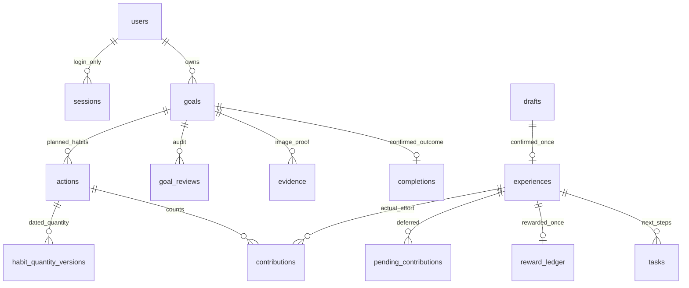
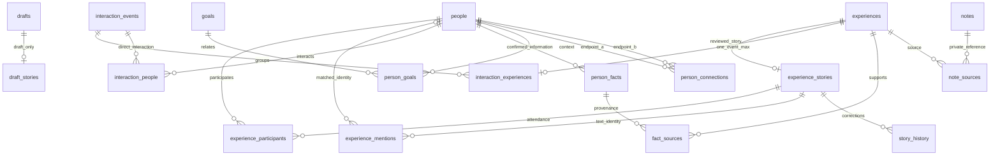
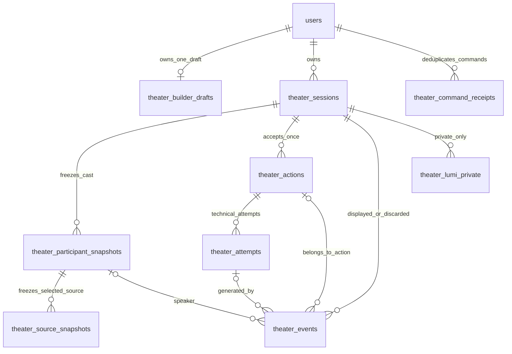

# Life World｜完整資料庫 Table Schema 與遷移架構

版本：v1.0 交付草案｜查核截止：2026-11-02 16:08（Asia/Taipei）
用途：Boyi 產品核對、Jerry 技術整合、資料夥伴資料品質審查。**現有 SQLite 事實、人物劇場擬議契約、PostgreSQL 遷移建議分別列示；本文件不是核准 migration，也不代表功能已整合。**

## 閱讀方式與交付範圍

| 區段 | 性質 | 可以如何使用 |
|---|---|---|
| A：SQLite 與完整 31 表字典 | 從固定 commit 的 SQL 重播、程式核對所得事實 | 查現有欄位、鍵與約束；不是線上 DB 實況證明 |
| B：Session Reliability 關聯式映射 | 9 張新表的設計提案，尚未落地 | 用來審查正式服務契約；不能說已在 migration 中 |
| C：PostgreSQL | 型別與併發建議、獨立草案 SQL | 規劃與隔離測試；不可直接作正式切換方案 |
| D：待決、驗收與風險 | 區分已知、未知、需核准內容 | 作後續工作包輸入；不是已通過驗收清單 |

附檔：`SQLITE_FACT_SCHEMA.sql`、`EXISTING_SQLITE_ERD.mmd`、`POSTGRESQL_CORE_DRAFT.sql`、`POSTGRESQL_THEATER_PROPOSAL.sql`。本儲存庫整理版以固定 Git commit 連結及 `SOURCE_MANIFEST.json` 保存追溯資訊，不重複收錄原 ZIP 的 evidence 程式副本或 build_schema.py；本輪重驗見 `VERIFICATION_LOCAL.md`。沒有使用者業務資料、DB 檔或帳號秘密。

## 0. 版本基準與證據優先序

### 0.1 本次重新核對的遠端版本

| 項目 | 本次結果 | 意義 |
|---|---|---|
| 指定分支 `review/current-state-2026-11-01` | `6676b61243d8b86a76637e8c154878d6fcd9701a` | 與使用者提供起始 commit 相同 |
| main | `8513b55df85aa4bd31ea48aa1fabb87eefa81117` | 指定分支相對 main ahead 1／behind 0，該提交尚未進 main |
| 較新相關分支 `fix/theater-session-isolation` | `9ba530999feb9241f5d7f71a9fa6dfa7c36a2a33` | 交付前再查已由 c7a0058 更新至此；相對指定基準 ahead 3／behind 0，diff 沒有 `app/` 或 migration 變更 |
| baseline migrations | 001–005，未見 006 | 本文件現有 SQLite 一律以這五份檔案與 db.py 的版本表定義為準 |

證據：[分支清單](https://api.github.com/repos/asixtw/life-world/branches?per_page=100)、[指定提交](https://github.com/asixtw/life-world/commit/6676b61243d8b86a76637e8c154878d6fcd9701a)、[main 比較](https://github.com/asixtw/life-world/compare/8513b55df85aa4bd31ea48aa1fabb87eefa81117...6676b61243d8b86a76637e8c154878d6fcd9701a)、[原型修復差異](https://github.com/asixtw/life-world/compare/6676b61243d8b86a76637e8c154878d6fcd9701a...9ba530999feb9241f5d7f71a9fa6dfa7c36a2a33)。分支名稱會移動，正文程式引用使用完整 SHA；本次不是所有其他分支的全面程式審查。原 ZIP 的初次與最後查核結果分存 source_manifest.json／final_refresh.json；本儲存庫以 SOURCE_MANIFEST.json 摘錄來源版本，本輪結果另列 VERIFICATION_LOCAL.md。

### 0.2 來源與衝突處理

1. **實體結構**：以 [001–005 migrations](https://github.com/asixtw/life-world/tree/6676b61243d8b86a76637e8c154878d6fcd9701a/app/migrations) 加上 [db.py](https://github.com/asixtw/life-world/blob/6676b61243d8b86a76637e8c154878d6fcd9701a/app/db.py) 為準。API 驗證不寫成 DB CHECK。
2. **使用方式**：對照 [service.py](https://github.com/asixtw/life-world/blob/6676b61243d8b86a76637e8c154878d6fcd9701a/app/service.py)、[goals.py](https://github.com/asixtw/life-world/blob/6676b61243d8b86a76637e8c154878d6fcd9701a/app/goals.py)、[people.py](https://github.com/asixtw/life-world/blob/6676b61243d8b86a76637e8c154878d6fcd9701a/app/people.py)、[connections.py](https://github.com/asixtw/life-world/blob/6676b61243d8b86a76637e8c154878d6fcd9701a/app/connections.py)、[schemas.py](https://github.com/asixtw/life-world/blob/6676b61243d8b86a76637e8c154878d6fcd9701a/app/schemas.py)、[main.py](https://github.com/asixtw/life-world/blob/6676b61243d8b86a76637e8c154878d6fcd9701a/app/main.py)、media.py 與 security.py。
3. **既有資料字典**：[DATABASE_SCHEMA.md](https://github.com/asixtw/life-world/blob/6676b61243d8b86a76637e8c154878d6fcd9701a/docs/DATABASE_SCHEMA.md)、[schema_snapshot.json](https://github.com/asixtw/life-world/blob/6676b61243d8b86a76637e8c154878d6fcd9701a/docs/database/schema_snapshot.json)、[sqlite_schema.sql](https://github.com/asixtw/life-world/blob/6676b61243d8b86a76637e8c154878d6fcd9701a/docs/database/sqlite_schema.sql)。其中 2026-10-29 記載的 `585e0a3`／「005 未發布」是歷史狀態；**005 與這些文件目前確實已在 6676b61**，不可沿用未發布結論。文件內歷史本機 DB 完整性結果也不能當作本次實測線上資料。
4. **劇場規格**：[SESSION_RELIABILITY_SPEC](../../team/theater/SESSION_RELIABILITY_SPEC.md)，v1.0 協作草案、2026-11-02、LW-THEATER-STATE-001。它明定本輪只修 Wireframe，**不改正式 app／API／SQLite**。第 5 節更明定是候選結構；B 區是本文件新增的關聯式設計，非原規格已核准 DDL。
5. **相關候選契約**：[劇場 ARCHITECTURE](https://github.com/asixtw/life-world/blob/6676b61243d8b86a76637e8c154878d6fcd9701a/docs/team/theater/ARCHITECTURE.md)、[產品決策](https://github.com/asixtw/life-world/blob/6676b61243d8b86a76637e8c154878d6fcd9701a/docs/team/theater/DECISIONS_v1.1_2026-10-30.md)、UX_BEHAVIOR、[POSTGRESQL_HANDOFF](https://github.com/asixtw/life-world/blob/6676b61243d8b86a76637e8c154878d6fcd9701a/docs/database/POSTGRESQL_HANDOFF.md)。後者是遷移提案，不能當正式 PG schema。

產品範圍仍有差異：本 ChatGPT 專案強調 POC 獎勵閉環，劇場決策文件描述 v1.1 封測延後獎勵閉環；現有 DB 又確實有 reward_ledger。故本文件保留現有帳本事實，但不自行裁決 11/13／封測應展示哪些功能。團隊人數的歷史描述也不作 schema 約束。

## A. 現有 SQLite 事實

### A.1 本次可重現的結構結果

在**獨立記憶體空庫**重播取得的 001–005，並依 db.py 建立 schema_migrations，實得：**31 張表（30 應用表＋1 版本表）、201 欄、60 條 FK、50 索引（9 明確＋41 PK／UNIQUE 自動）、0 view、0 trigger**。欄位、PK、FK、索引語意與既有 snapshot 相符。本次 SQLite runtime 3.35.5；空庫 integrity_check 為 ok、foreign_key_check 為 0。這些只驗證結構及 migration 在空庫可重播，不證明真實既有資料可以無損升級。

連線由 create_app → Database 管理，目錄優先 data_dir 參數 → LIFEWORLD_DATA_DIR → repository/data，檔名 lifeworld.sqlite3。WAL；每操作連線啟用 foreign_keys，寫入使用 BEGIN IMMEDIATE；migration 初始化連線沒有與 connect() 相同的 foreign_keys 設定，不把它描述為檔案永久全域屬性。沒有查詢或開啟使用者正在使用的 DB。[db.py 依據](https://github.com/asixtw/life-world/blob/6676b61243d8b86a76637e8c154878d6fcd9701a/app/db.py#L8)

| Migration | 建立／擴充內容 | 保留語意 |
|---|---|---|
| 001_initial.sql | 14 應用表：帳號、登入、目標／行動、人物、草稿／經歷、貢獻、帳本、任務、佐證、完成、筆記、requests | 正式人工確認與獎勵去重基礎 |
| 002_people_360.sql | people 擴欄；8 表：互動 3、人物事實 2、人物目標／關係、筆記來源 | 回填 legacy: 互動為 unknown，不推定見面 |
| 003_connections.sql | 5 表：草稿故事、正式故事、參與、提及、歷史 | 舊經歷回填待核對，不推論關係 |
| 004_goal_journey.sql | goals／actions 擴欄，goal_reviews、pending_contributions | 舊期限 NULL；到期待處理不抹除經歷 |
| 005_habit_versions.sql | habit_quantity_versions | 舊無開始日以 0001-01-01 表原始標準，不猜日期 |
| db.py | schema_migrations | runner 只記檔名，沒有內容 checksum |

### A.2 資料表示及不存在的能力

- **ID 是 TEXT**，不是統一 UUID。尤其 `legacy:<experience_id>` 必須保留。`sessions.token_hash` 是登入 token 雜湊；劇場不可借用它。
- 時點存 UTC 帶時區 ISO 8601 TEXT；日期為固定目標時區的 YYYY-MM-DD。DB 無日期語法 CHECK；格式及未來日期限制在 API／服務。
- target／quantity 等為十進位字串，由 Decimal 計算；不用 SQLite TEXT SUM 或 FLOAT。JSON 為 TEXT，沒有 json_valid CHECK，陣列元素 ID 沒有 FK。
- users.hatched_at 與帳本組合 Lumi／總養分，**沒有 pets、inventory、rooms、foods、decorations 或已實作的寵物等級表**。進度是 contributions 累計，沒有第二份 progress 百分比主檔。
- 正式 tasks 只有 ID／owner／來源 experience／title／done，**無日期與後續任務連回 action 的欄位**。原型的 task ID／日期與正式 tasks 是不同契約。
- 正式 notes 是單篇私人準備／模擬／訊息草稿，**不是多輪人物劇場**；現有 DB 無 theater Session／Action／Attempt／Event 表。
- 正式 App 已有媒體 capability 與辨識入口、輸入防護及可注入 provider；預設 media_provider=None、來源回傳 sha256 metadata，沒有新增媒體持久表。不能說「完全無後端媒體入口」，也不能說「真實辨識／永久附件已完成」。[main.py](https://github.com/asixtw/life-world/blob/6676b61243d8b86a76637e8c154878d6fcd9701a/app/main.py#L77)
- CRM 客戶／商機／名片、課程、訓練等專屬表尚不存在。本文件不憑產品願景造出現有 customers／opportunities；跨情境核心與 CRM 擴充另案核准。

### A.3 資料主權、來源追溯與交易

此處「資料主權」指**應用層誰可讀寫、哪個模組負責真實資料**，不是對法律上資料所有權的判定。users.id 是私人世界 owner；people 是使用者的私人紀錄，不是被記錄真人的登入帳號或本人認證。guest 升級保留 owner；人物功能另有 registered 門檻。普通 FK 只核對 ID 存在，不保證 owner 一致、不提供多租戶授權。服務必須驗證登入 owner 與全部關聯端點；子關聯表沒有 owner_id 時需 JOIN 父表驗權。[service._owned／_related](https://github.com/asixtw/life-world/blob/6676b61243d8b86a76637e8c154878d6fcd9701a/app/service.py#L128)

來源鏈有四條不同語意：

1. `drafts.raw_text` → 人工確認 → `experiences`；draft_id UNIQUE；不可用 AI 摘要覆蓋原文。
2. `person_facts` → `fact_sources` → `experiences`；revoked_at 保留撤回狀態；使用者確認不等於第三人證實。事實有效來源另依服務條件檢查。
3. `experience_stories` → participants／mentions／story_history；參與、直接互動、原文提及、身分配對與私人關係分開。mentions 的 start/end 為 Python Unicode code point。
4. `notes` → `note_sources` → 經歷只是引用，**沒有建場當時來源內容快照**；劇場正式快照需另建。

| 交易 | 一起成功或一起回滾 | 不變條件／限制 |
|---|---|---|
| confirm | experiences、貢獻或 pending、tasks、故事／互動、勾選人物更新、reward_ledger、draft confirmed、requests | 同草稿只能一經歷；一經歷至多一獎；只有人工確認正式入庫 |
| accept_pending | contributions、pending 狀態／採計量、goal revision、requests | 不重發 reward；目標／日期／revision 由服務核對 |
| goal create/review/complete | 目標、三行動、用量版本／回顧／完成與去重回執 | 單未結束目標、三行動靠服務＋SQLite 寫鎖，非已存在 DB unique/count CHECK |
| 故事更正／提及配對 | 對應故事／提及、revision、story_history | 不新增見面或獎勵；共現不生私人關係 |
| notes／task done／follow | 各私人資料更新 | 不更新真實貢獻與帳本 |

requests 以 `(owner_id, operation, request_id)` PK 加 fingerprint 防重送；相同 key 不同內容回衝突；回傳歷史 response 不代表最新資源狀態。SQLITE 的原子寫入不能直接換成 PG 一般 transaction 就假設等價。

### A.4 現有關聯概覽（非新設計）

下圖省略大多 owner 邊；完整 60 條 FK 見附檔 EXISTING_SQLITE_ERD.mmd。PK／Unique 決定的是「至多一筆」，不代表必然存在；SQLite PK 未宣告 NN 的歷史差異以逐表字典為準。






## A.5 現有 SQLite 完整逐表字典

本節由固定 commit 的 001–005 重播 metadata 產生；語意說明參考 DATABASE_SCHEMA.md 並對照服務。NN 僅指 SQL NOT NULL 宣告。所有 FK 的 ON UPDATE／ON DELETE 均為 NO ACTION；缺少 cascade 是事實，不可擅改。未宣告 default 用 —。TEXT PK 在此 SQLite rowid table 不自動等於 NN。

### A.5.1 `actions`｜三個習慣

**PK**：`id`。**資料主權**：owner_id → users.id；每次讀寫仍由服務核對登入 owner，FK 不提供列層權限。

**來源**：001_initial.sql、004_goal_journey.sql。**隔離／修改風險**：DB 無每目標恰三筆、position 唯一與 owner/goal 相等保證。target_is_derived 無 0/1 CHECK；新增約束先盤點。

| 欄位 | 型別 | PK 順位 | NN | Default | FK | 語意／來源追溯 |
|---|---|---|---|---|---|---|
| `id` | `TEXT` | 1 | 否 | — | — | 固定識別碼；服務產生，遷移保留原字串，不重建 ID。 |
| `goal_id` | `TEXT` | — | 是 | — | `goals.id` | 關聯目標 goals.id；不因目標結束而刪除歷史。 |
| `owner_id` | `TEXT` | — | 是 | — | `users.id` | 資料所屬 users.id；寫入及讀取均須核對同一帳號。 |
| `title` | `TEXT` | — | 是 | — | — | 供畫面呈現的標題／名稱；不是來源原文。 |
| `unit` | `TEXT` | — | 是 | — | — | 固定計量單位；本輪修改習慣不更換單位。 |
| `target` | `TEXT` | — | 是 | — | — | 預計累計量十進位字串；新式依日期版本加總，舊明確總量保留。 |
| `level` | `INTEGER` | — | 是 | — | — | 舊版 1–3 養分等級，相容保留，不當成目前正式獎勵政策。 |
| `weekdays` | `TEXT` | — | 是 | — | — | JSON 整數陣列，週一 0 至週日 6；保存星期快選。 |
| `position` | `INTEGER` | — | 是 | — | — | 三習慣的顯示順序；服務新建使用 0、1、2。 |
| `per_occurrence` | `TEXT` | — | 是 | `'1'` | — | 實體原始每次量；API 會用 quantity_versions 覆寫為今天適用量，不可直接當最新標準。 |
| `schedule_dates` | `TEXT` | — | 否 | — | — | 已確認安排日期的 JSON 字串陣列；NULL 代表舊資料待補設定。 |
| `cycle` | `TEXT` | — | 是 | `'month'` | — | month／week，日期編輯檢視，不是目標期限。 |
| `target_is_derived` | `INTEGER` | — | 是 | `0` | — | 1 代表 target 可依日期／用量版本推算，0 保留明確總量；DB 無布林 CHECK。 |

**CHECK**：`CHECK(level BETWEEN 1 AND 3)`；`CHECK(cycle IN ('month','week'))`。

| 索引名稱 | 類型／Unique | 鍵欄位 |
|---|---|---|
| `sqlite_autoindex_actions_1` | PK 自動／是 | `id` |

唯一約束即上列 Unique 索引；未列者無其他 UNIQUE。自動索引名稱僅記錄 SQLite metadata，不作 PG 名稱契約。

### A.5.2 `completions`｜人工成果完成

**PK**：`id`。**資料主權**：owner_id → users.id；每次讀寫仍由服務核對登入 owner，FK 不提供列層權限。

**來源**：001_initial.sql。**隔離／修改風險**：一目標至多一筆；evidence_ids 是 JSON 無元素 FK，服務核對同目標，不由累計量自動完成。

| 欄位 | 型別 | PK 順位 | NN | Default | FK | 語意／來源追溯 |
|---|---|---|---|---|---|---|
| `id` | `TEXT` | 1 | 否 | — | — | 固定識別碼；服務產生，遷移保留原字串，不重建 ID。 |
| `owner_id` | `TEXT` | — | 是 | — | `users.id` | 資料所屬 users.id；寫入及讀取均須核對同一帳號。 |
| `goal_id` | `TEXT` | — | 是 | — | `goals.id` | 唯一已完成目標；由佐證及人工確認交易產生。 |
| `evidence_ids` | `TEXT` | — | 是 | — | — | JSON 佐證 ID 陣列；不是 SQL 外鍵，服務檢查同帳號／同目標。 |
| `reflection` | `TEXT` | — | 是 | — | — | 使用者人工輸入的回顧／完成感想。 |
| `created_at` | `TEXT` | — | 是 | — | — | 建立時間，服務寫入帶時區的 UTC ISO 8601 文字。 |

**CHECK**：無。

| 索引名稱 | 類型／Unique | 鍵欄位 |
|---|---|---|
| `sqlite_autoindex_completions_1` | PK 自動／是 | `id` |
| `sqlite_autoindex_completions_2` | UNIQUE 自動／是 | `goal_id` |

唯一約束即上列 Unique 索引；未列者無其他 UNIQUE。自動索引名稱僅記錄 SQLite metadata，不作 PG 名稱契約。

### A.5.3 `contributions`｜正式習慣投入

**PK**：`id`。**資料主權**：owner_id → users.id；每次讀寫仍由服務核對登入 owner，FK 不提供列層權限。

**來源**：001_initial.sql。**隔離／修改風險**：quantity 為 Decimal 字串；UNIQUE 防同經歷同行動重複，但 DB 不保證行動屬於經歷的目標。

| 欄位 | 型別 | PK 順位 | NN | Default | FK | 語意／來源追溯 |
|---|---|---|---|---|---|---|
| `id` | `TEXT` | 1 | 否 | — | — | 固定識別碼；服務產生，遷移保留原字串，不重建 ID。 |
| `owner_id` | `TEXT` | — | 是 | — | `users.id` | 資料所屬 users.id；寫入及讀取均須核對同一帳號。 |
| `experience_id` | `TEXT` | — | 是 | — | `experiences.id` | 來源已確認經歷 experiences.id；不是尚未確認草稿。 |
| `action_id` | `TEXT` | — | 是 | — | `actions.id` | 關聯習慣 actions.id；保留穩定 ID，不以名稱配對。 |
| `quantity` | `TEXT` | — | 是 | — | — | 使用者核對的實際投入量，Decimal 處理；不可由排程推定。 |

**CHECK**：無。

| 索引名稱 | 類型／Unique | 鍵欄位 |
|---|---|---|
| `sqlite_autoindex_contributions_1` | PK 自動／是 | `id` |
| `sqlite_autoindex_contributions_2` | UNIQUE 自動／是 | `experience_id`, `action_id` |

唯一約束即上列 Unique 索引；未列者無其他 UNIQUE。自動索引名稱僅記錄 SQLite metadata，不作 PG 名稱契約。

### A.5.4 `draft_stories`｜草稿人物整理

**PK**：`draft_id`。**資料主權**：經 drafts.owner_id 繼承；payload 內人物 ID 沒有元素級 FK。

**來源**：003_connections.sql。**隔離／修改風險**：只在正式人工確認交易中轉為故事；payload 無 JSON CHECK／元素 FK。

| 欄位 | 型別 | PK 順位 | NN | Default | FK | 語意／來源追溯 |
|---|---|---|---|---|---|---|
| `draft_id` | `TEXT` | 1 | 否 | — | `drafts.id` | 一對一依附 drafts.id，保存未審閱的人物整理。 |
| `payload` | `TEXT` | — | 是 | — | — | JSON StoryInput：title、participants[{person_id,interacted}]、mentions[{name,start,end,person_id?}]。 |

**CHECK**：無。

| 索引名稱 | 類型／Unique | 鍵欄位 |
|---|---|---|
| `sqlite_autoindex_draft_stories_1` | PK 自動／是 | `draft_id` |

唯一約束即上列 Unique 索引；未列者無其他 UNIQUE。自動索引名稱僅記錄 SQLite metadata，不作 PG 名稱契約。

### A.5.5 `drafts`｜經歷草稿

**PK**：`id`。**資料主權**：owner_id → users.id；每次讀寫仍由服務核對登入 owner，FK 不提供列層權限。

**來源**：001_initial.sql。**隔離／修改風險**：contributions 是候選 JSON，不是正式貢獻。確認後禁止草稿編輯為服務規則；直接 SQL 可繞過。

| 欄位 | 型別 | PK 順位 | NN | Default | FK | 語意／來源追溯 |
|---|---|---|---|---|---|---|
| `id` | `TEXT` | 1 | 否 | — | — | 固定識別碼；服務產生，遷移保留原字串，不重建 ID。 |
| `owner_id` | `TEXT` | — | 是 | — | `users.id` | 資料所屬 users.id；寫入及讀取均須核對同一帳號。 |
| `goal_id` | `TEXT` | — | 否 | — | `goals.id` | 草稿關聯目標，選填；有貢獻時需核對行動屬於該目標。 |
| `person_id` | `TEXT` | — | 否 | — | `people.id` | 草稿主要關聯人物，選填；多人候選另存 draft_stories。 |
| `raw_text` | `TEXT` | — | 是 | — | — | 原始經歷文字，保留空白、換行與 Unicode，摘要不覆寫本欄。 |
| `occurred_at` | `TEXT` | — | 是 | — | — | 實際發生時間，服務轉 UTC 保存；與建立時間分開。 |
| `contributions` | `TEXT` | — | 是 | — | — | JSON [{action_id,quantity}]，尚未確認，不更新正式進度。 |
| `status` | `TEXT` | — | 是 | — | — | draft／confirmed；只有明確確認交易才能轉正式。 |
| `revision` | `INTEGER` | — | 是 | — | — | 樂觀鎖版本；寫入攜帶 expected_revision，衝突須重新核對。 |
| `created_at` | `TEXT` | — | 是 | — | — | 建立時間，服務寫入帶時區的 UTC ISO 8601 文字。 |
| `updated_at` | `TEXT` | — | 是 | — | — | 最近修改時間，UTC ISO 8601 文字。 |

**CHECK**：`CHECK(status IN ('draft','confirmed'))`。

| 索引名稱 | 類型／Unique | 鍵欄位 |
|---|---|---|
| `sqlite_autoindex_drafts_1` | PK 自動／是 | `id` |

唯一約束即上列 Unique 索引；未列者無其他 UNIQUE。自動索引名稱僅記錄 SQLite metadata，不作 PG 名稱契約。

### A.5.6 `evidence`｜目標完成圖片佐證

**PK**：`id`。**資料主權**：owner_id → users.id；每次讀寫仍由服務核對登入 owner，FK 不提供列層權限。

**來源**：001_initial.sql。**隔離／修改風險**：content 為圖片 BLOB；不是一般經歷附件表。移到物件儲存須核對 digest、owner、size 與引用。

| 欄位 | 型別 | PK 順位 | NN | Default | FK | 語意／來源追溯 |
|---|---|---|---|---|---|---|
| `id` | `TEXT` | 1 | 否 | — | — | 固定識別碼；服務產生，遷移保留原字串，不重建 ID。 |
| `owner_id` | `TEXT` | — | 是 | — | `users.id` | 資料所屬 users.id；寫入及讀取均須核對同一帳號。 |
| `goal_id` | `TEXT` | — | 是 | — | `goals.id` | 關聯目標 goals.id；不因目標結束而刪除歷史。 |
| `filename` | `TEXT` | — | 是 | — | — | 原始顯示檔名；視為私人 metadata，不作公開物件鍵。 |
| `mime` | `TEXT` | — | 是 | — | — | 驗證後圖片 MIME；目前服務接受 PNG／JPEG。 |
| `digest` | `TEXT` | — | 是 | — | — | 圖片內容 SHA-256，用於同目標、同帳號去重。 |
| `content` | `BLOB` | — | 是 | — | — | 經服務驗證的圖片 BLOB；不是私人筆記文字。 |
| `size` | `INTEGER` | — | 是 | — | — | 內容位元組數；上限由服務設定，不由 DB CHECK 強制。 |
| `created_at` | `TEXT` | — | 是 | — | — | 建立時間，服務寫入帶時區的 UTC ISO 8601 文字。 |

**CHECK**：無。

| 索引名稱 | 類型／Unique | 鍵欄位 |
|---|---|---|
| `sqlite_autoindex_evidence_1` | PK 自動／是 | `id` |
| `sqlite_autoindex_evidence_2` | UNIQUE 自動／是 | `owner_id`, `goal_id`, `digest` |

唯一約束即上列 Unique 索引；未列者無其他 UNIQUE。自動索引名稱僅記錄 SQLite metadata，不作 PG 名稱契約。

### A.5.7 `experience_mentions`｜原文提及與身分配對

**PK**：`id`。**資料主權**：owner_id → users.id；每次讀寫仍由服務核對登入 owner，FK 不提供列層權限。

**來源**：003_connections.sql。**隔離／修改風險**：位置為 Python Unicode code point，JS UTF-16 索引不可直接寫回；不可只因同名自動配對。

| 欄位 | 型別 | PK 順位 | NN | Default | FK | 語意／來源追溯 |
|---|---|---|---|---|---|---|
| `id` | `TEXT` | 1 | 否 | — | — | 固定識別碼；服務產生，遷移保留原字串，不重建 ID。 |
| `owner_id` | `TEXT` | — | 是 | — | `users.id` | 資料所屬 users.id；寫入及讀取均須核對同一帳號。 |
| `experience_id` | `TEXT` | — | 是 | — | `experience_stories.experience_id` | 來源已確認經歷 experiences.id；不是尚未確認草稿。 |
| `name` | `TEXT` | — | 是 | — | — | 精確原文人名片段，須與 raw_text[start:end] 相符。 |
| `start` | `INTEGER` | — | 是 | — | — | Python Unicode code point 起點；不是 UTF-8 byte 或 JavaScript UTF-16 位移。 |
| `end` | `INTEGER` | — | 是 | — | — | Unicode code point 排他終點；必須大於 start。 |
| `status` | `TEXT` | — | 是 | `'unmatched'` | — | unmatched／matched／rejected；配對不等於出席或直接關係。 |
| `person_id` | `TEXT` | — | 否 | — | `people.id` | matched 時必填，其餘狀態必空，由 DB CHECK 保護。 |
| `revision` | `INTEGER` | — | 是 | `1` | — | 樂觀鎖版本；寫入攜帶 expected_revision，衝突須重新核對。 |

**CHECK**：`CHECK(start>=0)`；`CHECK(end>start)`；`CHECK(status IN ('unmatched','matched','rejected'))`；`CHECK((status='matched' AND person_id IS NOT NULL) OR (status<>'matched' AND person_id IS NULL))`。

| 索引名稱 | 類型／Unique | 鍵欄位 |
|---|---|---|
| `mentions_person` | 明確建立／否 | `person_id`, `status`, `experience_id` |
| `sqlite_autoindex_experience_mentions_1` | PK 自動／是 | `id` |
| `sqlite_autoindex_experience_mentions_2` | UNIQUE 自動／是 | `experience_id`, `start`, `end` |

唯一約束即上列 Unique 索引；未列者無其他 UNIQUE。自動索引名稱僅記錄 SQLite metadata，不作 PG 名稱契約。

### A.5.8 `experience_participants`｜逐故事參與與直接互動

**PK**：`experience_id`, `person_id`。**資料主權**：由 experience_stories 與 people 雙端推導；服務必須確認同 owner。

**來源**：003_connections.sql。**隔離／修改風險**：interacted 與參與分開；提及配對不能自行插入此表。

| 欄位 | 型別 | PK 順位 | NN | Default | FK | 語意／來源追溯 |
|---|---|---|---|---|---|---|
| `experience_id` | `TEXT` | 1 | 是 | — | `experience_stories.experience_id` | 逐筆故事的實際參與名單，不取合併事件人物聯集。 |
| `person_id` | `TEXT` | 2 | 是 | — | `people.id` | 關聯人物 people.id；是否可空依本欄宣告。 |
| `interacted` | `INTEGER` | — | 是 | `0` | — | 0／1 同場是否另有直接互動；提及不能直接設為參與。 |

**CHECK**：`CHECK(interacted IN (0,1))`。

| 索引名稱 | 類型／Unique | 鍵欄位 |
|---|---|---|
| `participants_person` | 明確建立／否 | `person_id`, `experience_id` |
| `sqlite_autoindex_experience_participants_1` | PK 自動／是 | `experience_id`, `person_id` |

唯一約束即上列 Unique 索引；未列者無其他 UNIQUE。自動索引名稱僅記錄 SQLite metadata，不作 PG 名稱契約。

### A.5.9 `experience_stories`｜交會故事狀態

**PK**：`experience_id`。**資料主權**：owner_id → users.id；每次讀寫仍由服務核對登入 owner，FK 不提供列層權限。

**來源**：003_connections.sql。**隔離／修改風險**：reviewed 表示使用者核對，不是第三人證實。available=0 是展示撤回，不等於刪除經歷或隱私抹除。

| 欄位 | 型別 | PK 順位 | NN | Default | FK | 語意／來源追溯 |
|---|---|---|---|---|---|---|
| `experience_id` | `TEXT` | 1 | 否 | — | `experiences.id` | 與正式經歷一對一的故事狀態。 |
| `owner_id` | `TEXT` | — | 是 | — | `users.id` | 資料所屬 users.id；寫入及讀取均須核對同一帳號。 |
| `title` | `TEXT` | — | 是 | `''` | — | 故事標題；空白時 API 以摘要前 80 字顯示，不造事件。 |
| `reviewed` | `INTEGER` | — | 是 | `0` | — | 0／1，人物及故事是否已由使用者核對；不表示所有參與者證實。 |
| `available` | `INTEGER` | — | 是 | `1` | — | 0／1，只控制交會來源展示；撤回不刪經歷或帳本。 |
| `revision` | `INTEGER` | — | 是 | `1` | — | 樂觀鎖版本；寫入攜帶 expected_revision，衝突須重新核對。 |

**CHECK**：`CHECK(reviewed IN (0,1))`；`CHECK(available IN (0,1))`。

| 索引名稱 | 類型／Unique | 鍵欄位 |
|---|---|---|
| `sqlite_autoindex_experience_stories_1` | PK 自動／是 | `experience_id` |
| `stories_owner_review` | 明確建立／否 | `owner_id`, `reviewed`, `available` |

唯一約束即上列 Unique 索引；未列者無其他 UNIQUE。自動索引名稱僅記錄 SQLite metadata，不作 PG 名稱契約。

### A.5.10 `experiences`｜已確認真實經歷

**PK**：`id`。**資料主權**：owner_id → users.id；每次讀寫仍由服務核對登入 owner，FK 不提供列層權限。

**來源**：001_initial.sql。**隔離／修改風險**：draft_id UNIQUE 防重複確認；原文不可用摘要取代。主人物欄位不等同逐故事出席名單。

| 欄位 | 型別 | PK 順位 | NN | Default | FK | 語意／來源追溯 |
|---|---|---|---|---|---|---|
| `id` | `TEXT` | 1 | 否 | — | — | 固定識別碼；服務產生，遷移保留原字串，不重建 ID。 |
| `owner_id` | `TEXT` | — | 是 | — | `users.id` | 資料所屬 users.id；寫入及讀取均須核對同一帳號。 |
| `draft_id` | `TEXT` | — | 是 | — | `drafts.id` | 唯一來源草稿；同一草稿至多形成一筆正式經歷。 |
| `goal_id` | `TEXT` | — | 否 | — | `goals.id` | 保存記錄當時的目標上下文；不表示自動有貢獻。 |
| `person_id` | `TEXT` | — | 否 | — | `people.id` | 相容舊版的主要人物，非完整參與名單；新版必須是已確認參與者。 |
| `raw_text` | `TEXT` | — | 是 | — | — | 原始經歷文字，保留空白、換行與 Unicode，摘要不覆寫本欄。 |
| `summary` | `TEXT` | — | 是 | — | — | 經使用者確認的摘要。 |
| `occurred_at` | `TEXT` | — | 是 | — | — | 實際發生時間，服務轉 UTC 保存；與建立時間分開。 |
| `created_at` | `TEXT` | — | 是 | — | — | 建立時間，服務寫入帶時區的 UTC ISO 8601 文字。 |

**CHECK**：無。

| 索引名稱 | 類型／Unique | 鍵欄位 |
|---|---|---|
| `experiences_owner_idx` | 明確建立／否 | `owner_id` |
| `sqlite_autoindex_experiences_1` | PK 自動／是 | `id` |
| `sqlite_autoindex_experiences_2` | UNIQUE 自動／是 | `draft_id` |

唯一約束即上列 Unique 索引；未列者無其他 UNIQUE。自動索引名稱僅記錄 SQLite metadata，不作 PG 名稱契約。

### A.5.11 `fact_sources`｜人物資訊來源

**PK**：`fact_id`, `experience_id`。**資料主權**：由 person_facts 與 experiences 雙端推導；服務必須確認同 owner。

**來源**：002_people_360.sql。**隔離／修改風險**：revoked_at 不會刪原經歷；evidence_type 的三種值由服務驗證，DB 無 enum CHECK。

| 欄位 | 型別 | PK 順位 | NN | Default | FK | 語意／來源追溯 |
|---|---|---|---|---|---|---|
| `fact_id` | `TEXT` | 1 | 是 | — | `person_facts.id` | 關聯人物資訊 person_facts.id。 |
| `experience_id` | `TEXT` | 2 | 是 | — | `experiences.id` | 來源已確認經歷 experiences.id；不是尚未確認草稿。 |
| `evidence_type` | `TEXT` | — | 是 | — | — | 服務限定 stated_by_person／observed_by_user／documented_source；DB 未加 CHECK。 |
| `revoked_at` | `TEXT` | — | 否 | — | — | 來源撤回時間；不刪除原經歷。 |

**CHECK**：無。

| 索引名稱 | 類型／Unique | 鍵欄位 |
|---|---|---|
| `sqlite_autoindex_fact_sources_1` | PK 自動／是 | `fact_id`, `experience_id` |

唯一約束即上列 Unique 索引；未列者無其他 UNIQUE。自動索引名稱僅記錄 SQLite metadata，不作 PG 名稱契約。

### A.5.12 `goal_reviews`｜目標回顧與異動快照

**PK**：`id`。**資料主權**：owner_id → users.id；每次讀寫仍由服務核對登入 owner，FK 不提供列層權限。

**來源**：004_goal_journey.sql。**隔離／修改風險**：前後 JSON 可能含私人內容；ORDER BY created_at,rowid 不能直接移至 PG。

| 欄位 | 型別 | PK 順位 | NN | Default | FK | 語意／來源追溯 |
|---|---|---|---|---|---|---|
| `id` | `TEXT` | 1 | 否 | — | — | 固定識別碼；服務產生，遷移保留原字串，不重建 ID。 |
| `owner_id` | `TEXT` | — | 是 | — | `users.id` | 資料所屬 users.id；寫入及讀取均須核對同一帳號。 |
| `goal_id` | `TEXT` | — | 是 | — | `goals.id` | 關聯目標 goals.id；不因目標結束而刪除歷史。 |
| `decision` | `TEXT` | — | 是 | — | — | 服務限定 end／extend／setup／schedule；DB 未加 enum CHECK。 |
| `previous_state` | `TEXT` | — | 是 | — | — | 操作前目標及習慣 JSON 快照，不遞迴嵌入歷史 reviews。 |
| `new_state` | `TEXT` | — | 是 | — | — | 操作後 JSON 快照，保留名稱／排程／用量版本異動。 |
| `reflection` | `TEXT` | — | 是 | — | — | 使用者人工輸入的回顧／完成感想。 |
| `created_at` | `TEXT` | — | 是 | — | — | 建立時間，服務寫入帶時區的 UTC ISO 8601 文字。 |

**CHECK**：無。

| 索引名稱 | 類型／Unique | 鍵欄位 |
|---|---|---|
| `sqlite_autoindex_goal_reviews_1` | PK 自動／是 | `id` |

唯一約束即上列 Unique 索引；未列者無其他 UNIQUE。自動索引名稱僅記錄 SQLite metadata，不作 PG 名稱契約。

### A.5.13 `goals`｜目標與實體生命週期

**PK**：`id`。**資料主權**：owner_id → users.id；每次讀寫仍由服務核對登入 owner，FK 不提供列層權限。

**來源**：001_initial.sql、004_goal_journey.sql。**隔離／修改風險**：DB 無單一未結束目標唯一約束；到期待回顧仍占名額。不得把公開五狀態寫進實體兩狀態。

| 欄位 | 型別 | PK 順位 | NN | Default | FK | 語意／來源追溯 |
|---|---|---|---|---|---|---|
| `id` | `TEXT` | 1 | 否 | — | — | 固定識別碼；服務產生，遷移保留原字串，不重建 ID。 |
| `owner_id` | `TEXT` | — | 是 | — | `users.id` | 資料所屬 users.id；寫入及讀取均須核對同一帳號。 |
| `title` | `TEXT` | — | 是 | — | — | 供畫面呈現的標題／名稱；不是來源原文。 |
| `outcome` | `TEXT` | — | 是 | — | — | 使用者描述終極成果；不由習慣累計自動認定達成。 |
| `status` | `TEXT` | — | 是 | — | — | 實體僅 active／completed；公開五狀態另由日期與結束欄位推導。 |
| `created_at` | `TEXT` | — | 是 | — | — | 建立時間，服務寫入帶時區的 UTC ISO 8601 文字。 |
| `completed_at` | `TEXT` | — | 否 | — | — | 人工確認完成時間；未完成可空。 |
| `reflection` | `TEXT` | — | 是 | `''` | — | 使用者人工輸入的回顧／完成感想。 |
| `start_date` | `TEXT` | — | 否 | — | — | 目標當地開始日 YYYY-MM-DD；舊資料可空，不猜期限。 |
| `deadline` | `TEXT` | — | 否 | — | — | 使用者選定的截止日；含固定目標時區整天，舊資料可空。 |
| `schedule_timezone` | `TEXT` | — | 否 | — | — | 建立／補設定時固定的 IANA 目標時區；舊資料可空。 |
| `revision` | `INTEGER` | — | 是 | `1` | — | 樂觀鎖版本；寫入攜帶 expected_revision，衝突須重新核對。 |
| `ended_at` | `TEXT` | — | 否 | — | — | 主動收藏未完成挑戰的時間；不等於刪除目標。 |
| `end_reason` | `TEXT` | — | 否 | — | — | early_end／expired；區分提前結束與到期未完成。 |

**CHECK**：`CHECK(status IN ('active','completed'))`；`CHECK(end_reason IN ('early_end','expired'))`。

| 索引名稱 | 類型／Unique | 鍵欄位 |
|---|---|---|
| `goals_owner_idx` | 明確建立／否 | `owner_id` |
| `sqlite_autoindex_goals_1` | PK 自動／是 | `id` |

唯一約束即上列 Unique 索引；未列者無其他 UNIQUE。自動索引名稱僅記錄 SQLite metadata，不作 PG 名稱契約。

### A.5.14 `habit_quantity_versions`｜習慣日期用量版本

**PK**：`action_id`, `effective_from`。**資料主權**：經 actions.owner_id → users.id 繼承；此表沒有 owner_id。

**來源**：005_habit_versions.sql。**隔離／修改風險**：0001-01-01 是舊原始標準標記；同生效日 UPSERT，改前值須由 goal_reviews 追溯。

| 欄位 | 型別 | PK 順位 | NN | Default | FK | 語意／來源追溯 |
|---|---|---|---|---|---|---|
| `action_id` | `TEXT` | 1 | 是 | — | `actions.id` | 關聯習慣 actions.id；保留穩定 ID，不以名稱配對。 |
| `effective_from` | `TEXT` | 2 | 是 | — | — | 目標當地生效日；新調整從隔天生效；0001-01-01 只標記舊原始標準，非真實起日。 |
| `quantity` | `TEXT` | — | 是 | — | — | 該版本每次預期量的精確十進位字串，不是完成量。 |
| `created_at` | `TEXT` | — | 是 | — | — | 此生效日版本最近確認時間；同日改寫會更新，前值見 goal_reviews。 |

**CHECK**：無。

| 索引名稱 | 類型／Unique | 鍵欄位 |
|---|---|---|
| `sqlite_autoindex_habit_quantity_versions_1` | PK 自動／是 | `action_id`, `effective_from` |

唯一約束即上列 Unique 索引；未列者無其他 UNIQUE。自動索引名稱僅記錄 SQLite metadata，不作 PG 名稱契約。

### A.5.15 `interaction_events`｜去重互動事件

**PK**：`id`。**資料主權**：owner_id → users.id；每次讀寫仍由服務核對登入 owner，FK 不提供列層權限。

**來源**：002_people_360.sql。**隔離／修改風險**：只有 in_person 算實體見面；legacy: ID 不可轉為 UUID。事件聚合不代表逐故事所有人都到場。

| 欄位 | 型別 | PK 順位 | NN | Default | FK | 語意／來源追溯 |
|---|---|---|---|---|---|---|
| `id` | `TEXT` | 1 | 否 | — | — | 固定識別碼；服務產生，遷移保留原字串，不重建 ID。 |
| `owner_id` | `TEXT` | — | 是 | — | `users.id` | 資料所屬 users.id；寫入及讀取均須核對同一帳號。 |
| `kind` | `TEXT` | — | 是 | — | — | in_person／call／message／other／unknown；只有 in_person 計見面次數。 |
| `occurred_at` | `TEXT` | — | 是 | — | — | 實際發生時間，服務轉 UTC 保存；與建立時間分開。 |
| `revision` | `INTEGER` | — | 是 | `1` | — | 樂觀鎖版本；寫入攜帶 expected_revision，衝突須重新核對。 |

**CHECK**：`CHECK(kind IN ('in_person','call','message','other','unknown'))`。

| 索引名稱 | 類型／Unique | 鍵欄位 |
|---|---|---|
| `interactions_owner_time` | 明確建立／否 | `owner_id`, `occurred_at` |
| `sqlite_autoindex_interaction_events_1` | PK 自動／是 | `id` |

唯一約束即上列 Unique 索引；未列者無其他 UNIQUE。自動索引名稱僅記錄 SQLite metadata，不作 PG 名稱契約。

### A.5.16 `interaction_experiences`｜事件與經歷對應

**PK**：`experience_id`。**資料主權**：由 experiences 與 interaction_events 雙端推導；服務必須確認同 owner。

**來源**：002_people_360.sql。**隔離／修改風險**：PK 限一經歷至多一事件；合併事件不可重複計會面或重發獎。

| 欄位 | 型別 | PK 順位 | NN | Default | FK | 語意／來源追溯 |
|---|---|---|---|---|---|---|
| `experience_id` | `TEXT` | 1 | 否 | — | `experiences.id` | 主鍵使一筆經歷最多對應一個互動事件；一事件可對應多筆經歷。 |
| `event_id` | `TEXT` | — | 是 | — | `interaction_events.id` | 關聯互動事件 interaction_events.id。 |

**CHECK**：無。

| 索引名稱 | 類型／Unique | 鍵欄位 |
|---|---|---|
| `sqlite_autoindex_interaction_experiences_1` | PK 自動／是 | `experience_id` |

唯一約束即上列 Unique 索引；未列者無其他 UNIQUE。自動索引名稱僅記錄 SQLite metadata，不作 PG 名稱契約。

### A.5.17 `interaction_people`｜事件互動人物

**PK**：`event_id`, `person_id`。**資料主權**：由 interaction_events 與 people 雙端推導；服務必須確認同 owner。

**來源**：002_people_360.sql。**隔離／修改風險**：事件人物是直接互動聚合，不能拿聯集覆蓋 experience_participants。

| 欄位 | 型別 | PK 順位 | NN | Default | FK | 語意／來源追溯 |
|---|---|---|---|---|---|---|
| `event_id` | `TEXT` | 1 | 是 | — | `interaction_events.id` | 事件聚合的互動人物關聯；不能當成每筆故事的出席名單。 |
| `person_id` | `TEXT` | 2 | 是 | — | `people.id` | 關聯人物 people.id；是否可空依本欄宣告。 |

**CHECK**：無。

| 索引名稱 | 類型／Unique | 鍵欄位 |
|---|---|---|
| `sqlite_autoindex_interaction_people_1` | PK 自動／是 | `event_id`, `person_id` |

唯一約束即上列 Unique 索引；未列者無其他 UNIQUE。自動索引名稱僅記錄 SQLite metadata，不作 PG 名稱契約。

### A.5.18 `note_sources`｜筆記引用來源

**PK**：`note_id`, `experience_id`。**資料主權**：由 notes 與 experiences 雙端推導；服務必須確認同 owner。

**來源**：002_people_360.sql。**隔離／修改風險**：只保存來源引用，不是建立時內容快照；讀取須重新核對來源可用性及 owner。

| 欄位 | 型別 | PK 順位 | NN | Default | FK | 語意／來源追溯 |
|---|---|---|---|---|---|---|
| `note_id` | `TEXT` | 1 | 是 | — | `notes.id` | 關聯私人筆記 notes.id。 |
| `experience_id` | `TEXT` | 2 | 是 | — | `experiences.id` | 私人筆記引用的已確認經歷；服務另檢查與人物的關聯。 |

**CHECK**：無。

| 索引名稱 | 類型／Unique | 鍵欄位 |
|---|---|---|
| `sqlite_autoindex_note_sources_1` | PK 自動／是 | `note_id`, `experience_id` |

唯一約束即上列 Unique 索引；未列者無其他 UNIQUE。自動索引名稱僅記錄 SQLite metadata，不作 PG 名稱契約。

### A.5.19 `notes`｜私人小劇場筆記

**PK**：`id`。**資料主權**：owner_id → users.id；每次讀寫仍由服務核對登入 owner，FK 不提供列層權限。

**來源**：001_initial.sql。**隔離／修改風險**：正式私人 preparation/simulation/message 筆記；不是多輪劇場場次，也不得回寫人物或帳本。

| 欄位 | 型別 | PK 順位 | NN | Default | FK | 語意／來源追溯 |
|---|---|---|---|---|---|---|
| `id` | `TEXT` | 1 | 否 | — | — | 固定識別碼；服務產生，遷移保留原字串，不重建 ID。 |
| `owner_id` | `TEXT` | — | 是 | — | `users.id` | 資料所屬 users.id；寫入及讀取均須核對同一帳號。 |
| `person_id` | `TEXT` | — | 否 | — | `people.id` | 關聯人物 people.id；是否可空依本欄宣告。 |
| `kind` | `TEXT` | — | 是 | — | — | preparation／simulation／message；相遇後回顧另走真實經歷流程。 |
| `title` | `TEXT` | — | 是 | — | — | 供畫面呈現的標題／名稱；不是來源原文。 |
| `content` | `TEXT` | — | 是 | — | — | 私人準備／模擬／訊息草稿；不更新正式人物、進度或積分。 |
| `created_at` | `TEXT` | — | 是 | — | — | 建立時間，服務寫入帶時區的 UTC ISO 8601 文字。 |

**CHECK**：`CHECK(kind IN ('preparation','simulation','message'))`。

| 索引名稱 | 類型／Unique | 鍵欄位 |
|---|---|---|
| `sqlite_autoindex_notes_1` | PK 自動／是 | `id` |

唯一約束即上列 Unique 索引；未列者無其他 UNIQUE。自動索引名稱僅記錄 SQLite metadata，不作 PG 名稱契約。

### A.5.20 `pending_contributions`｜待處理／未採計投入

**PK**：`id`。**資料主權**：owner_id → users.id；每次讀寫仍由服務核對登入 owner，FK 不提供列層權限。

**來源**：004_goal_journey.sql。**隔離／修改風險**：採計只寫 contributions，不重發獎；accepted_quantity 與 status 一致性未用 CHECK 限制。

| 欄位 | 型別 | PK 順位 | NN | Default | FK | 語意／來源追溯 |
|---|---|---|---|---|---|---|
| `id` | `TEXT` | 1 | 否 | — | — | 固定識別碼；服務產生，遷移保留原字串，不重建 ID。 |
| `owner_id` | `TEXT` | — | 是 | — | `users.id` | 資料所屬 users.id；寫入及讀取均須核對同一帳號。 |
| `goal_id` | `TEXT` | — | 是 | — | `goals.id` | 關聯目標 goals.id；不因目標結束而刪除歷史。 |
| `experience_id` | `TEXT` | — | 是 | — | `experiences.id` | 來源已確認經歷 experiences.id；不是尚未確認草稿。 |
| `action_id` | `TEXT` | — | 是 | — | `actions.id` | 關聯習慣 actions.id；保留穩定 ID，不以名稱配對。 |
| `quantity` | `TEXT` | — | 是 | — | — | 原填貢獻量字串；經歷可已保存，但本量尚未正式採計。 |
| `status` | `TEXT` | — | 是 | `'pending'` | — | pending／accepted／unapplied；逐筆採計或未採計歷史。 |
| `accepted_quantity` | `TEXT` | — | 否 | — | — | 人工核對後實際採計量，可與原填不同，未採計可空。 |
| `accepted_at` | `TEXT` | — | 否 | — | — | 確認採計時間；不會再次產生 reward_ledger。 |

**CHECK**：`CHECK(status IN ('pending','accepted','unapplied'))`。

| 索引名稱 | 類型／Unique | 鍵欄位 |
|---|---|---|
| `pending_goal_idx` | 明確建立／否 | `owner_id`, `goal_id` |
| `sqlite_autoindex_pending_contributions_1` | PK 自動／是 | `id` |
| `sqlite_autoindex_pending_contributions_2` | UNIQUE 自動／是 | `experience_id`, `action_id` |

唯一約束即上列 Unique 索引；未列者無其他 UNIQUE。自動索引名稱僅記錄 SQLite metadata，不作 PG 名稱契約。

### A.5.21 `people`｜人物收藏冊主檔

**PK**：`id`。**資料主權**：owner_id → users.id；每次讀寫仍由服務核對登入 owner，FK 不提供列層權限。

**來源**：001_initial.sql、002_people_360.sql。**隔離／修改風險**：role 為舊相容欄位；roles/tags 非四維度正式事實。revision 存在，但不是全域人物來源版本鏈。

| 欄位 | 型別 | PK 順位 | NN | Default | FK | 語意／來源追溯 |
|---|---|---|---|---|---|---|
| `id` | `TEXT` | 1 | 否 | — | — | 固定識別碼；服務產生，遷移保留原字串，不重建 ID。 |
| `owner_id` | `TEXT` | — | 是 | — | `users.id` | 資料所屬 users.id；寫入及讀取均須核對同一帳號。 |
| `name` | `TEXT` | — | 是 | — | — | 人物稱呼，不以姓名作唯一身分。 |
| `role` | `TEXT` | — | 是 | `''` | — | 舊版單一完整角色字串，相容保留，不能自動拆成已驗證事實。 |
| `notes` | `TEXT` | — | 是 | `''` | — | 使用者備註，不自動轉人物事實或 AI 訓練資料。 |
| `created_at` | `TEXT` | — | 是 | — | — | 建立時間，服務寫入帶時區的 UTC ISO 8601 文字。 |
| `roles` | `TEXT` | — | 是 | `'[]'` | — | JSON 多角色字串陣列。 |
| `tags` | `TEXT` | — | 是 | `'[]'` | — | JSON 人物標籤字串陣列，用於搜尋。 |
| `category` | `TEXT` | — | 是 | `'other'` | — | 服務限定 business／life／learning／other；DB 無類別 CHECK。 |
| `followed` | `INTEGER` | — | 是 | `0` | — | 0／1 私人星標（介面已由關注改稱星標）；不通知對方，不代表親密度。 |
| `revision` | `INTEGER` | — | 是 | `1` | — | 樂觀鎖版本；寫入攜帶 expected_revision，衝突須重新核對。 |
| `common_context` | `TEXT` | — | 是 | `''` | — | 人工記錄的共同場合／交集文字，不推論私人關係。 |

**CHECK**：`CHECK(followed IN (0,1))`。

| 索引名稱 | 類型／Unique | 鍵欄位 |
|---|---|---|
| `sqlite_autoindex_people_1` | PK 自動／是 | `id` |

唯一約束即上列 Unique 索引；未列者無其他 UNIQUE。自動索引名稱僅記錄 SQLite metadata，不作 PG 名稱契約。

### A.5.22 `person_connections`｜明確人物關係

**PK**：`id`。**資料主權**：owner_id → users.id；每次讀寫仍由服務核對登入 owner，FK 不提供列層權限。

**來源**：002_people_360.sql。**隔離／修改風險**：服務排序 person_a/person_b 並拒絕自連；DB 無 a<b／a<>b CHECK，JSON 來源無實體 FK。

| 欄位 | 型別 | PK 順位 | NN | Default | FK | 語意／來源追溯 |
|---|---|---|---|---|---|---|
| `id` | `TEXT` | 1 | 否 | — | — | 固定識別碼；服務產生，遷移保留原字串，不重建 ID。 |
| `owner_id` | `TEXT` | — | 是 | — | `users.id` | 資料所屬 users.id；寫入及讀取均須核對同一帳號。 |
| `person_a` | `TEXT` | — | 是 | — | `people.id` | 明確關係的一端人物；服務將兩端 ID 排序。 |
| `person_b` | `TEXT` | — | 是 | — | `people.id` | 明確關係的另一端人物；服務拒絕自連與跨帳號。 |
| `label` | `TEXT` | — | 是 | — | — | 使用者明確輸入的關係名稱，不由故事共現自動推論。 |
| `source_experience_ids` | `TEXT` | — | 是 | — | — | JSON 經歷 ID 陣列；來源由服務核對，非 SQL 外鍵，可空陣列。 |

**CHECK**：無。

| 索引名稱 | 類型／Unique | 鍵欄位 |
|---|---|---|
| `sqlite_autoindex_person_connections_1` | PK 自動／是 | `id` |
| `sqlite_autoindex_person_connections_2` | UNIQUE 自動／是 | `person_a`, `person_b` |

唯一約束即上列 Unique 索引；未列者無其他 UNIQUE。自動索引名稱僅記錄 SQLite metadata，不作 PG 名稱契約。

### A.5.23 `person_facts`｜四維度人物資訊

**PK**：`id`。**資料主權**：owner_id → users.id；每次讀寫仍由服務核對登入 owner，FK 不提供列層權限。

**來源**：002_people_360.sql。**隔離／修改風險**：normalized_value 為 NFKC/casefold 等應用正規化；不可用 PG lower 替代。conflict/archived/unavailable 均須保留。

| 欄位 | 型別 | PK 順位 | NN | Default | FK | 語意／來源追溯 |
|---|---|---|---|---|---|---|
| `id` | `TEXT` | 1 | 否 | — | — | 固定識別碼；服務產生，遷移保留原字串，不重建 ID。 |
| `owner_id` | `TEXT` | — | 是 | — | `users.id` | 資料所屬 users.id；寫入及讀取均須核對同一帳號。 |
| `person_id` | `TEXT` | — | 是 | — | `people.id` | 關聯人物 people.id；是否可空依本欄宣告。 |
| `dimension` | `TEXT` | — | 是 | — | — | interests／food／skills／habits，對應四個人物維度。 |
| `value` | `TEXT` | — | 是 | — | — | 使用者已核對的資訊標籤，無資料不補造。 |
| `normalized_value` | `TEXT` | — | 是 | — | — | Unicode NFKC＋casefold 等正規化後的同值去重鍵。 |
| `description` | `TEXT` | — | 是 | — | — | 資訊說明，不覆寫來源經歷。 |
| `status` | `TEXT` | — | 是 | — | — | confirmed／conflict／archived／unavailable；衝突保留，最後來源撤回可不可用。 |
| `conflict_group` | `TEXT` | — | 否 | — | — | 人工指定的衝突群組；未衝突可空。 |
| `revision` | `INTEGER` | — | 是 | `1` | — | 樂觀鎖版本；寫入攜帶 expected_revision，衝突須重新核對。 |
| `created_at` | `TEXT` | — | 是 | — | — | 建立時間，服務寫入帶時區的 UTC ISO 8601 文字。 |

**CHECK**：`CHECK(dimension IN ('interests','food','skills','habits'))`；`CHECK(status IN ('confirmed','conflict','archived','unavailable'))`。

| 索引名稱 | 類型／Unique | 鍵欄位 |
|---|---|---|
| `sqlite_autoindex_person_facts_1` | PK 自動／是 | `id` |
| `sqlite_autoindex_person_facts_2` | UNIQUE 自動／是 | `person_id`, `dimension`, `normalized_value` |

唯一約束即上列 Unique 索引；未列者無其他 UNIQUE。自動索引名稱僅記錄 SQLite metadata，不作 PG 名稱契約。

### A.5.24 `person_goals`｜人物與目標關聯

**PK**：`person_id`, `goal_id`。**資料主權**：owner_id → users.id；每次讀寫仍由服務核對登入 owner，FK 不提供列層權限。

**來源**：002_people_360.sql。**隔離／修改風險**：普通 FK 不保證人物、目標、owner 三者一致；label 不代表對方承諾。

| 欄位 | 型別 | PK 順位 | NN | Default | FK | 語意／來源追溯 |
|---|---|---|---|---|---|---|
| `person_id` | `TEXT` | 1 | 是 | — | `people.id` | 關聯人物 people.id；是否可空依本欄宣告。 |
| `goal_id` | `TEXT` | 2 | 是 | — | `goals.id` | 關聯目標 goals.id；不因目標結束而刪除歷史。 |
| `owner_id` | `TEXT` | — | 是 | — | `users.id` | 資料所屬 users.id；寫入及讀取均須核對同一帳號。 |
| `label` | `TEXT` | — | 是 | `''` | — | 人物與目標的明確關聯說明，不代表對方承諾。 |

**CHECK**：無。

| 索引名稱 | 類型／Unique | 鍵欄位 |
|---|---|---|
| `sqlite_autoindex_person_goals_1` | PK 自動／是 | `person_id`, `goal_id` |

唯一約束即上列 Unique 索引；未列者無其他 UNIQUE。自動索引名稱僅記錄 SQLite metadata，不作 PG 名稱契約。

### A.5.25 `requests`｜請求重送去重

**PK**：`owner_id`, `operation`, `request_id`。**資料主權**：owner_id → users.id；每次讀寫仍由服務核對登入 owner，FK 不提供列層權限。

**來源**：001_initial.sql。**隔離／修改風險**：fingerprint 依穩定 JSON 序列化；回執可能含私人資料。沒有 created_at／expires_at，清理期限未定。

| 欄位 | 型別 | PK 順位 | NN | Default | FK | 語意／來源追溯 |
|---|---|---|---|---|---|---|
| `owner_id` | `TEXT` | 1 | 是 | — | `users.id` | 資料所屬 users.id；寫入及讀取均須核對同一帳號。 |
| `operation` | `TEXT` | 2 | 是 | — | — | 去重操作命名空間，例如 confirm／goal:create／goal:review:<ID>。 |
| `request_id` | `TEXT` | 3 | 是 | — | — | 呼叫端產生、重試沿用的提交識別碼，與 owner／operation 組成 PK。 |
| `fingerprint` | `TEXT` | — | 是 | — | — | 穩定序列化請求的內容雜湊；同 key 不同內容回衝突。 |
| `response` | `TEXT` | — | 是 | — | — | 成功 JSON 回執；可能含私人資料，不作公開測試資料。 |

**CHECK**：無。

| 索引名稱 | 類型／Unique | 鍵欄位 |
|---|---|---|
| `sqlite_autoindex_requests_1` | PK 自動／是 | `owner_id`, `operation`, `request_id` |

唯一約束即上列 Unique 索引；未列者無其他 UNIQUE。自動索引名稱僅記錄 SQLite metadata，不作 PG 名稱契約。

### A.5.26 `reward_ledger`｜養分帳本

**PK**：`id`。**資料主權**：owner_id → users.id；每次讀寫仍由服務核對登入 owner，FK 不提供列層權限。

**來源**：001_initial.sql。**隔離／修改風險**：一經歷至多一筆正分帳；rule_version 是實作政策版本，不代表正式商業獎勵已核准。

| 欄位 | 型別 | PK 順位 | NN | Default | FK | 語意／來源追溯 |
|---|---|---|---|---|---|---|
| `id` | `TEXT` | 1 | 否 | — | — | 固定識別碼；服務產生，遷移保留原字串，不重建 ID。 |
| `owner_id` | `TEXT` | — | 是 | — | `users.id` | 資料所屬 users.id；寫入及讀取均須核對同一帳號。 |
| `experience_id` | `TEXT` | — | 是 | — | `experiences.id` | 唯一經歷來源，防止同筆經歷重複發獎。 |
| `points` | `INTEGER` | — | 是 | — | — | 一次已確認經歷的正整數養分；不因缺席扣分。 |
| `rule_version` | `TEXT` | — | 是 | — | — | 產生本次回饋的規則版本，保留歷史可追溯。 |
| `created_at` | `TEXT` | — | 是 | — | — | 建立時間，服務寫入帶時區的 UTC ISO 8601 文字。 |

**CHECK**：`CHECK(points>0)`。

| 索引名稱 | 類型／Unique | 鍵欄位 |
|---|---|---|
| `sqlite_autoindex_reward_ledger_1` | PK 自動／是 | `id` |
| `sqlite_autoindex_reward_ledger_2` | UNIQUE 自動／是 | `experience_id` |

唯一約束即上列 Unique 索引；未列者無其他 UNIQUE。自動索引名稱僅記錄 SQLite metadata，不作 PG 名稱契約。

### A.5.27 `schema_migrations`｜資料庫遷移版本

**PK**：`version`。**資料主權**：系統層，全資料庫共用；沒有使用者內容。

**來源**：app/db.py。**隔離／修改風險**：只記 migration 檔名，沒有 checksum；不得修改舊 migration 後假設 runner 會重跑。

| 欄位 | 型別 | PK 順位 | NN | Default | FK | 語意／來源追溯 |
|---|---|---|---|---|---|---|
| `version` | `TEXT` | 1 | 否 | — | — | 已套用的 migration 檔名；僅版本標記，未保存 migration 內容雜湊。 |

**CHECK**：無。

| 索引名稱 | 類型／Unique | 鍵欄位 |
|---|---|---|
| `sqlite_autoindex_schema_migrations_1` | PK 自動／是 | `version` |

唯一約束即上列 Unique 索引；未列者無其他 UNIQUE。自動索引名稱僅記錄 SQLite metadata，不作 PG 名稱契約。

### A.5.28 `sessions`｜登入工作階段

**PK**：`token_hash`。**資料主權**：owner_id → users.id；每次讀寫仍由服務核對登入 owner，FK 不提供列層權限。

**來源**：001_initial.sql。**隔離／修改風險**：這是登入 Session；到期由服務判斷。遷移是否輪換登入待決，不能與 theater_sessions 合併。

| 欄位 | 型別 | PK 順位 | NN | Default | FK | 語意／來源追溯 |
|---|---|---|---|---|---|---|
| `token_hash` | `TEXT` | 1 | 否 | — | — | 登入 cookie token 的 SHA-256 雜湊；不是可回傳的原 token。 |
| `owner_id` | `TEXT` | — | 是 | — | `users.id` | 資料所屬 users.id；寫入及讀取均須核對同一帳號。 |
| `csrf_token` | `TEXT` | — | 是 | — | — | 寫入防護的隨機 CSRF token；不放公開文件／日誌。 |
| `expires_at` | `TEXT` | — | 是 | — | — | 工作階段到期時間；服務判定失效。 |
| `created_at` | `TEXT` | — | 是 | — | — | 建立時間，服務寫入帶時區的 UTC ISO 8601 文字。 |

**CHECK**：無。

| 索引名稱 | 類型／Unique | 鍵欄位 |
|---|---|---|
| `session_owner_idx` | 明確建立／否 | `owner_id` |
| `sqlite_autoindex_sessions_1` | PK 自動／是 | `token_hash` |

唯一約束即上列 Unique 索引；未列者無其他 UNIQUE。自動索引名稱僅記錄 SQLite metadata，不作 PG 名稱契約。

### A.5.29 `story_history`｜交會更正歷史

**PK**：`id`。**資料主權**：owner_id → users.id；每次讀寫仍由服務核對登入 owner，FK 不提供列層權限。

**來源**：003_connections.sql。**隔離／修改風險**：前後快照含隱私，撤回後仍可能留副本；rowid 次序需另設穩定排序。

| 欄位 | 型別 | PK 順位 | NN | Default | FK | 語意／來源追溯 |
|---|---|---|---|---|---|---|
| `id` | `TEXT` | 1 | 否 | — | — | 固定識別碼；服務產生，遷移保留原字串，不重建 ID。 |
| `owner_id` | `TEXT` | — | 是 | — | `users.id` | 資料所屬 users.id；寫入及讀取均須核對同一帳號。 |
| `experience_id` | `TEXT` | — | 是 | — | `experience_stories.experience_id` | 來源已確認經歷 experiences.id；不是尚未確認草稿。 |
| `action` | `TEXT` | — | 是 | — | — | 人工更正／配對／展示異動的操作名稱；DB 未限制 enum。 |
| `before_json` | `TEXT` | — | 是 | — | — | 操作前 JSON 狀態，可能包含來源原文，不公開匯出。 |
| `after_json` | `TEXT` | — | 是 | — | — | 操作後 JSON 狀態；與更正同交易保存。 |
| `created_at` | `TEXT` | — | 是 | — | — | 建立時間，服務寫入帶時區的 UTC ISO 8601 文字。 |

**CHECK**：無。

| 索引名稱 | 類型／Unique | 鍵欄位 |
|---|---|---|
| `sqlite_autoindex_story_history_1` | PK 自動／是 | `id` |
| `story_history_source` | 明確建立／否 | `experience_id`, `created_at` |

唯一約束即上列 Unique 索引；未列者無其他 UNIQUE。自動索引名稱僅記錄 SQLite metadata，不作 PG 名稱契約。

### A.5.30 `tasks`｜後續待辦

**PK**：`id`。**資料主權**：owner_id → users.id；每次讀寫仍由服務核對登入 owner，FK 不提供列層權限。

**來源**：001_initial.sql。**隔離／修改風險**：正式表只有 title/done，無 due_date／goal_id／action_id；不能把原型具名任務日期寫成正式欄位。勾選不發獎。

| 欄位 | 型別 | PK 順位 | NN | Default | FK | 語意／來源追溯 |
|---|---|---|---|---|---|---|
| `id` | `TEXT` | 1 | 否 | — | — | 固定識別碼；服務產生，遷移保留原字串，不重建 ID。 |
| `owner_id` | `TEXT` | — | 是 | — | `users.id` | 資料所屬 users.id；寫入及讀取均須核對同一帳號。 |
| `experience_id` | `TEXT` | — | 是 | — | `experiences.id` | 來源已確認經歷 experiences.id；不是尚未確認草稿。 |
| `title` | `TEXT` | — | 是 | — | — | 供畫面呈現的標題／名稱；不是來源原文。 |
| `done` | `INTEGER` | — | 是 | `0` | — | 0／1 待辦勾選，不等於習慣貢獻或終極成果完成。 |

**CHECK**：`CHECK(done IN (0,1))`。

| 索引名稱 | 類型／Unique | 鍵欄位 |
|---|---|---|
| `sqlite_autoindex_tasks_1` | PK 自動／是 | `id` |

唯一約束即上列 Unique 索引；未列者無其他 UNIQUE。自動索引名稱僅記錄 SQLite metadata，不作 PG 名稱契約。

### A.5.31 `users`｜帳號與首次引導

**PK**：`id`。**資料主權**：本列 id 是私人世界的 owner；不是團隊共用帳號。

**來源**：001_initial.sql。**隔離／修改風險**：升級訪客保留 ID；遷移不可重建 owner 或公開 password_hash。

| 欄位 | 型別 | PK 順位 | NN | Default | FK | 語意／來源追溯 |
|---|---|---|---|---|---|---|
| `id` | `TEXT` | 1 | 否 | — | — | 固定識別碼；服務產生，遷移保留原字串，不重建 ID。 |
| `status` | `TEXT` | — | 是 | — | — | guest／registered；升級不變更 owner ID。 |
| `username` | `TEXT` | — | 否 | — | — | 本機登入帳號，唯一；訪客可空。 |
| `password_hash` | `TEXT` | — | 否 | — | — | 密碼雜湊，使用 pwdlib 建議雜湊器；訪客可空，不存明文。 |
| `name` | `TEXT` | — | 是 | `''` | — | 使用者希望被稱呼的名稱。 |
| `bio` | `TEXT` | — | 是 | `''` | — | 首次引導的個人介紹；建立首目標前由服務檢查。 |
| `timezone` | `TEXT` | — | 是 | `'Asia/Taipei'` | — | 帳號 IANA 時區；不覆寫既有目標固定時區。 |
| `hatched_at` | `TEXT` | — | 否 | — | — | 首次成功建立目標後 Lumi 誕生時間；NULL 代表尚未孵化。 |
| `created_at` | `TEXT` | — | 是 | — | — | 建立時間，服務寫入帶時區的 UTC ISO 8601 文字。 |

**CHECK**：`CHECK(status IN ('guest','registered'))`。

| 索引名稱 | 類型／Unique | 鍵欄位 |
|---|---|---|
| `sqlite_autoindex_users_1` | PK 自動／是 | `id` |
| `sqlite_autoindex_users_2` | UNIQUE 自動／是 | `username` |

唯一約束即上列 Unique 索引；未列者無其他 UNIQUE。自動索引名稱僅記錄 SQLite metadata，不作 PG 名稱契約。


## B. 人物劇場 Session Reliability：擬議表／未落地契約

### B.1 已有原型與正式資料庫的界線

附件規格明確限於 Wireframe，沒有授權新增正式 DB。本節的 9 張表是**將候選資料結構轉為正式持久化的建議**；不得添加到「既有 31 表」數量，也不代表 Jerry／Boyi 已核准。採 TEXT ID、JSONB 與複合 owner FK 是本文件的工程選擇，並非原型已使用 PostgreSQL。

已補查 [9ba5309 的 theater.js](https://github.com/asixtw/life-world/blob/9ba530999feb9241f5d7f71a9fa6dfa7c36a2a33/collaboration/flow-wireframe/theater.js)。可直接看到 schemaVersion=2、revision、draft/current/history/viewingHistoryId、participantSnapshots/sourceSnapshots、actionRecords/attempts、generationEpoch、lumiPrivate，以及主原型／劇場取代時的復原日誌。新增提交補上刷新時 pending attempt 標 interrupted 與提示音拒絕／停止處理，沒有新增 SQL 資料表。**舊六項缺陷不能一概照抄成此修復分支仍未修**；本次是靜態核對，不重新認證 SR-01～20 全數通過。[修復分支驗收文件](https://github.com/asixtw/life-world/blob/9ba530999feb9241f5d7f71a9fa6dfa7c36a2a33/docs/team/theater/ACCEPTANCE.md)所記前次 77 passed／最新 93 passed 是來源分支的歷史結果，本次未重跑。

原型儲存域：`lifeworld:flow-wireframe:v1`、`lifeworld:theater-wireframe:v05`、`lifeworld:flow-wireframe:transaction:v1`。這些是瀏覽器 key，不是 SQL table，也沒有正式 owner 驗權。本機 revision 檢查無法宣稱具備完整跨分頁交易；復原日誌可能暫存取代前後私人內容，刪除／示例保護仍須包含它。

| 規格候選結構 | 最新原型可見欄位 | 正式候選落點／差異 |
|---|---|---|
| TheaterState | schemaVersion/revision、draft、current、history、viewingHistoryId | 不建巨型 state table；跨表交易＋命令回執。viewingHistoryId 保持裝置 UI 狀態 |
| BuilderDraft | id/revision/stage、situation/purpose、people/sources、assumptions、updatedAt | theater_builder_drafts；people → person_ids、sources → selected_source_refs |
| Session | current.id/revision/status、paused、endReason、createdAt、input、recipient | theater_sessions.lifecycle 統一 status＋paused＋endReason；原型 input/recipient → input_draft/recipient_ids；all 展開為當場對象 |
| ParticipantSnapshot | personId、snapshotVersion、name、roles、kind、capturedAt、availability | theater_participant_snapshots；上游版本可空，不捏造 personVersion |
| SourceSnapshot | personId/personName、content、來源識別與 validity | theater_source_snapshots＋participant FK；原型單段 source 不具有全域穩定 source ID／版本 |
| Action／Attempt | actionRecords、counted、attemptId/actionId/status/epoch | theater_actions、theater_attempts；玩家次數與技術次數分開 |
| Event | events＋pending，visibility | theater_events；不把 pending 列表當已展示回顧 |
| Lumi private | lumiPrivate、lumiInput／lumiAdvice | theater_lumi_private；排除角色讀取與公開回顧 |
| 重送／新場雙擊 | 原型狀態與命令保護 | 新增 theater_command_receipts；正式服務需持久化防重送 |

prototype Date.now() 為毫秒時間，遷移必須明確轉成 UTC 時點；不能當 ISO 字串或秒直接匯入。原型 source 可能只是人物卡的一段文字；**有自造 snapshot ID 不代表上游有可追溯 source ID**。舊紀錄缺快照必須保留「缺少當時來源」標記，不能從最新 people 倒填成歷史事實。

### B.2 邊界、關聯與不變條件

1. 同一 owner 最多一個 ACTIVE／PAUSED 場次，另可有一份 builder draft 與多個 ENDED 歷史。這採用附件「建議預設」，待產品核准；PAUSED 仍占用名額。新場替換舊場須同交易保存舊場結束與新場建立。
2. Session 建立後只讀固定人物、情境、假設、來源與限額快照。編輯 B 草稿不能改 A；看／刪 H 不修改 A。歷史不另複製完整表，使用 ENDED 過濾以避免兩份真相。
3. custom／demo 分域；建場時逐一核對 live 人物／來源 owner、種類、版本及選取同意。缺 ID 阻擋，不能以第一位人物回退。snapshot 的 person_id/source_id 是**來源副本識別，刻意不對 live people/experiences 建強制 FK**，避免刪人物時直接連鎖刪史或失去追溯 ID。這增加服務重新驗證責任，並不是永久留存授權。
4. 一個 actionId 固定文字與對象、接受時計次一次；重試沿用 action、另建 attempt。相同 ID 不同內容回衝突。一次技術重試是**每場**配置，不是每個 action 一次；最後行動失敗仍可使用剩餘技術額度。
5. 接受結果時必須同時驗 owner、sessionId/actionId/attemptId/epoch、場次尚可生成、來源仍有效。queued 只能轉 displayed 或 discarded；discarded 不得復活。DB CHECK 只能驗當下合法值，**本草案未設狀態轉移 trigger**，須在服務帶條件更新＋鎖與測試保證。
6. Lumi 私訊不進角色 events、角色上下文或公開回顧。一般 recap 查詢明確只取 displayed；Lumi 作獨立私人查詢，禁止整個 Session JSON 序列化給角色。建議獨立 repository 方法或服務 DB role；本草案尚未實作權限 role／RLS。
7. 不寫 people/person_facts/experiences/contributions/reward_ledger；模擬不增真實進度。正式 runtime 可再以最小 DB 權限縮小寫入範圍，但本文件沒有授權啟用。
8. 人物刪除／來源撤回先標失效並暫停，下一輪重新驗證時阻擋。歷史可讀、遮蔽、永久刪除及供應商留存政策待定；validity=revoked 不是隱私刪除完成。snapshot content 允許 NULL 是為候選遮蔽流程預留，不能自行決定何時清空。



圖為**提案**。receipt.session_id 保留追溯值而無 live FK；participant/source 不接 live people FK；與 A 圖的 SQL 實體關係不能混用。

### B.3 擬議表詳細定義

以下逐欄定義對應附檔 POSTGRESQL_THEATER_PROPOSAL.sql。所有型別／預設／unique／索引均為**待核准設計**。PK 隱含 NN；表層 composite FK 同時限制 owner＋session。沒列 default 表示必須由命令提供或可為 NULL；所有 FK 更新／刪除預設 NO ACTION。JSON 陣列只有形狀 CHECK，元素的同場對象與授權仍須服務檢查。


#### B.3.1 `theater_builder_drafts`（擬議）

**來源／新增假設**：附件 §5 BuilderDraft；新增 domain、單 owner UNIQUE 為本文件提案。
**資料主權**：owner_id 是登入 owner；直接或經複合 FK 連到所屬 Session，僅本人可讀寫。
**隔離／風險**：JSON 人物／來源沒有元素 FK；建場必須重新驗證。更新草稿不得碰既有 Session。

| 欄位 | PG 候選型別 | PK | NN | Default | FK | 用途 |
|---|---|---|---|---|---|---|
| `id` | `text` | 1 | 是 | — | — | 草稿穩定識別碼，由服務生成 |
| `owner_id` | `text` | — | 是 | — | lw_core_draft.users.id | 由登入身分決定，不信任客戶端 owner |
| `revision` | `bigint` | — | 是 | `1` | — | expected_revision 比對 |
| `domain` | `text` | — | 是 | — | — | custom／demo 分域，禁止混場 |
| `stage` | `text` | — | 是 | — | — | 建立步驟；具體 enum 待 UI 契約固定 |
| `situation` | `text` | — | 是 | `''` | — | 草稿情境 |
| `purpose` | `text` | — | 是 | `''` | — | 草稿目的 |
| `person_ids` | `jsonb` | — | 是 | `'[]'::jsonb` | — | 候選人物 ID；元素仍須服務驗證 |
| `selected_source_refs` | `jsonb` | — | 是 | `'[]'::jsonb` | — | 候選來源 locator／version，尚非凍結快照 |
| `assumptions` | `jsonb` | — | 是 | `'[]'::jsonb` | — | 明示的情境假設 |
| `updated_at` | `timestamptz` | — | 是 | — | — | 服務時間，不默認採客戶端 Date.now |

**表層鍵／CHECK**（皆為候選；欄位內 PK／直接 FK 見上表）：
```sql
UNIQUE(owner_id)
CHECK(revision > 0)
CHECK(domain IN ('custom','demo'))
CHECK(jsonb_typeof(person_ids)='array')
CHECK(jsonb_typeof(selected_source_refs)='array')
CHECK(jsonb_typeof(assumptions)='array')
```

**明確索引**：
```sql
-- 無；PK／UNIQUE 自動支援索引仍存在
```

#### B.3.2 `theater_sessions`（擬議）

**來源／新增假設**：附件 §3–6 Session；schema_version、domain 與一致性 CHECK 為本文件提案。
**資料主權**：owner_id 是登入 owner；直接或經複合 FK 連到所屬 Session，僅本人可讀寫。
**隔離／風險**：單 ACTIVE/PAUSED 部分 unique 待核准；lifecycle 狀態轉移、limits JSON 內容、epoch 更新需服務交易。歷史保留原列而非另複製。

| 欄位 | PG 候選型別 | PK | NN | Default | FK | 用途 |
|---|---|---|---|---|---|---|
| `id` | `text` | 1 | 是 | — | — | 新建場次 ID，重練不能沿用 |
| `owner_id` | `text` | — | 是 | — | lw_core_draft.users.id | 私人擁有者 |
| `revision` | `bigint` | — | 是 | `1` | — | 每個成功命令遞增 |
| `schema_version` | `bigint` | — | 是 | `1` | — | 正式候選 payload 版本，不等同原型 schemaVersion=2 |
| `domain` | `text` | — | 是 | — | — | custom 或 demo |
| `lifecycle` | `text` | — | 是 | `'ACTIVE'` | — | ACTIVE／PAUSED／ENDED；歷史為 ENDED 查詢 |
| `pause_reason` | `text` | — | 否 | — | — | 暫停原因，非人物行為 |
| `scenario_snapshot` | `jsonb` | — | 是 | — | — | 建場時 situation／purpose 凍結 |
| `assumptions_snapshot` | `jsonb` | — | 是 | `'[]'::jsonb` | — | 假設不是人物正式事實 |
| `limits_snapshot` | `jsonb` | — | 是 | — | — | 玩家、角色、Lumi、技術重試上限；值需核准 |
| `generation_epoch` | `bigint` | — | 是 | `0` | — | 介入、暫停、離頁、結束使舊生成失效 |
| `input_draft` | `text` | — | 是 | `''` | — | 尚未送出的文字；不是已接受 action |
| `recipient_ids` | `jsonb` | — | 是 | `'[]'::jsonb` | — | 輸入草稿對象，以 participant_key 引用；all 需展開 |
| `created_at` | `timestamptz` | — | 是 | — | — | 建場時間 |
| `ended_at` | `timestamptz` | — | 否 | — | — | 結束時間 |
| `end_reason` | `text` | — | 否 | — | — | 結束原因字彙待正式契約固定 |

**表層鍵／CHECK**（皆為候選；欄位內 PK／直接 FK 見上表）：
```sql
UNIQUE(owner_id,id)
CHECK(revision > 0 AND schema_version > 0 AND generation_epoch >= 0)
CHECK(domain IN ('custom','demo'))
CHECK(lifecycle IN ('ACTIVE','PAUSED','ENDED'))
CHECK((lifecycle='ENDED' AND ended_at IS NOT NULL AND end_reason IS NOT NULL) OR (lifecycle<>'ENDED' AND ended_at IS NULL AND end_reason IS NULL))
CHECK(jsonb_typeof(scenario_snapshot)='object')
CHECK(jsonb_typeof(assumptions_snapshot)='array')
CHECK(jsonb_typeof(limits_snapshot)='object')
CHECK(jsonb_typeof(recipient_ids)='array')
```

**明確索引**：
```sql
CREATE UNIQUE INDEX theater_one_open_owner ON lw_theater_draft.theater_sessions(owner_id) WHERE lifecycle IN ('ACTIVE','PAUSED');
CREATE INDEX theater_owner_history ON lw_theater_draft.theater_sessions(owner_id,lifecycle,created_at DESC,id);
```

#### B.3.3 `theater_participant_snapshots`（擬議）

**來源／新增假設**：附件 §4.2／§5 ParticipantSnapshot；participant_key 是本文件場次內識別。
**資料主權**：owner_id 是登入 owner；直接或經複合 FK 連到所屬 Session，僅本人可讀寫。
**隔離／風險**：person_id 刻意無 live FK；修改名字不能覆寫快照。kind/domain 與來源 owner 必須在建場和後續生成時檢查。

| 欄位 | PG 候選型別 | PK | NN | Default | FK | 用途 |
|---|---|---|---|---|---|---|
| `owner_id` | `text` | 1 | 是 | — | lw_theater_draft.theater_sessions.owner_id（複合） | 經複合 FK 繼承場次擁有者 |
| `session_id` | `text` | 2 | 是 | — | lw_theater_draft.theater_sessions.id（複合） | 固定所屬場次 |
| `participant_key` | `text` | 3 | 是 | — | — | 場次內識別；custom/demo 明確命名空間 |
| `person_id` | `text` | — | 是 | — | — | 建場來源識別副本，刻意不是 live people FK |
| `person_version` | `text` | — | 否 | — | — | 來源提供時才填，不捏造正式 revision |
| `snapshot_version` | `bigint` | — | 是 | — | — | 快照格式版本 |
| `name` | `text` | — | 是 | — | — | 當時名字 |
| `roles` | `jsonb` | — | 是 | `'[]'::jsonb` | — | 當時角色 |
| `kind` | `text` | — | 是 | — | — | custom／demo；真實人物的模擬仍不代表本人意見 |
| `captured_at` | `timestamptz` | — | 是 | — | — | 擷取時間 |
| `availability` | `text` | — | 是 | `'available'` | — | 失效後不能注入下一輪 |

**表層鍵／CHECK**（皆為候選；欄位內 PK／直接 FK 見上表）：
```sql
PRIMARY KEY(owner_id,session_id,participant_key)
UNIQUE(owner_id,session_id,person_id)
FOREIGN KEY(owner_id,session_id) REFERENCES lw_theater_draft.theater_sessions(owner_id,id)
CHECK(snapshot_version > 0)
CHECK(kind IN ('custom','demo'))
CHECK(availability IN ('available','missing','revoked','redacted'))
CHECK(jsonb_typeof(roles)='array')
```

**明確索引**：
```sql
-- 無；PK／UNIQUE 自動支援索引仍存在
```

#### B.3.4 `theater_source_snapshots`（擬議）

**來源／新增假設**：附件 §4.2／§5 SourceSnapshot；locator 與 source_kind 正式字彙為本文件候選。
**資料主權**：owner_id 是登入 owner；直接或經複合 FK 連到所屬 Session，僅本人可讀寫。
**隔離／風險**：可空 source_id 明示上游缺正式 ID；有效快照必須有內容並被選取。不能把 invalid 標記當成刪除完成；locator 可含私人 metadata。

| 欄位 | PG 候選型別 | PK | NN | Default | FK | 用途 |
|---|---|---|---|---|---|---|
| `id` | `text` | 1 | 是 | — | — | 快照 ID，不冒充上游 sourceId |
| `owner_id` | `text` | — | 是 | — | lw_theater_draft.theater_participant_snapshots.owner_id（複合） | 同場次 owner |
| `session_id` | `text` | — | 是 | — | lw_theater_draft.theater_participant_snapshots.session_id（複合） | 凍結來源所屬場次 |
| `participant_key` | `text` | — | 是 | — | lw_theater_draft.theater_participant_snapshots.participant_key（複合） | 透過 participant 快照取得 personId |
| `source_id` | `text` | — | 否 | — | — | 上游確有穩定 ID 才填；原型單段來源可為 NULL |
| `source_locator` | `jsonb` | — | 是 | — | — | 來源表／ID／路徑及擷取限制；不能是任意 SQL |
| `source_version` | `text` | — | 否 | — | — | 上游版本若不存在保持 NULL |
| `source_kind` | `text` | — | 是 | — | — | 區分觀測、轉述、假設及 simulation |
| `content` | `text` | — | 否 | — | — | 凍結可用文字；redacted 可清空，不代表刪除流程已完成 |
| `selected_by_user` | `boolean` | — | 是 | — | — | 明確選取，不能以存在就當同意 |
| `validity` | `text` | — | 是 | `'valid'` | — | 不再有效的來源禁止再次生成 |
| `captured_at` | `timestamptz` | — | 是 | — | — | 擷取時間 |

**表層鍵／CHECK**（皆為候選；欄位內 PK／直接 FK 見上表）：
```sql
FOREIGN KEY(owner_id,session_id,participant_key) REFERENCES lw_theater_draft.theater_participant_snapshots(owner_id,session_id,participant_key)
CHECK(source_kind IN ('confirmed_observation','user_report','scenario_assumption','simulation'))
CHECK(validity IN ('valid','revoked','missing','redacted'))
CHECK(validity<>'valid' OR (content IS NOT NULL AND selected_by_user))
CHECK(jsonb_typeof(source_locator)='object')
```

**明確索引**：
```sql
CREATE INDEX theater_sources_revalidation ON lw_theater_draft.theater_source_snapshots(owner_id,source_id,validity);
CREATE INDEX theater_sources_session ON lw_theater_draft.theater_source_snapshots(owner_id,session_id);
```

#### B.3.5 `theater_actions`（擬議）

**來源／新增假設**：附件 §5 Action／§6；id 即 actionId，fingerprint 是本文件補強。
**資料主權**：owner_id 是登入 owner；直接或經複合 FK 連到所屬 Session，僅本人可讀寫。
**隔離／風險**：接受時計一次須先鎖 Session 再檢總額；same ID 不同內容衝突。counted 不得重試時清回 false。

| 欄位 | PG 候選型別 | PK | NN | Default | FK | 用途 |
|---|---|---|---|---|---|---|
| `id` | `text` | 1 | 是 | — | — | 對應 actionId；雙擊／重試沿用 |
| `owner_id` | `text` | — | 是 | — | lw_theater_draft.theater_sessions.owner_id（複合） | 同場次 owner |
| `session_id` | `text` | — | 是 | — | lw_theater_draft.theater_sessions.id（複合） | 固定場次 |
| `payload_fingerprint` | `text` | — | 是 | — | — | 固定 text＋recipientIds 的 canonical hash；演算法版本待定 |
| `text` | `text` | — | 是 | — | — | 被接受時固定的玩家文字 |
| `recipient_ids` | `jsonb` | — | 是 | — | — | 接受時固定對象；需服務核對屬同場 |
| `status` | `text` | — | 是 | `'accepted'` | — | 行動與技術嘗試狀態分開 |
| `counted` | `boolean` | — | 是 | `true` | — | 接受時計一次的候選規則 |
| `created_at` | `timestamptz` | — | 是 | — | — | 接受時間 |

**表層鍵／CHECK**（皆為候選；欄位內 PK／直接 FK 見上表）：
```sql
UNIQUE(owner_id,session_id,id)
FOREIGN KEY(owner_id,session_id) REFERENCES lw_theater_draft.theater_sessions(owner_id,id)
CHECK(status IN ('accepted','generating','succeeded','failed','interrupted'))
CHECK(jsonb_typeof(recipient_ids)='array')
```

**明確索引**：
```sql
CREATE INDEX theater_actions_session ON lw_theater_draft.theater_actions(owner_id,session_id,created_at,id);
```

#### B.3.6 `theater_attempts`（擬議）

**來源／新增假設**：附件 §5 Attempt／§6；新增 ordinal 與時間欄位供追溯。
**資料主權**：owner_id 是登入 owner；直接或經複合 FK 連到所屬 Session，僅本人可讀寫。
**隔離／風險**：只允許一個 pending 的索引不是完整生成租約；全場技術重試總額不能只用每 action ordinal 限制。

| 欄位 | PG 候選型別 | PK | NN | Default | FK | 用途 |
|---|---|---|---|---|---|---|
| `id` | `text` | 1 | 是 | — | — | 每次技術嘗試獨立 attemptId |
| `owner_id` | `text` | — | 是 | — | lw_theater_draft.theater_actions.owner_id（複合） | 同 action owner |
| `session_id` | `text` | — | 是 | — | lw_theater_draft.theater_actions.session_id（複合） | 同 action session |
| `action_id` | `text` | — | 是 | — | lw_theater_draft.theater_actions.id（複合） | 技術重試不新增 action |
| `ordinal` | `bigint` | — | 是 | — | — | 同 action 的第幾次嘗試 |
| `status` | `text` | — | 是 | `'pending'` | — | pending／succeeded／failed／interrupted |
| `epoch` | `bigint` | — | 是 | — | — | 此次生成接受時的 generationEpoch |
| `error_kind` | `text` | — | 否 | — | — | 技術失敗／拒絕／費用耗盡分類，具體碼待定 |
| `created_at` | `timestamptz` | — | 是 | — | — | 嘗試開始 |
| `finished_at` | `timestamptz` | — | 否 | — | — | 未完成可空 |

**表層鍵／CHECK**（皆為候選；欄位內 PK／直接 FK 見上表）：
```sql
UNIQUE(owner_id,session_id,action_id,id)
UNIQUE(owner_id,session_id,action_id,ordinal)
FOREIGN KEY(owner_id,session_id,action_id) REFERENCES lw_theater_draft.theater_actions(owner_id,session_id,id)
CHECK(ordinal > 0 AND epoch >= 0)
CHECK(status IN ('pending','succeeded','failed','interrupted'))
```

**明確索引**：
```sql
CREATE UNIQUE INDEX theater_one_pending_attempt ON lw_theater_draft.theater_attempts(owner_id,session_id) WHERE status='pending';
```

#### B.3.7 `theater_events`（擬議）

**來源／新增假設**：附件 §5 Event；speaker_kind、sequence、nullable action/attempt 是本文件補充，須核准。
**資料主權**：owner_id 是登入 owner；直接或經複合 FK 連到所屬 Session，僅本人可讀寫。
**隔離／風險**：CHECK 不阻止 discarded 改回 queued；帶條件 UPDATE 與 Session/attempt/epoch 核對不可省。JSON 對象必須同場；回顧只取 displayed。

| 欄位 | PG 候選型別 | PK | NN | Default | FK | 用途 |
|---|---|---|---|---|---|---|
| `id` | `text` | 1 | 是 | — | — | 事件穩定 ID，展示確認重送沿用 |
| `owner_id` | `text` | — | 是 | — | lw_theater_draft.theater_participant_snapshots.owner_id（複合） | 同場次 owner |
| `session_id` | `text` | — | 是 | — | lw_theater_draft.theater_participant_snapshots.session_id（複合） | 固定場次 |
| `action_id` | `text` | — | 否 | — | lw_theater_draft.theater_attempts.action_id（複合） | 開場系統事件可空（本文件新增假設，待核准） |
| `attempt_id` | `text` | — | 否 | — | lw_theater_draft.theater_attempts.id（複合） | 玩家／系統事件可空，角色生成需服務要求 |
| `sequence` | `bigint` | — | 是 | — | — | 場次內展示順序，不使用 rowid |
| `speaker_kind` | `text` | — | 是 | — | — | player／participant／system，排除 Lumi |
| `participant_key` | `text` | — | 否 | — | lw_theater_draft.theater_participant_snapshots.participant_key（複合） | participant 發言必須引用同場快照 |
| `recipient_ids` | `jsonb` | — | 是 | `'[]'::jsonb` | — | 角色對象不能含 Lumi 私訊 |
| `behavior` | `text` | — | 否 | — | — | 七種角色行為碼由正式契約再固定 |
| `text` | `text` | — | 是 | — | — | 不論是否展示，均為私人模擬內容 |
| `visibility` | `text` | — | 是 | `'queued'` | — | 只有 displayed 可進回顧 |
| `displayed_at` | `timestamptz` | — | 否 | — | — | 客戶端確認展示後由伺服器記錄 |

**表層鍵／CHECK**（皆為候選；欄位內 PK／直接 FK 見上表）：
```sql
UNIQUE(owner_id,session_id,sequence)
FOREIGN KEY(owner_id,session_id) REFERENCES lw_theater_draft.theater_sessions(owner_id,id)
FOREIGN KEY(owner_id,session_id,action_id) REFERENCES lw_theater_draft.theater_actions(owner_id,session_id,id)
FOREIGN KEY(owner_id,session_id,action_id,attempt_id) REFERENCES lw_theater_draft.theater_attempts(owner_id,session_id,action_id,id)
FOREIGN KEY(owner_id,session_id,participant_key) REFERENCES lw_theater_draft.theater_participant_snapshots(owner_id,session_id,participant_key)
CHECK(sequence > 0)
CHECK(speaker_kind IN ('player','participant','system'))
CHECK((speaker_kind='participant' AND participant_key IS NOT NULL) OR (speaker_kind<>'participant' AND participant_key IS NULL))
CHECK(attempt_id IS NULL OR action_id IS NOT NULL)
CHECK(visibility IN ('queued','displayed','discarded'))
CHECK((visibility='displayed' AND displayed_at IS NOT NULL) OR (visibility<>'displayed' AND displayed_at IS NULL))
CHECK(jsonb_typeof(recipient_ids)='array')
```

**明確索引**：
```sql
CREATE UNIQUE INDEX theater_one_player_event ON lw_theater_draft.theater_events(owner_id,session_id,action_id) WHERE speaker_kind='player' AND action_id IS NOT NULL;
CREATE INDEX theater_events_recap ON lw_theater_draft.theater_events(owner_id,session_id,visibility,sequence);
```

#### B.3.8 `theater_lumi_private`（擬議）

**來源／新增假設**：附件 §5 lumiPrivate／§8 SR-17；本文件獨立成表。
**資料主權**：owner_id 是登入 owner；直接或經複合 FK 連到所屬 Session，僅本人可讀寫。
**隔離／風險**：一般角色上下文與 recap 不得 JOIN；request 去重不等於內容授權。advice NULL 不代表可自動補產生或退費。

| 欄位 | PG 候選型別 | PK | NN | Default | FK | 用途 |
|---|---|---|---|---|---|---|
| `id` | `text` | 1 | 是 | — | — | 私訊／建議 ID |
| `owner_id` | `text` | — | 是 | — | lw_theater_draft.theater_sessions.owner_id（複合） | 僅 owner 可讀 |
| `session_id` | `text` | — | 是 | — | lw_theater_draft.theater_sessions.id（複合） | 所屬場次 |
| `request_id` | `text` | — | 是 | — | — | Lumi 重送去重；是否允許技術重試另定 |
| `user_text` | `text` | — | 是 | — | — | 使用者私訊 |
| `advice` | `text` | — | 否 | — | — | 未成功或已遮蔽可空 |
| `status` | `text` | — | 是 | — | — | accepted／succeeded／failed／interrupted |
| `created_at` | `timestamptz` | — | 是 | — | — | 接受時間 |

**表層鍵／CHECK**（皆為候選；欄位內 PK／直接 FK 見上表）：
```sql
UNIQUE(owner_id,session_id,request_id)
FOREIGN KEY(owner_id,session_id) REFERENCES lw_theater_draft.theater_sessions(owner_id,id)
CHECK(status IN ('accepted','succeeded','failed','interrupted'))
```

**明確索引**：
```sql
CREATE INDEX theater_lumi_owner_session ON lw_theater_draft.theater_lumi_private(owner_id,session_id,created_at,id);
```

#### B.3.9 `theater_command_receipts`（擬議）

**來源／新增假設**：附件重複開始／重送要求；本文件仿照既有 requests 增加正式候選。
**資料主權**：owner_id 是登入 owner；直接或經複合 FK 連到所屬 Session，僅本人可讀寫。
**隔離／風險**：session_id 無 FK 是為刪除後追溯；response 含私人副本，永久刪除時也須處理。成功回執不能讓被刪 Session 復活。

| 欄位 | PG 候選型別 | PK | NN | Default | FK | 用途 |
|---|---|---|---|---|---|---|
| `owner_id` | `text` | 1 | 是 | — | lw_core_draft.users.id | owner 操作命名空間 |
| `operation` | `text` | 2 | 是 | — | — | start／end／delete 等命令；不是已存在 HTTP 路由 |
| `request_id` | `text` | 3 | 是 | — | — | 客戶端同命令重送沿用 |
| `session_id` | `text` | — | 否 | — | — | 可保留已刪場次 ID 的追溯值，刻意無 live FK |
| `fingerprint` | `text` | — | 是 | — | — | 同 key 異內容回 409 |
| `response` | `jsonb` | — | 是 | — | — | 私人成功回執；刪除流程須同步清理或遮蔽 |
| `created_at` | `timestamptz` | — | 是 | — | — | 留存期限未定，不設自動 TTL |

**表層鍵／CHECK**（皆為候選；欄位內 PK／直接 FK 見上表）：
```sql
PRIMARY KEY(owner_id,operation,request_id)
```

**明確索引**：
```sql
-- 無；PK／UNIQUE 自動支援索引仍存在
```


### B.4 正式服務命令與交易候選（不是已存在 API）

| 命令 | 交易內完成 | 失敗／競爭處理 |
|---|---|---|
| createDraft | 核對 owner、單草稿與 revision，保存草稿 | 舊 revision 回 409，保留客戶端輸入 |
| startSession | 鎖 owner 的 users 列；核對 receipt；驗草稿 revision、人物／來源與同意；結束舊場並作廢 queued；建全套快照與新場；保存 receipt | 任一失敗回滾，A／B 不丟失；相同 request 回相同場次。部分 unique 為最終併發防線 |
| submitAction | 鎖場次；驗 revision、lifecycle、來源；固定 action payload；檢查 counted 總數、場次技術限額；建 action／attempt；提交後才呼叫 provider | 不把 DB transaction 跨越遠端 AI 呼叫。請求逾時不能盲目再呼叫；先核對 attempt／provider 去重與未知結果 |
| retryAction | 同 action／文字／對象，累計「全場」額外 attempts；建新 attempt；更新 epoch／狀態 | 已成功回舊結果；最後一次玩家額度不擋有效重試；改字算新 action |
| displayEvent | 鎖場次；驗 owner／attempt／epoch；條件更新 queued→displayed，寫 displayed_at | 重送同 event 直接回既有確認；discarded／過期 epoch 拒絕，不能復活 |
| pause/end/leave | epoch 遞增、queued→discarded、pending attempt→interrupted，保存 inputDraft；end 另設 ended_at/reason | 刷新不自動重試；晚回應拒收。已發生成本不能宣稱撤銷 |
| view/deleteHistory | view 只讀 ENDED；delete 核對指定 ID／owner／ENDED，依核准政策清理子資料與 receipts | 不借用 activeSession；NO ACTION 代表服務需明確順序處理，不是已有完整刪除 API |
| reset/loadExample | 原型用已知 key 清單與復原日誌；正式服務另定刪除工作包 | 本機 reset 不碰正式登入、IndexedDB 素材或其他網站資料；原型成功不代表伺服器已刪 |

用量主帳以 `COUNT(actions WHERE counted)`、全場 `SUM(各 action attempts 數−1)` 與 Lumi accepted 命令數推導；在 Session 列鎖內驗證再寫。`limits_snapshot` 的 JSON 必須再經型別驗證，空 object 不能通過建場。原型配置 1v1 8／多人 6、每段最多 3、Lumi 2、技術重試 1 不是正式收費方案。無伺服器費用預留／實際用量／供應商請求流水表，也無 worker lease／outbox；**本 9 表提案不構成真實 AI 成本控制或正式上線完整架構**，需在確定 provider 與非同步執行方式後補契約。

## C. PostgreSQL 遷移建議（未實作）

### C.1 草案 SQL 範圍

`POSTGRESQL_CORE_DRAFT.sql` 對 A 的全部 31 表提供 PG 建表／60 FK／9 原有明確索引映射；保留既有 UNIQUE 與 CHECK 語意。使用 `lw_core_draft`，不是 public；無資料匯入，無現有 runner／driver 改寫，無真實 PG 執行結果。`POSTGRESQL_THEATER_PROPOSAL.sql` 在另一 schema `lw_theater_draft` 建立 B 的 9 表，依賴草案 core.users。**兩份 SQL 都是審查附件，不能稱為已部署或可直接用於正式資料遷移。**

草案額外改變已明列：所有 PG PK 隱含 NOT NULL；goal_reviews／story_history 加 audit_seq identity unique，以替代 SQLite rowid；goals 加 one_open_goal_per_owner 部分 unique（active 且 ended_at NULL）。這三種強化須 preflight 舊資料，不能假裝與 SQLite 完全等價。PK／UNIQUE 在 PG 由引擎建立支援索引；沒有照抄 sqlite_autoindex 名稱。[PostgreSQL 約束文件](https://www.postgresql.org/docs/18/ddl-constraints.html)

### C.2 型別映射（涵蓋 A 區全部欄位）

| SQLite 欄位集合／規則 | PG 草案 | 遷移與相容風險 |
|---|---|---|
| 所有 PK／FK／token_hash／狀態／一般文字 | text（除下列特例） | 保留 legacy: ID；不按姓名重建、不強迫 UUID。密碼／token 雜湊保持位元組語意 |
| 所有 `*_at`：created、updated、occurred、expires、hatched、completed、ended、accepted、revoked | timestamptz | 先驗證每筆含時區；API 仍序列化 ISO，保留原固定 IANA 時區欄位 |
| goals.start_date/deadline、habit_quantity_versions.effective_from | date | NULL 舊期限不猜；0001-01-01 哨兵保留解釋，不當真實挑戰日期 |
| actions.target/per_occurrence、habit_quantity_versions.quantity、contributions.quantity、pending.quantity/accepted_quantity | numeric（不指定固定 precision/scale） | 不採 float；每筆輸入最多六位小數與 10^12 限制在 API，衍生 target 可更大；numeric 回傳仍為 decimal string |
| actions.target_is_derived、tasks.done、people.followed、stories.reviewed/available、participants.interacted | boolean | 舊值先檢 0/1；target_is_derived 本來沒 CHECK。不可把任意非零全轉 true |
| actions.weekdays/schedule_dates、people.roles/tags、drafts.contributions、draft_stories.payload | jsonb | 驗形狀／元素，不只 JSON 語法；NULL 舊日期不同於 [] |
| completions.evidence_ids、person_connections.source_experience_ids | jsonb | 仍無元素 FK；日後若改關聯表，需另案保留次序與來源 |
| goal_reviews.previous_state/new_state、story_history.before_json/after_json、requests.response | jsonb | 重新序列化可能改空白／鍵序，不能重新計算舊 fingerprint 或以 JSONB bytes 證明原文一致 |
| evidence.content | bytea | 第一階段保留 BLOB 語意；物件儲存另案遷移，核對 digest 後才處理舊副本 |
| 其他 INTEGER（revision、level、position、points、size、start/end 等） | bigint | 避免 SQLite 64 位整數被縮到 PG integer；前端安全整數／索引位移上限仍須 API 控制 |
| 固定時區名稱、raw_text、summary、normalized_value、fingerprint | text | 不改原文、Unicode span 或正規化演算法，不以 lower() 取代 Python NFKC＋casefold |

型別選擇參考 [PG Data Types](https://www.postgresql.org/docs/18/datatype.html)；本次官方 current 導向 18，本文件固定連結版本，不代表已選定雲端 PG 版本。JSONB 支援結構化儲存，但不自動驗證參照、隱私與業務規則；numeric、date 與時間需真實資料盤點後才能定匯入轉型規則。

### C.3 owner 一致、併發與索引

- 現有 owner 欄位不是 SQL tenant boundary。短期保留服務驗權；可對直接 owner 表新增 `(owner_id,id)` UNIQUE，將子表改 composite FK。無 owner 的橋接表需決定增加 owner 或以受控 JOIN 驗證。**core 草案尚未完成此強化**；不要說草案已讓所有跨 owner 引用不可能。
- B 的 composite FK 已限制 owner／session／action／participant，但 JSON recipients、source locator 指到 live 資源的有效性、kind 與 domain 相符等仍需服務。text 快照 ID 沒有 live FK 的取捨見 B.2。
- PG 一般 transaction 不等於 SQLite 單寫入鎖。建目標／建場鎖對應 users 列，場次命令鎖 sessions 列；部分 unique 防競爭。更新使用 `WHERE id=? AND owner_id=? AND revision=expected` 並驗影響一列；同命令回執、revision、子資料同交易提交。DB unique violation／serialization failure 要回滾、重讀既有回執，不能重發獎。[PG Transaction Isolation](https://www.postgresql.org/docs/18/transaction-iso.html)
- 恰三 habits 無法以普通跨表 CHECK 保證；同交易檢查，必要時審查 deferred trigger。DB 權限不得讓未驗證客戶端直接寫表。
- 保留 9 個現有明確索引；量測後可評估 contributions(owner_id,action_id)、experiences(owner_id,occurred_at DESC,id)、tasks(owner_id,done)、fact_sources(experience_id,revoked_at) 與 FK 子端索引。這些**未寫進 core 草案**，避免未量測就宣稱必要；JSONB 不一律建 GIN。
- RLS 可另列防禦層；先定資料庫 role 與登入 owner 傳遞方式。table owner／BYPASSRLS 等繞過情況與連線池狀態須測試；本草案沒有 ENABLE RLS 或 policy，不能以「PostgreSQL」推論已自動隔離。[PG Row Security](https://www.postgresql.org/docs/18/ddl-rowsecurity.html)
- 所有既有 FK 維持 NO ACTION，不擅改 CASCADE；任務、經歷、歷史、撤回與帳本需各自刪除政策。只存 idempotency receipt 的 response 也可能藏有已刪資料。

### C.4 必改的程式相依與切換條件

| 相依 | 目前 SQLite | PG 接續要求 |
|---|---|---|
| Database | sqlite3.connect、PRAGMA、BEGIN IMMEDIATE、executescript | driver／pool、交易與 migration 管理另案實作；不以換連線字串當完成 |
| SQL | `?`、INSERT OR IGNORE、SQLite UPSERT、rowid | 適配參數風格與 ON CONFLICT；goal_reviews/story_history 查 audit_seq；不可用隨機 UUID 當先後次序 |
| 指紋 | encoded(sort_keys=True) 等既有 canonical 序列化 | 保留原規則／歷史回執，不從新 JSONB 格式重算舊值 |
| 日期與 Decimal | TEXT＋Python 解析／計算 | DB typed 結果到 API 仍保持字串日期／decimal、固定目標時區 |
| 媒體 | evidence BLOB；辨識入口不保存附件 | BYTEA 起步；cloud object／媒體 jobs 不因 PG 遷移自動完成 |
| 排序／分頁 | 部分查詢在 Python 組合；rowid tie break | 穩定 cursor／排序、固定時鐘測試與 query plan；API limit 不代表 DB 已分頁 |
| 登入 | SQLite sessions／Cookie | 是否輪換登入、guest 未認領資料與密碼 hash 相容性需先定切換方案 |

遷移順序建議：固定 commit／migrations → 私人備份副本 preflight → 建隔離 PG → 一次性匯入並逐表核對 count／PK/FK／原文 digest／Decimal 合計／BLOB digest／JSON 語意 → 真實 PG 跑 API、雙帳號與併發重送 → 備份還原演練 → 停寫／最後同步／切換及回退審查。audit_seq 匯入要保存舊 rowid 先後映射；新增 sequence 後續值要校準。切換後新寫入如何退回 SQLite 需另定，程式 revert 不等於資料 rollback。

## D. 已知缺口、待核准與驗證

### D.1 需要優先處理的修改風險

| 優先 | 已核對發現／未知 | 影響與處理 |
|---|---|---|
| P0 | 正式 `_save_goal_contributions(c,...occurred_at,...)` 沒用 occurred_at 檢查期間；只用目前推導 status 決定直接或 pending | 原型已修不等於正式後端已修；進行中目標的期間外舊經歷有直接採計風險。先補前後界線／時區案例再修，不藉 schema 文件改產品程式 |
| P0 | 現有 FK 不限制 owner 相等；橋接表部分無 owner | 不能只靠 UUID 隱藏資料；直接 SQL、PG 遷移、服務新增路徑都需雙端驗權 |
| P0 | 正式劇場尚無 server Session／快照／去重與成本硬限制 | 本機修復有助驗證，但不構成正式 AI 封測就緒 |
| P0 | 撤回、歷史永久刪除、供應商及備份留存未決 | snapshot／story_history／reviews／requests／復原日誌都可能保存副本；不能只標 invalid 就稱完成刪除 |
| P1 | SQLite PK 可空、JSON／Decimal／日期多靠 API；真實資料未盤點 | PG 型別與 PK 強化可能拒絕舊值；先回報 aggregate 差異，不猜填或重建 ID |
| P1 | 單目標與三 habits 靠 SQLite 交易；PG concurrency 改變 | 部分 unique＋列鎖、重送與版本競爭驗收不可省 |
| P1 | 正式 tasks 沒原型的日期／後續活動關聯 | 跨端整合前需定新增欄位及既有資料語意；不直接把 action_id 塞入 task |
| P1 | schema_migrations 只有 filename，文件註記時間早於遠端發布 | 加 checksum 是未來 runner 改進；本次另有 manifest，不改歷史 migrations |

第一項是**程式靜態依據**，非本次重跑 API 後發現的實測 bug：[goals.py#L93](https://github.com/asixtw/life-world/blob/6676b61243d8b86a76637e8c154878d6fcd9701a/app/goals.py#L93)；`_related()` 核對行動同 owner／goal，但沒有補活動日期邊界；`_valid_time()` 只拒未來經歷。[service.py#L166](https://github.com/asixtw/life-world/blob/6676b61243d8b86a76637e8c154878d6fcd9701a/app/service.py#L166)

### D.2 決策清單（本文件不代團隊核准）

| ID | 待決／假設 | 需要確認者／影響 |
|---|---|---|
| DEC-01 | 單一 ACTIVE/PAUSED 場＋單草稿是否採用；PAUSED 名額範圍是否跨 custom/demo | Boyi／Jerry；部分 unique 與 UI 流程 |
| DEC-02 | 失效立即暫停、重建才可換人；已展示歷史如何遮蔽／刪除 | Boyi／Jerry；snapshot schema／清理與復原 |
| DEC-03 | 接受時計次；全場一次技術重試；Lumi 錯誤／重送計數 | Boyi／Jerry；限額交易／正式價格不能沿用原型 |
| DEC-04 | sourceId／版本來源與可用範圍，觀測／轉述／假設 enum 正式值 | Jerry／資料夥伴／Boyi；不能用 people.revision 代表所有來源版本 |
| DEC-05 | provider、模型、worker 同步／非同步、費用預留、逾時未知結果及租約 | Jerry／Boyi；可能追加 usage／provider request／outbox 表，目前未建 |
| DEC-06 | PG 版本／區域／部署、RLS 策略、owner 複合 FK 導入方式 | Jerry；driver、role、pool、migration 工具與備份 |
| DEC-07 | 正式後續 tasks 的日期／活動類型與目標關聯 | Boyi／Jerry；同步 API、UI、migration、測試 |
| DEC-08 | 未登入資料、receipt、歷史／媒體／供應商／備份保存與刪除 | Boyi／Jerry；不得自行設永久保存或 TTL |
| DEC-09 | 11/13 POC 核心獎勵閉環與 v1.1 劇場封測延後獎勵的範圍差異 | Boyi；保留 DB 不代表重新決定展示內容 |

無需現在建的新表：房間／物品庫／寵物完整遊戲系統、CRM 插件平台、多情境微服務。媒體 media_objects／draft_media／experience_media、processing_jobs、preferences、名片草稿、邀請／復原等只在既有 POSTGRESQL_HANDOFF 有候選方向，本次不造出未核准全欄位契約，也不算進已實作或本 9 表。若納入下一輪，須先補輸入、人工確認、來源與留存條件。

### D.3 正式實作後的必要驗收（本次未執行）

- 核心：同草稿重送／雙擊只能一經歷、一 reward；同 key 異內容拒絕；任一步失敗全部回滾；pending 採計不再獎勵。
- 日期：開始日前／截止日後、固定目標時區午夜、逾期待回顧、舊無期限、明日用量版本與歷史 target 不回算。
- 權限：雙帳號讀寫／橋接／JSON ID 交叉引用拒絕；guest 與 registered 門檻維持；展示撤回與來源撤回規則分別驗。
- 遷移：各表數量／內容、legacy: ID、NULL 日期、0/1、Decimal 六位精度與大 target、NFKC、Emoji Unicode span、BLOB digest、同時刻 audit 排序。
- 劇場：SR-01～20，包括 A/B/H 隔離、缺人不回退、快照不漂移、全場技術重試／最後一次失敗、同 ID／晚回應／epoch、刷新不自動重送、Lumi 隔離、displayed-only 回顧、清除／示例失敗復原與多頁衝突。
- PG 真實併發：兩請求同時建目標／場次、同 action／displayEvent 重送、revision 衝突、工作程序重啟及 provider 結果未知；不能用 SQLite 通過代替。
- 產品：390×844／桌面、鍵盤焦點、空白／失敗／保存中；iOS／Safari 與實機軟鍵盤另驗，不以 Chromium 歷史截圖代替。

### D.4 本次實際執行與限制

本次只讀遠端 repository／原附件，在本專案 `deliverables/` 產出文件與來源副本；沒有修改、checkout、commit、push、合併或部署 asixtw/life-world，沒有讀取真實使用者 DB。

已執行：來源檔案 Git blob 指紋核對；001–005 空庫重播與 metadata 比對；SQLite 純 DDL 重建比對；虛構舊資料升級與約束邊界探針；文件欄位／表數／引用及草案 SQL 靜態一致性檢查。原包逐項結果與限制見 `VERIFICATION.md`；本輪重新查核見 `VERIFICATION_LOCAL.md`／`verification_local.json`。

**未執行**：正式 FastAPI 測試、瀏覽器 SR 回歸、真實資料升級、PostgreSQL 語法／執行／併發／匯入、雲端部署、備份還原、真實 ASR／LLM。環境沒有 psql／postgres／pglast，故 PG SQL 僅為靜態審查草案，不標示測試通過。可交付文件完成，不等於上列工程工作已完成。
