# Life World 獨立 Wireframe｜功能測試規格與實測證據

日期：2026-11-02。範圍：`collaboration/flow-wireframe` 本機虛構資料；不代表正式 App、API、資料庫、真實 AI 或 ASR 已完成。基準為 `review/current-state-2026-11-01` 的 `6676b61243d8b86a76637e8c154878d6fcd9701a`。本輪成果提交至獨立 GitHub 審查分支；未合併或部署。

## 測試方式與資料

以隔離 Chromium context、localhost 靜態伺服器和虛構人物阿哲、怡君操作。狀態斷言讀取 `TheaterUI.snapshot()`、本原型的 localStorage 與正式原型的 `people/records/goal/points`；同時檢查畫面、文案及無外部 API 請求。截圖為實際 Chromium 操作所得，保存於 `docs/artifacts/theater-reliability/`。390×844 為 Chromium 行動視窗，**不是 iOS／Safari 實機**。夜間提示是原型既有顯示，截圖時未填入任何真人資料。

執行環境無預裝 `.venv`，所以於 `/tmp/lw-venv` 安裝 pytest／Playwright，並以系統 `/usr/bin/chromium` 作 Chromium 執行檔。官方 Playwright 瀏覽器下載返回 HTTP 403，因此此結果只適用系統 Chromium。執行命令：

```sh
PLAYWRIGHT_BROWSERS_PATH=/tmp/lw-browsers /tmp/lw-venv/bin/python -m pytest browser_tests/test_theater_wireframe.py browser_tests/test_flow_wireframe.py -q --tb=short
```

修復前以同一批新增瀏覽器案例在指定基準重跑：**SR-01、SR-04、SR-05 有效失敗**（人物漂移、歷史覆蓋活動場、刪歷史清空活動場）；SR-02／03 的舊入口停在非預期步驟，案例未走到交易斷言，列為入口紅燈。原始輸出見 [紅燈日誌](RELIABILITY_RED_2026-11-02.txt)。第一候選版完整回歸為 **71 passed，0 failed，0 skipped**，見 [候選版綠燈日誌](RELIABILITY_GREEN_2026-11-02.txt)。停止舊引擎新增入口與加入可恢復儲存日誌後的前次完整回歸為 **77 passed**，見 [前次日誌](RELIABILITY_FINAL_2026-11-02.txt)。補齊可在本機驗證的子情境與音效拒絕降級後，最終完整回歸為 **94 passed，0 failed，0 skipped**，見 [擴充驗收日誌](RELIABILITY_EXTENDED_2026-11-02.txt)。

## 狀態及舊欄位映射

| 本次狀態責任 | 原型實際欄位 | 舊欄位處理 |
|---|---|---|
| BuilderDraft | `draft`；`snapshot().builderDraft` 別名 | 舊 `draft` 加上 `id/revision/stage`，建立中的資料不再驅動活動場 |
| activeSession | `current`；`snapshot().activeSession` 別名 | 舊活動場缺可信快照時暫停，不以最新人物補造 |
| history | `history[]`，穩定 `id` | 舊紀錄標 `legacySnapshotMissing`，只讀已展示內容 |
| viewingHistoryId | `viewingHistoryId` | 查閱歷史只設定 ID，不替換 `current` |
| Participant／Source 快照 | `participantSnapshots/sourceSnapshots` | 建場擷取名稱、角色、選定來源內容與本機擷取時間；尚無正式來源版本 ID |
| Usage／重試 | `actionRecords[].actionId/attempts[].attemptId`、`generationEpoch` | 玩家行動接受時計次一次；技術重試沿用行動 ID |
| 示範／清除交易 | `WireframeStorage` 交易日誌 key | 先保存兩個 key 原文；prepared 中斷重載回退，committed 中斷重載重放。回復失敗保留日誌並阻止取代。 |
| 版本與音效 | `schemaVersion=2`、`revision`、`soundEnabled` | 舊資料可重入遷移；未知新版本與損毀 JSON 阻止寫入；音效預設關閉 |

六項建議預設採用：單一活動場與一份草稿、草稿取代提示、來源／人物失效即暫停、行動接受時計次、示例整體取代確認、revision 衝突阻止舊頁覆寫。歷史永久留存、來源撤回後刪除／遮蔽仍未定案；快照失效提示不是隱私刪除政策。

## SR-01～20 驗收矩陣

「通過」僅指列出的本機線框操作與斷言；「部分通過」表示本案例已有實測，但仍有列明子情境未驗。跨裝置、伺服器交易及真實服務不在本次測試。

| ID | 操作與關鍵狀態斷言 | 本輪結果／截圖 |
|---|---|---|
| SR-01 | A 後編輯 B 人物；A `id/personIds/participantSnapshots` 固定 | 通過（本機）；人物、來源快照、cap、指定收件人及後續發言者固定；`test_sr01_active_cast_is_immutable_while_editing_new_draft`、SR-06；[活動人物](../../artifacts/theater-reliability/sr01-active-cast.png) |
| SR-02 | A 未送文字，B 開始取消；A `input/id` 不變 | 通過（本機）；取消後 A 輸入／ID 與 B 草稿仍保留；`test_sr02_sr03_replace_transaction`；[取消後畫面](../../artifacts/theater-reliability/sr02-cancel-new-session.png) |
| SR-03 | 結束 A 開 B；A 歷史唯一、B 新 ID／零行動 | 通過（本機）；A 歷史唯一、B 新 ID／零行動／零事件，沒有沿用未發生承諾；`test_sr02_sr03_replace_transaction`、`test_sr03_sr09_double_click_is_idempotent` |
| SR-04 | 看 H、刷新；`viewingHistoryId` 與 A `id` 各自保留 | 通過（本機）；刷新後 A 與歷史檢視 ID 保留，歷史回顧無送出／刪除動作，返回 A 後歷史不變；`test_sr04_history_view_keeps_active_session`；[歷史回顧](../../artifacts/theater-reliability/sr04-history-view.png) |
| SR-05 | 取消刪除、刪 H1；H2、A、輸入不變 | 通過；`test_sr05_delete_one_history_preserves_other_and_active`；[歷史列表](../../artifacts/theater-reliability/sr05-history-delete.png) |
| SR-06 | 人物改名後，活動場使用快照名稱與來源內容 | 通過；`test_sr06_sr07_sr08_snapshots_revocation_and_retry`；與 SR-07 同測試 |
| SR-07 | 已選來源撤回，下一輪暫停、行動不增加 | 通過（本機）；來源撤回即暫停、建場前來源失效阻擋，活動人物刪除後保留快照並阻擋新行動；`test_sr06_sr07_sr08_snapshots_revocation_and_retry`、`test_sr07_missing_person_id_blocks_start`、`test_sr07_active_person_removed_pauses_without_new_action`、`test_sr07_removed_source_blocks_start`；[來源失效](../../artifacts/theater-reliability/sr07-source-revoked.png)、[人物刪除](../../artifacts/theater-reliability/sr07-person-removed.png) |
| SR-08 | 服務失敗再試；同 actionId、兩個 attemptId、一次玩家事件 | 通過（本機）；一次玩家事件、固定 actionId／兩個 attemptId，角色事件 ID 無重複；`test_sr08_sr09_retry_ids_and_last_action`；[重試畫面](../../artifacts/theater-reliability/sr08-retry.png) |
| SR-09 | 行動接受即計一次、重試不另計；原本八次上限回歸 | 部分通過；最後一次失敗重試、雙擊與成功行動再次觸發本機 retry 均不重計／重播；`test_sr08_sr09_retry_ids_and_last_action`、`test_sr09_last_action_retry_uses_existing_budget`、`test_sr03_sr09_double_click_is_idempotent`、`test_sr09_completed_action_cannot_be_retried_or_replayed`。原型沒有外部 provider，同 ID 的真正網路重送未驗 |
| SR-10 | 暫停提升 epoch，queued 清除，晚到計時器無事件 | 通過（本機）；暫停、Lumi、結束、介入與換場後，舊 queued 事件均不展示／不入歷史；`test_sr10_epoch_discards_queued_after_pause`、`test_sr10_late_queued_response_is_discarded_for_transitions`、`test_sr10_replace_session_drops_old_queued_response`；[暫停畫面](../../artifacts/theater-reliability/sr10-pause-discard.png) |
| SR-11 | 刷新後 pending 不補播，已展示玩家事件與計次保留 | 通過（本機）；刷新不補播，玩家事件與計次保留，未完成 attempt 標 interrupted；`test_sr11_sr16_refresh_pending_and_legacy_migration`、`test_sr11_pending_attempt_refresh_is_not_replayed` |
| SR-12 | 草稿接續、另建、取消與 ID／欄位保護 | 通過（本機）；草稿接續、另建、取消及人物卡帶入既有草稿均有 ID／欄位斷言；`test_sr12_builder_draft_choices`、`test_sr12_person_card_with_existing_draft_choices`；[人物卡草稿](../../artifacts/theater-reliability/sr12-person-card-draft.png) |
| SR-13 | 清除取消與確認，無關 key 保留 | 通過；`test_sr13_reset_scoped_keys`、`test_sr13_reset_failure_is_recoverable`、`test_sr13_transaction_journal_recovery_is_idempotent`；取消、確認及第二個 key 故障注入後回退／重試；[取消清除](../../artifacts/theater-reliability/sr13-cancel-reset.png) |
| SR-14 | 示例取代先提示；取消保留 A，確認清除劇場資料 | 通過；`test_sr14_demo_replace_prompt`、`test_sr14_two_key_failure_rolls_back_and_retries`；取消、確認及第二個 key 故障注入後回退／重試；[取消示例](../../artifacts/theater-reliability/sr14-cancel-demo.png)、[故障回退](../../artifacts/theater-reliability/sr14-transaction-rollback.png) |
| SR-15 | 損毀 JSON、未知 schema 保留原始值 | 通過（本機）；損毀 JSON、未知 schema 保留原始值且顯示退路文案；儲存額滿保留可複製文字；`test_sr15_corrupt_and_newer_schema_are_readonly`、`test_sr15_storage_quota_keeps_visible_draft`；[保存失敗](../../artifacts/theater-reliability/sr15-storage-failure.png) |
| SR-16 | 舊歷史可讀並標缺少快照，不偽造來源 | 通過（本機）；舊歷史唯讀、來源不偽造，重載後同 ID 且不重複歷史；`test_sr11_sr16_refresh_pending_and_legacy_migration`；[舊版歷史](../../artifacts/theater-reliability/sr16-legacy-history.png) |
| SR-17 | Lumi 私訊僅在 `lumiPrivate`；再練事件／額度重設 | 通過；`test_sr17_lumi_private_and_repractice`、`test_v05_builder_bounded_group_stop_lumi_and_recap` |
| SR-18 | 正式原型 `people/records/goal/points` 不變；既有活動關聯回歸 | 通過；`test_v05_builder_bounded_group_stop_lumi_and_recap`、`test_record_selects_actual_habit_and_stores_only_confirmed_contribution`、`test_unassociated_record_has_no_goal_and_out_of_period_cannot_contribute`；既有劇場與完整流程案例 |
| SR-19 | 390×844／1440×1050 可操作、無橫向溢出 | 部分通過；390×844／1440×1050 Chromium、長姓名、輸入焦點與捲動不溢出；`test_sr19_mobile_desktop_and_sound_toggle`、`test_sr19_long_name_mobile_layout`、`test_sr19_mobile_focus_and_scroll_after_long_name`、`test_v05_compose_remains_visible_after_each_turn`；[手機](../../artifacts/theater-reliability/sr19-live-390.png)、[桌面](../../artifacts/theater-reliability/sr19-live-1440.png)、[長姓名](../../artifacts/theater-reliability/sr19-long-name-390.png)、[焦點](../../artifacts/theater-reliability/sr19-mobile-focus.png)；iOS／Safari 真機軟鍵盤未驗 |
| SR-20 | 第二頁先寫，舊頁停止寫入且保留未送文字 | 通過；`test_sr20_second_tab_conflict`；[衝突提示](../../artifacts/theater-reliability/sr20-conflict.png) |

### 音效驗收

| 項目 | 操作與斷言 | 結果／截圖 |
|---|---|---|
| 預設靜音 | 新場 `soundEnabled=false`，UI 顯示關閉 | 通過；[手機靜音](../../artifacts/theater-reliability/sound-off-390.png) |
| 明確開啟／保存 | 點擊後 `soundEnabled=true`，刷新仍保留 | 通過；`test_sr19_mobile_desktop_and_sound_toggle` |
| 關閉 | 點擊靜音後 `soundEnabled=false` | 通過；[桌面靜音](../../artifacts/theater-reliability/sound-off-1440.png) |
| 短提示音 | Web Audio 合成確認、完成、錯誤三種短音；文字提示獨立存在 | 通過（假 AudioContext）；確認、完成、錯誤音頻率與事件次數、雙擊去重已斷言；`test_sound_completion_error_and_resume_rejection`；真機聽感未驗 |
| 中止／雙擊／刷新 | 沒有重播歷史事件的呼叫路徑；音效不排長時間隊列 | 通過（假 AudioContext）；刷新不補播、靜音不播放、離頁／暫停取消待解鎖音效、結束只播完成音；`test_sound_is_opt_in_and_no_refresh_replay`、`test_sound_pending_unlock_respects_session_transition`；真機聽感未驗 |
| 音訊拒絕／不可用 | suspended `resume()` 拒絕或無 AudioContext 時自動關閉偏好、保留文字且無未處理 Promise | 通過（假裝置）；`test_sound_rejected_or_unavailable_falls_back_to_text`、`test_sound_completion_resume_rejection_is_visible_on_recap`（回顧頁文字提示）；[拒絕降級](../../artifacts/theater-reliability/sound-resume-denied.png) |

### 舊版歷史唯讀與取代失敗回退

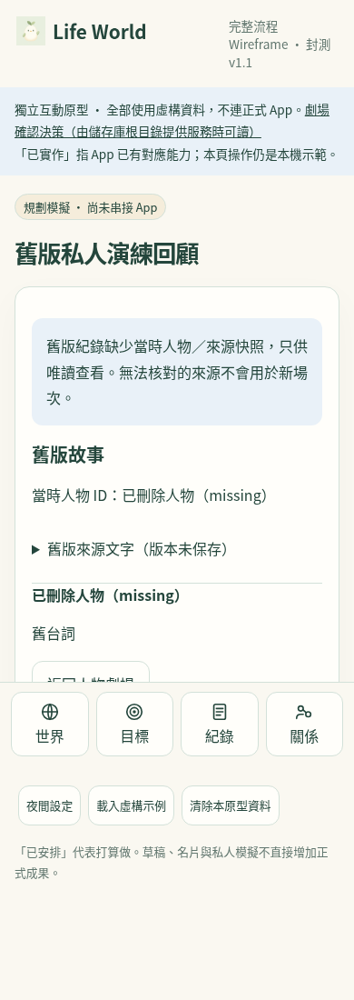

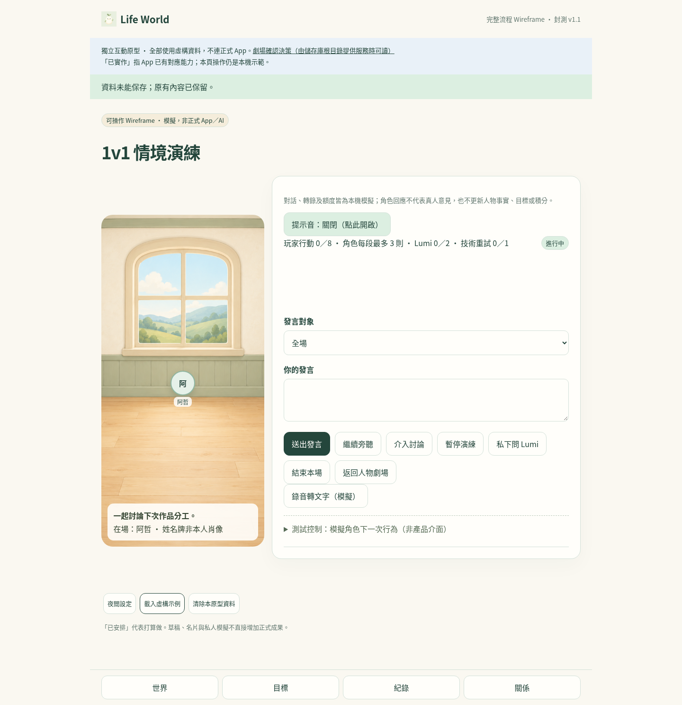

### 保存失敗與暫停

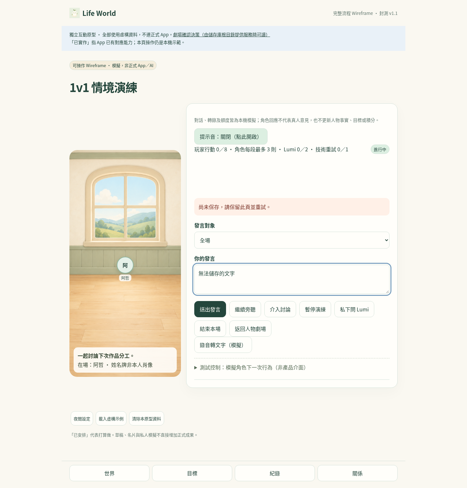

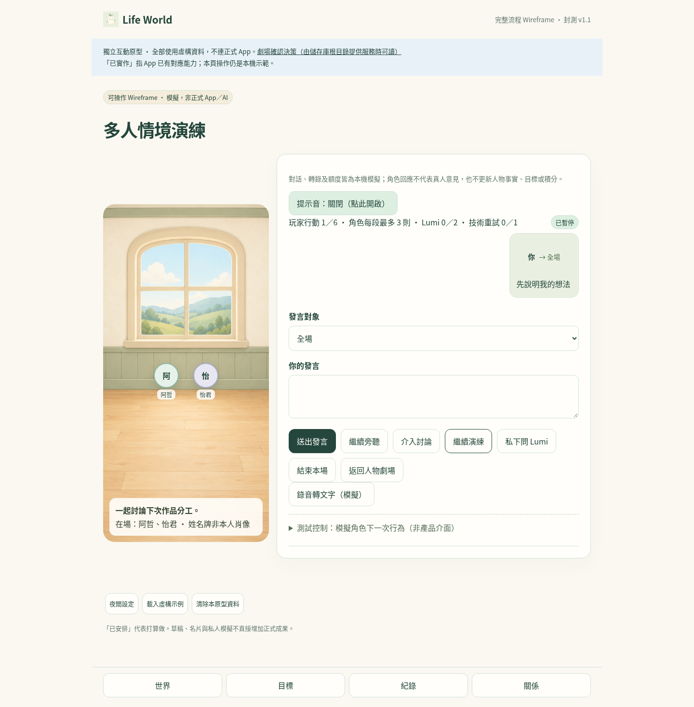

## 實際畫面

### 手機 390×844：活動場與輸入

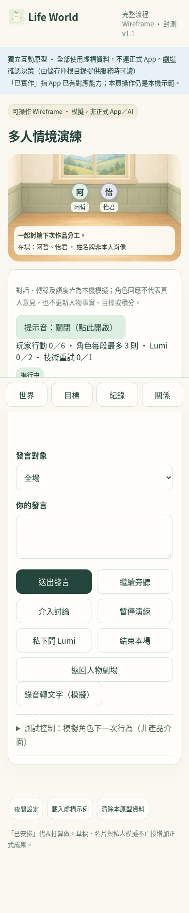

### 桌面 1440×1050：活動場與指定人物


### 歷史唯讀與目前場次隔離

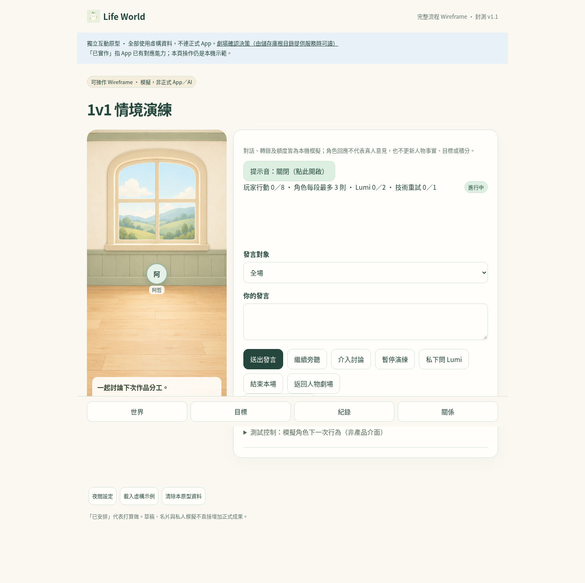

### 來源失效、技術重試與多分頁衝突

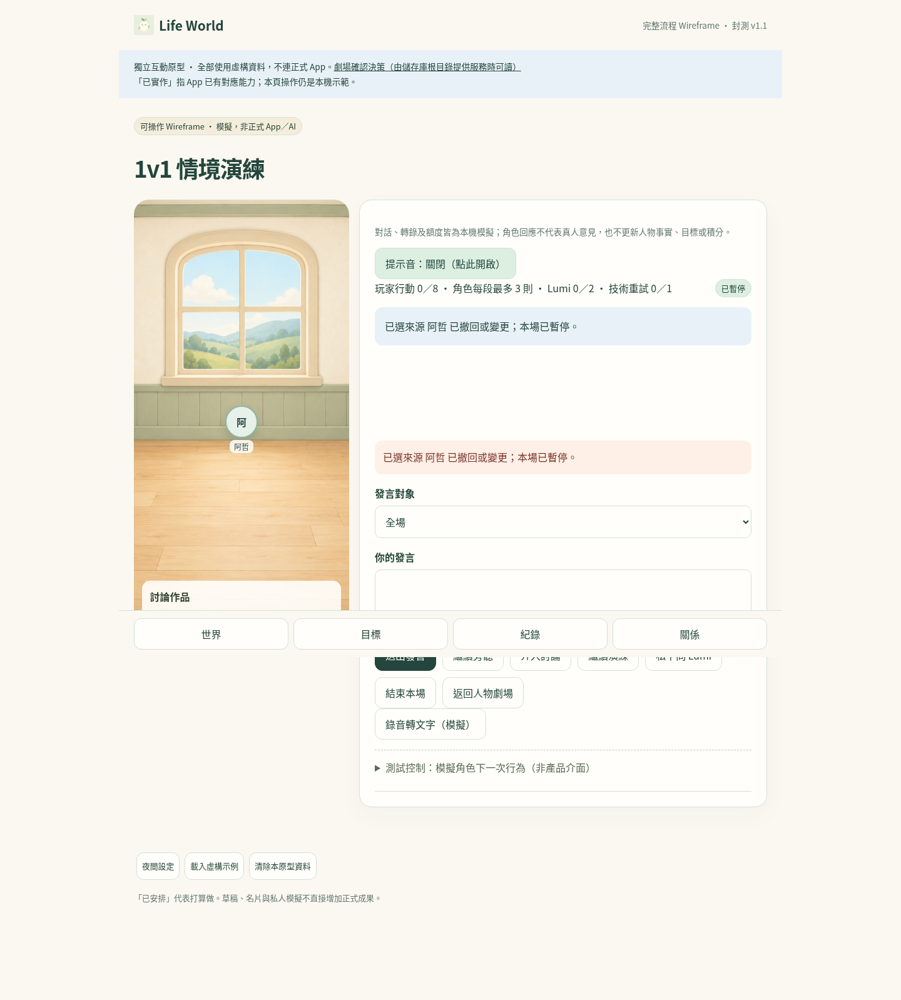

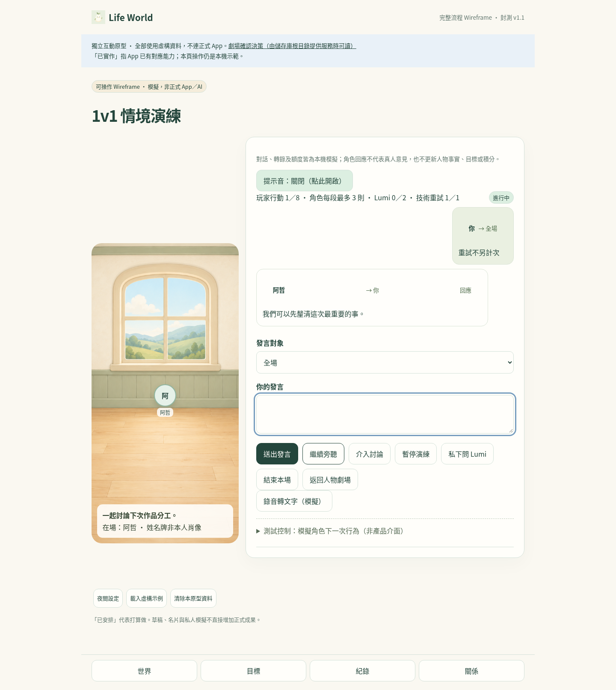

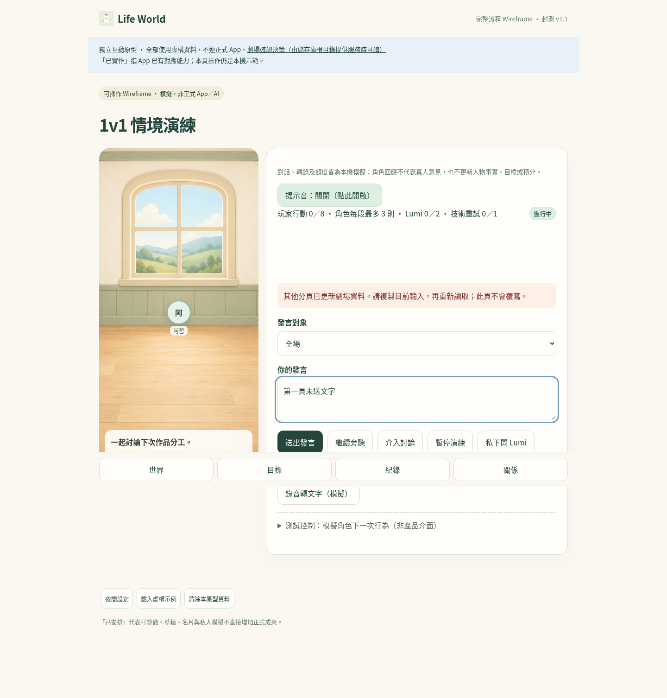

## 新增補測實際畫面

### 活動人物被刪除後暫停

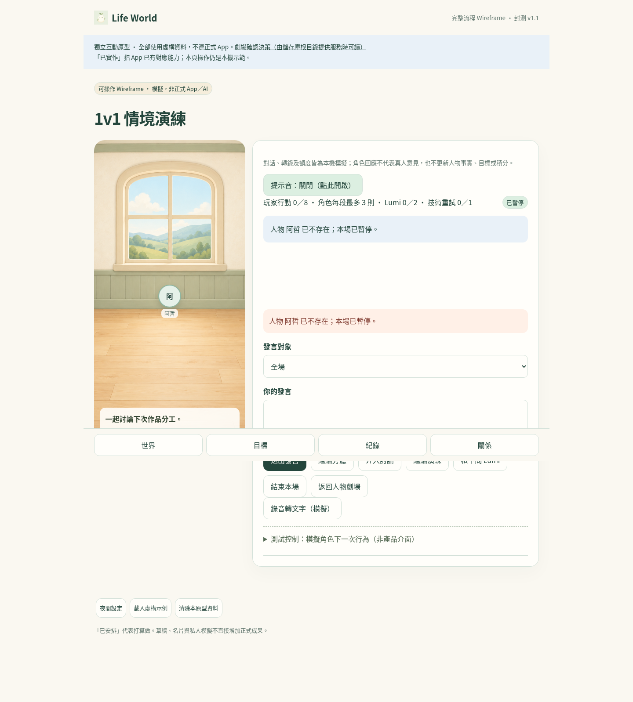

### 人物卡帶入新草稿

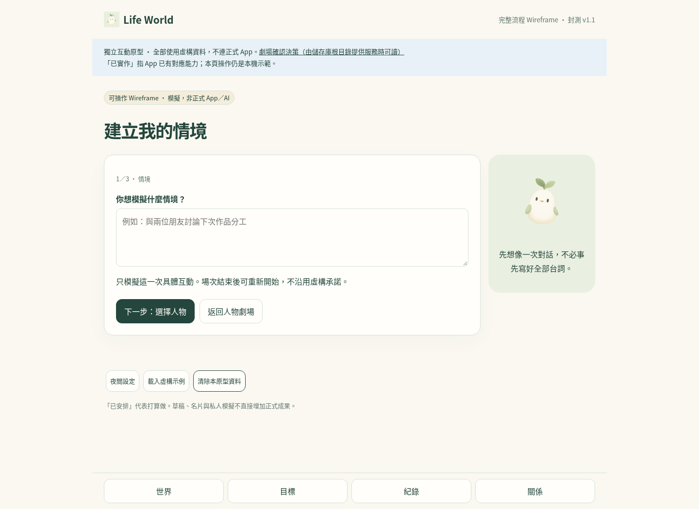

### 手機輸入焦點

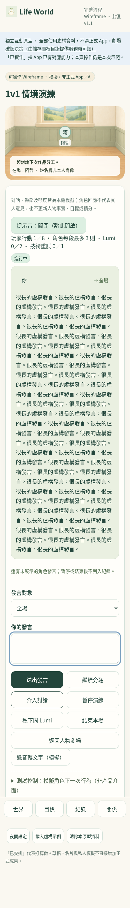

### 音效解除暫停遭拒的文字降級

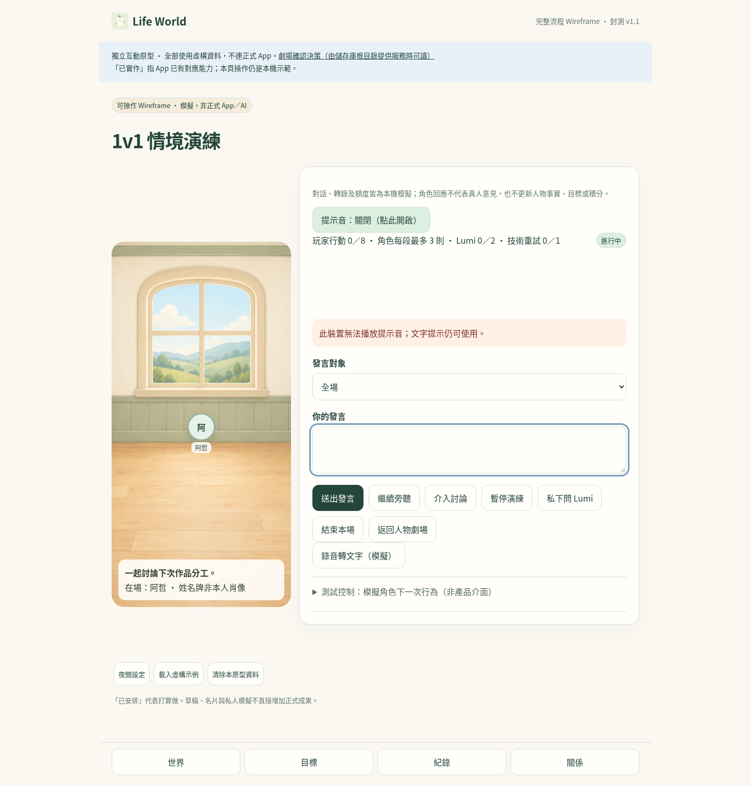

## 已知限制與回退

- 原型使用 localStorage，revision 檢查只能降低多分頁舊寫入風險，不提供伺服器交易、owner 驗權或跨裝置同步。示例／清除的日誌可在同瀏覽器重載時復原兩個 key；無法承諾 localStorage 跨分頁完整交易。
- 舊私人演練停止新建、送出及繼續，只提供唯讀回顧；舊資料沒有可信人物／來源快照，缺失 ID 以缺失標記呈現。舊操作測試已改為新版 Builder 與唯讀遷移驗收。
- 正式來源 ID／版本、撤回資料長期留存政策、真實 AI／ASR、服務費用硬限制、實機 iOS／Safari 與軟鍵盤都尚未驗證。
- 回退程式前須先保留 `lifeworld:theater-wireframe:v05` 原始值；舊版程式不理解 schemaVersion 2。不要以 `localStorage.clear()` 清除網站資料，亦不要把降版資料強制重設。
